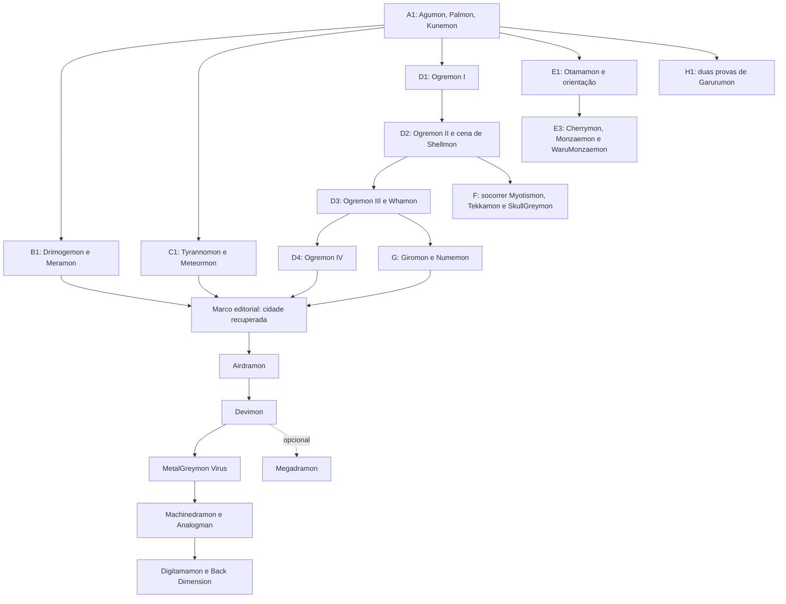

# Campanha própria — Digimon World (PlayStation)

**Decisão consolidada de decks:** consultar o [registro por confronto](2026-10-20-decks-por-confronto.md) e o [banco de receitas completas](2026-10-20-listas-competitivas-confrontos.md). Eles substituem a lista de candidatos como decisão editorial, mantendo explícitos os grupos parciais, referências históricas e bloqueios da versão fiel. Nenhuma receita foi integrada ao produto.

**Atualização de decks:** o [cruzamento competitivo de World 1–3](2026-10-20-world-decks-competitivos.md) acrescenta 24 listas completas verificadas pela API DigiLab e uma matriz por encontro. A pesquisa narrativa abaixo permanece com suas lacunas de evidência original; a presença nominal nas listas não aprova fidelidade, legalidade regional integral ou engine. As menções a ausência de listas nesta subpesquisa descrevem a etapa narrativa anterior.

Planejamento editorial e técnico em português; consulta em **20/10/2026**. Nenhuma implementação, lista de deck nova, reprodução do jogo ou validação de cartas foi realizada nesta pesquisa. Este documento aprofunda [o catálogo geral](2026-10-20-catalogo-combates-digimon.md) e segue [o plano do Story Mode](2026-10-20-universo-digimon-story-mode.md).

## 1. Decisão e abrangência real

Recomendo uma campanha independente, **Reconstruir File City**, com mapa de regiões e ramos opcionais, culminando em Analogman. A missão de recrutar moradores e salvar a ilha sustenta a campanha; o protagonista controla **um parceiro criado pelo jogador**, cuja espécie e geração variam. Agumon/Gabumon são escolhas iniciais, não uma dupla obrigatória nem justificativa para impor WarGreymon no final. [Contexto do jogo, fonte secundária](https://wikimon.net/Digimon_World).

Três alternativas foram avaliadas: somente chefes finais seria simples, mas apagaria a reconstrução; reproduzir todos os encontros selvagens e torneios elevaria volume sem acrescentar história; **selecionar eventos regionais e recrutamentos marcantes**, com desafios extras separados, preserva a identidade e permite entrega incremental. A terceira é a recomendação.

O registro abaixo contém **40 fichas de batalha**: 25 na seleção inicial de campanha e capítulos laterais, 11 desafios de recrutamento adicionais e 4 de pós-jogo. As três entradas Back Dimension são **variantes de localização do mesmo encontro recorrente**, portanto são **38 identidades de confronto** se deduplicadas por evento e composição. Não são 40 chefes inéditos nem inventário de todas as lutas possíveis do jogo. Há ainda três pautas de pesquisa fora da contagem: guardas da fortaleza, guardiões de Ice Sanctuary e torneios.

Todos os confrontos estão no estado **S: sustentado por fonte secundária; pendente de conferência no jogo original**. Não há ficha P, de verificação primária concluída. Uma fonte com tabela detalhada permite nomear os integrantes, mas não substitui essa conferência. A busca por manual oficial/scan não produziu nesta rodada um documento acessível que confirmasse os encontros; páginas de manuais de V-Pet e de next order foram descartadas por serem outras obras. Não coletamos ROM, save ou ativos do jogo.

## 2. Convenções para ler cada ficha

Em todas as linhas, **P = parceiro variável do jogador**. Toy Town é a exceção de forma obrigatória no evento: o parceiro torna-se Monzaemon. “Individual” significa um único adversário identificado pela fonte consultada, não prova de que não haja inimigos selvagens próximos. “Obrigatório local” significa que o confronto é necessário para concluir aquele evento; não significa que todo jogador precise concluir a região para chegar ao final.

As categorias editoriais são C (seleção inicial), D (desafio adicional) e PÓS (epílogo). No original, recrutamentos normalmente são opcionais individualmente, ainda que o conjunto de moradores permita progredir. Cada tabela registra o gatilho original; as condições simplificadas do produto estão na seção de grafo. A ordem apresentada é editorial e não uma ordem canônica única de exploração.

### Arco A — Primeiros moradores

| ID      | Capítulo / local   | Confronto completo identificado | Gatilho e papel no original                                    | Desfecho a apresentar         | Seleção / fonte                                                                                                                          |
| ------- | ------------------ | ------------------------------- | -------------------------------------------------------------- | ----------------------------- | ---------------------------------------------------------------------------------------------------------------------------------------- |
| DW1-001 | A1 · Native Forest | P vs. Agumon                    | Primeiro acesso à floresta; encontro inicial                   | Vitória e recrutamento        | C · [Native Forest](https://almarsguides.com/retro/walkthroughs/PS1/Games/DigimonWorld/FullPlaythrough/RecruitableDigimon/NativeForest/) |
| DW1-002 | A1 · Native Forest | P vs. Palmon                    | Insistir na conversa; recrutamento                             | Vitória e melhoria da fazenda | C · [Native Forest](https://almarsguides.com/retro/walkthroughs/PS1/Games/DigimonWorld/FullPlaythrough/RecruitableDigimon/NativeForest/) |
| DW1-003 | A1 · Kunemon's Bed | P vs. Kunemon                   | Oferecer alimento; recrutamento                                | Vitória e abertura de atalho  | C · [Native Forest](https://almarsguides.com/retro/walkthroughs/PS1/Games/DigimonWorld/FullPlaythrough/RecruitableDigimon/NativeForest/) |
| DW1-004 | A2 · File City     | P vs. Greymon                   | Conversar com Jijimon com 15+ de prosperidade; evento de arena | Vitória; Greymon abre a arena | C · [Recruitment Guide, File City](https://gamefaqs.gamespot.com/ps/913684-digimon-world/faqs/73895)                                     |

### Arco B — Calor subterrâneo

| ID      | Capítulo / local                    | Confronto completo identificado | Gatilho e papel no original                                              | Desfecho a apresentar                  | Seleção / fonte                                                                                                                        |
| ------- | ----------------------------------- | ------------------------------- | ------------------------------------------------------------------------ | -------------------------------------- | -------------------------------------------------------------------------------------------------------------------------------------- |
| DW1-005 | B1 · Drill Tunnel, área residencial | P vs. Drimogemon                | Abordar morador irritado; obrigatório local                              | Vitória libera sequência da escavação  | C · [Drill Tunnel](https://almarsguides.com/retro/walkthroughs/ps1/games/digimonworld/fullplaythrough/recruitabledigimon/drilltunnel/) |
| DW1-006 | B1 · Lava Cave                      | P vs. Meramon                   | Avançar escavação e mover rocha com parceiro Champion; obrigatório local | Vitória; calor reduzido e recrutamento | C · [Drill Tunnel](https://almarsguides.com/retro/walkthroughs/ps1/games/digimonworld/fullplaythrough/recruitabledigimon/drilltunnel/) |

O Drimogemon enfrentado no alojamento e o Drimogemon recrutado após a escavação não devem virar automaticamente uma única personagem. O recrutamento posterior acontece por conversa e espera; não há um segundo duelo inventado. O transporte de terra pode aparecer como passagem narrativa, sem minijogo obrigatório nem espera real. [Drill Tunnel](https://almarsguides.com/retro/walkthroughs/ps1/games/digimonworld/fullplaythrough/recruitabledigimon/drilltunnel/).

### Arco C — Crise na região dos dinossauros

| ID      | Capítulo / local                  | Confronto completo identificado | Gatilho e papel no original                                      | Desfecho a apresentar                                                | Seleção / fonte                                                                                                                                     |
| ------- | --------------------------------- | ------------------------------- | ---------------------------------------------------------------- | -------------------------------------------------------------------- | --------------------------------------------------------------------------------------------------------------------------------------------------- |
| DW1-007 | C1 · Ancient Dino Region          | P vs. Tyrannomon                | Acesso pela região de Centarumon; obrigatório local              | Vitória; Tyrannomon permite investigação                             | C · [Ancient Dino Region](https://almarsguides.com/retro/walkthroughs/PS1/Games/DigimonWorld/FullPlaythrough/RecruitableDigimon/AncientDinoRegion/) |
| DW1-008 | C1 · Speedy Zone, passagem oculta | P vs. Meteormon                 | Investigar o objeto após falar com Tyrannomon; obrigatório local | Vitória e esclarecimento; retornar a Tyrannomon conclui recrutamento | C · [Strategy Guide, Tyrannomon](https://gamefaqs.gamespot.com/ps/913684-digimon-world/faqs/71504)                                                  |

Meteormon não deve ser contado como morador recrutado. O nome localizado do inimigo e sua correspondência a Insekimon no catálogo TCG precisam constar no dicionário editorial, sem substituir a espécie por Gotsumon comum. Conferir apresentação do evento no jogo antes de escrever diálogos.

### Arco D — Os quatro encontros com os bandidos

| ID      | Capítulo / local                          | TODOS os adversários identificados      | Gatilho e papel no original                                 | Desfecho a apresentar                                   | Seleção / fonte                                                                                                                        |
| ------- | ----------------------------------------- | --------------------------------------- | ----------------------------------------------------------- | ------------------------------------------------------- | -------------------------------------------------------------------------------------------------------------------------------------- |
| DW1-009 | D1 · Great Canyon, estrada do elevador    | P vs. Ogremon + Agumon ×2               | Rumor dos bandidos com Yuramon; primeira emboscada          | Grupo derrotado foge                                    | C · [Great Canyon](https://almarsguides.com/retro/walkthroughs/PS1/Games/DigimonWorld/FullPlaythrough/RecruitableDigimon/GreatCanyon/) |
| DW1-010 | D2 · Ogre Fortress, sala do chefe         | P vs. Ogremon + Agumon ×2               | Seguir grupo à fortaleza; segundo encontro                  | Ogremon foge pelo elevador; ramo de Shellmon disponível | C · [Strategy Guide, Ogremon](https://gamefaqs.gamespot.com/ps/913684-digimon-world/faqs/71504)                                        |
| DW1-011 | D2 · Great Canyon, ninho                  | P vs. Birdramon                         | Subir pelo elevador; recrutamento opcional                  | Vitória; serviço de transporte na cidade                | C · [Great Canyon](https://almarsguides.com/retro/walkthroughs/PS1/Games/DigimonWorld/FullPlaythrough/RecruitableDigimon/GreatCanyon/) |
| DW1-012 | D3 · Secret Beach Cave, acesso com Whamon | P vs. Ogremon + Gabumon + WaruSeadramon | Após fortaleza, aceitar pedido de Whamon; terceiro encontro | Bandidos fogem; Whamon é libertado e pode ser recrutado | C · [Ogremon, seção World](https://digimon.fandom.com/wiki/Ogremon)                                                                    |
| DW1-013 | D4 · Drill Tunnel                         | P vs. Ogremon + Agumon ×2               | Após Secret Beach Cave; quarto encontro                     | Vitória; Ogremon finalmente aceita viver na cidade      | C · [Strategy Guide, Ogremon](https://gamefaqs.gamespot.com/ps/913684-digimon-world/faqs/71504)                                        |

**Correção das 19 entradas anteriores:** DW1-010 não é apenas “Ogremon e subordinados”; DW1-012 inclui Gabumon; DW1-013 **não é Ogremon sozinho**. A tabela de Neve identifica dois Agumon também no quarto encontro. As quatro vitórias são eventos diferentes; fugir após as três primeiras é o desfecho dos bandidos, não derrota do jogador.

WaruSeadramon é o nome apresentado pelas fontes do jogo. Não trocar por MegaSeadramon comum. A associação com o nome moderno WaruMegaSeadramon deve ser verificada na edição e no catálogo de cartas escolhido; por enquanto o campo de alias fica pendente e a produção do deck correspondente permanece bloqueada.

O Agumon da entrada da fortaleza e batalhas de guardas internas não foram somados: falta reconstruir o trajeto e separar combate forçado de encontro evitável. Não chamar toda sala com Agumon de um novo capítulo principal.

### Arco E — Névoa e brinquedos

| ID      | Capítulo / local           | Confronto completo identificado | Gatilho e papel no original                                                | Desfecho a apresentar                                                     | Seleção / fonte                                                                                                                      |
| ------- | -------------------------- | ------------------------------- | -------------------------------------------------------------------------- | ------------------------------------------------------------------------- | ------------------------------------------------------------------------------------------------------------------------------------ |
| DW1-014 | E1 · Geko Swamp            | P vs. Otamamon                  | Encontrar Otamamon no pântano; evento local                                | Gekomon conduz jogador a ShogunGekomon                                    | C · [Geko Swamp](https://almarsguides.com/retro/walkthroughs/PS1/Games/DigimonWorld/FullPlaythrough/RecruitableDigimon/GekoSwamp/)   |
| DW1-015 | E2 · Misty Trees, estátuas | P vs. Kokatorimon               | Encontrá-lo de manhã cedo; recrutamento opcional                           | Vitória; morador e estátua na cidade                                      | D · [Misty Trees](https://almarsguides.com/retro/walkthroughs/PS1/Games/DigimonWorld/FullPlaythrough/RecruitableDigimon/MistyTrees/) |
| DW1-016 | E2 · Misty Trees, penhasco | P vs. Gabumon                   | Localizar Gabumon escondido; recrutamento opcional                         | Vitória; auxilia exploração de tesouros                                   | D · [Recruitment Guide, Gabumon](https://gamefaqs.gamespot.com/ps/913684-digimon-world/faqs/73895)                                   |
| DW1-017 | E3 · Toy Mansion           | **Monzaemon vs. WaruMonzaemon** | Numemon usa traje; falar com Tinmon e atravessar mansão; obrigatório local | Recuperar engrenagem e devolvê-la a Tinmon; resolver crise dos brinquedos | C · [Toy Town](https://almarsguides.com/retro/walkthroughs/PS1/Games/DigimonWorld/FullPlaythrough/RecruitableDigimon/ToyTown/)       |

Cherrymon não é um chefe derrotado: a passagem à cidade dos brinquedos se abre por conversa. O recrutamento de Monzaemon é representado após a missão, sem afirmar que um segundo parceiro foi adicionado simultaneamente ao grupo. Para adaptação TCG, DW1-017 pede deck emprestado de Monzaemon e introdução explicando a transformação do parceiro; é uma exceção editorial explícita à seleção livre. [Toy Town](https://almarsguides.com/retro/walkthroughs/PS1/Games/DigimonWorld/FullPlaythrough/RecruitableDigimon/ToyTown/).

### Arco F — O desaparecimento na mansão

| ID      | Capítulo / local               | Confronto completo identificado | Gatilho e papel no original                                                                           | Desfecho a apresentar                                               | Seleção / fonte                                                                                                                          |
| ------- | ------------------------------ | ------------------------------- | ----------------------------------------------------------------------------------------------------- | ------------------------------------------------------------------- | ---------------------------------------------------------------------------------------------------------------------------------------- |
| DW1-018 | F1 · Secret Lab, acesso à cela | P vs. Tekkamon                  | Resgate anterior de Myotismon, notícia de Shellmon e exploração com parceiro Virus; obrigatório local | Vitória permite avançar                                             | C · [Strategy Guide, SkullGreymon](https://gamefaqs.gamespot.com/ps/913684-digimon-world/faqs/71504)                                     |
| DW1-019 | F1 · Secret Lab, sala final    | P vs. SkullGreymon              | Após DW1-018 e localizar Myotismon; obrigatório local                                                 | Vitória e resgate; SkullGreymon torna-se disponível na cidade/arena | C · [Overdell e mansão](https://almarsguides.com/retro/walkthroughs/PS1/Games/DigimonWorld/FullPlaythrough/RecruitableDigimon/Overdell/) |

Myotismon é **resgatado**, não chefe deste arco. Devimon aparece e libera a progressão por cena/conversa; a redação “attack” de um guia não basta para criar uma batalha jogável contra ele na mansão. O duelo definido contra Devimon é o de Mount Infinity. Os três Darkrizamon da rota alternativa do laboratório não integram DW1-018: são outro encontro cuja obrigatoriedade e composição precisam de conferência em save. [Descrição do resgate](https://almarsguides.com/retro/walkthroughs/PS1/Games/DigimonWorld/FullPlaythrough/RecruitableDigimon/Overdell/).

### Arco G — Poluição e memória da ilha

| ID      | Capítulo / local             | Confronto completo identificado | Gatilho e papel no original                                                 | Desfecho a apresentar                                  | Seleção / fonte                                                                                                                                           |
| ------- | ---------------------------- | ------------------------------- | --------------------------------------------------------------------------- | ------------------------------------------------------ | --------------------------------------------------------------------------------------------------------------------------------------------------------- |
| DW1-020 | G1 · Factorial Town, fábrica | P vs. Giromon                   | Via Whamon; investigar esgoto, Andromon e troca de turno; obrigatório local | Vitória encerra surto; Andromon pode resolver poluição | C · [Factorial Town](https://almarsguides.com/retro/walkthroughs/PS1/Games/DigimonWorld/FullPlaythrough/RecruitableDigimon/FactorialTown/)                |
| DW1-021 | G2 · Factorial Town, esgoto  | P vs. Numemon                   | Resolver Giromon e retomar conversa; recrutamento local                     | Vitória e recrutamento de Numemon                      | C · [Factorial Town, seção Numemon](https://almarsguides.com/retro/walkthroughs/PS1/Games/DigimonWorld/FullPlaythrough/RecruitableDigimon/FactorialTown/) |

Andromon não é inimigo derrotado. Sua cooperação e a recuperação de registros fornecem a resolução narrativa, depois da vitória sobre Giromon. A referência a informações históricas deve passar por tradução comparada, sem reproduzir textos do jogo a partir de memória. [Contexto narrativo](https://wikimon.net/Digimon_World).

### Arco H — A prova de confiança e a ascensão

| ID      | Capítulo / local                | Confronto completo identificado  | Gatilho e papel no original                                        | Desfecho a apresentar                                        | Seleção / fonte                                                                                                                                |
| ------- | ------------------------------- | -------------------------------- | ------------------------------------------------------------------ | ------------------------------------------------------------ | ---------------------------------------------------------------------------------------------------------------------------------------------- |
| DW1-022 | H1 · Freezeland                 | P vs. Garurumon, primeira luta   | Abordar Garurumon; recrutamento opcional                           | Vitória; convite à revanche                                  | C · [Freezeland, Garurumon](https://almarsguides.com/retro/walkthroughs/PS1/Games/DigimonWorld/FullPlaythrough/RecruitableDigimon/Freezeland/) |
| DW1-023 | H1 · Freezeland                 | P vs. Garurumon, revanche        | Retornar no encontro combinado; sem itens ou comandos no original  | Vitória no teste de confiança; recrutamento                  | C · [Freezeland, Garurumon](https://almarsguides.com/retro/walkthroughs/PS1/Games/DigimonWorld/FullPlaythrough/RecruitableDigimon/Freezeland/) |
| DW1-024 | H2 · File City                  | P vs. Airdramon                  | Jijimon anuncia abertura de Mount Infinity com 50+ de prosperidade | Vitória; caminho final disponível                            | C · [Mount Infinity](https://almarsguides.com/retro/walkthroughs/PS1/Games/DigimonWorld/FullPlaythrough/RecruitableDigimon/MountInfinity/)     |
| DW1-025 | H3 · Mount Infinity             | P vs. Devimon                    | Guardião do caminho; obrigatório para subir                        | Vitória e recrutamento                                       | C · [Mount Infinity](https://almarsguides.com/retro/walkthroughs/PS1/Games/DigimonWorld/FullPlaythrough/RecruitableDigimon/MountInfinity/)     |
| DW1-026 | H3 · Mount Infinity, tesouros   | P vs. Megadramon                 | Desvio opcional                                                    | Vitória e recrutamento                                       | D · [Mount Infinity](https://almarsguides.com/retro/walkthroughs/PS1/Games/DigimonWorld/FullPlaythrough/RecruitableDigimon/MountInfinity/)     |
| DW1-027 | H3 · Mount Infinity             | P vs. MetalGreymon **Virus**     | Guardião do caminho; obrigatório para subir                        | Vitória; acesso ao confronto final                           | C · [Mount Infinity](https://almarsguides.com/retro/walkthroughs/PS1/Games/DigimonWorld/FullPlaythrough/RecruitableDigimon/MountInfinity/)     |
| DW1-028 | H4 · Mount Infinity, sala final | P vs. Machinedramon de Analogman | Chegar ao antagonista; final principal                             | Vitória, fracasso do plano de Analogman e retorno do jogador | C · [História do jogo](https://wikimon.net/Digimon_World)                                                                                      |

As partidas DW1-022 e DW1-023 não devem ser fundidas: a revanche tem regra própria. Reproduzir “sem comandos” literalmente exigiria jogo automatizado e seria uma experiência diferente. Recomenda-se duelo TCG normal com desafio opcional “sem cartas Option”, identificado como adaptação e sujeito a teste de equilíbrio; **não** dizer que o TCG recria a regra original exatamente. Não bloquear quem usa tecnologias assistivas com uma prova de velocidade ou interface sem controle.

### Arco I — Desafios de moradores, fora da conquista principal

| ID      | Capítulo / local            | Confronto completo identificado | Gatilho e papel no original                | Desfecho a apresentar          | Seleção / fonte                                                                                                                              |
| ------- | --------------------------- | ------------------------------- | ------------------------------------------ | ------------------------------ | -------------------------------------------------------------------------------------------------------------------------------------------- |
| DW1-029 | I1 · Gear Savanna           | P vs. Patamon, luta 1           | Desafio inicial; recrutamento              | Vitória; Patamon insiste       | D · [Gear Savanna](https://almarsguides.com/retro/walkthroughs/PS1/Games/DigimonWorld/FullPlaythrough/RecruitableDigimon/GearSavanna/)       |
| DW1-030 | I1 · Gear Savanna           | P vs. Patamon, luta 2           | Após DW1-029, em sequência                 | Segunda vitória; novo desafio  | D · [Gear Savanna](https://almarsguides.com/retro/walkthroughs/PS1/Games/DigimonWorld/FullPlaythrough/RecruitableDigimon/GearSavanna/)       |
| DW1-031 | I1 · Gear Savanna           | P vs. Patamon, luta 3           | Após DW1-030, em sequência                 | Terceira vitória; recrutamento | D · [Gear Savanna](https://almarsguides.com/retro/walkthroughs/PS1/Games/DigimonWorld/FullPlaythrough/RecruitableDigimon/GearSavanna/)       |
| DW1-032 | I2 · Tropical Jungle, praia | P vs. Piximon                   | Aparição rara; recrutamento opcional       | Vitória e recrutamento         | D · [Tropical Jungle](https://almarsguides.com/retro/walkthroughs/PS1/Games/DigimonWorld/FullPlaythrough/RecruitableDigimon/TropicalJungle/) |
| DW1-033 | I2 · Mount Panorama Plains  | P vs. Mamemon                   | Aparição rara após acesso regional         | Vitória e recrutamento         | D · [Mount Panorama](https://almarsguides.com/retro/walkthroughs/PS1/Games/DigimonWorld/FullPlaythrough/RecruitableDigimon/MountPanorama/)   |
| DW1-034 | I2 · Factorial Town         | P vs. MetalMamemon              | Aparição rara em área externa              | Vitória e recrutamento         | D · [Factorial Town](https://almarsguides.com/retro/walkthroughs/PS1/Games/DigimonWorld/FullPlaythrough/RecruitableDigimon/FactorialTown/)   |
| DW1-035 | I3 · Native Forest, árvore  | P vs. Etemon                    | 50+ de prosperidade; emboscada             | Vitória e recrutamento         | D · [Native Forest](https://almarsguides.com/retro/walkthroughs/PS1/Games/DigimonWorld/FullPlaythrough/RecruitableDigimon/NativeForest/)     |
| DW1-036 | I3 · Digimon Bridge         | P vs. Ninjamon                  | Loja secreta disponível; aparição na ponte | Vitória e recrutamento         | D · [Native Forest](https://almarsguides.com/retro/walkthroughs/PS1/Games/DigimonWorld/FullPlaythrough/RecruitableDigimon/NativeForest/)     |

Patamon tem três confrontos listados separadamente porque o usuário pediu cada combate. Editorialmente, eles podem compor um desafio de três etapas, sem três recompensas repetíveis. Não é necessário impor três partidas TCG completas iguais: após revisão do original, uma partida com fases pode condensá-las, desde que a ficha declare o agrupamento e preserve o evento na apresentação.

### Arco J — Epílogo e Back Dimension

| ID      | Capítulo / local                                    | Confronto completo identificado             | Gatilho e papel no original                            | Desfecho a apresentar                | Seleção / fonte                                                                                                                                           |
| ------- | --------------------------------------------------- | ------------------------------------------- | ------------------------------------------------------ | ------------------------------------ | --------------------------------------------------------------------------------------------------------------------------------------------------------- |
| DW1-037 | J1 · Mount Infinity, sala final                     | P vs. Digitamamon                           | Concluir jogo, salvar, recarregar e retornar; pós-jogo | Vitória e recrutamento               | PÓS · [Mount Infinity, Digitamamon](https://almarsguides.com/retro/walkthroughs/PS1/Games/DigimonWorld/FullPlaythrough/RecruitableDigimon/MountInfinity/) |
| DW1-038 | J2 · Back Dimension, acesso por Ice Sanctuary       | P vs. Machinedramon, manifestação posterior | Distorção após final; variante de localização          | Vitória desfaz transformação forçada | PÓS · [Back Dimension](https://wikimon.net/Back_Dimension)                                                                                                |
| DW1-039 | J2 · Back Dimension, acesso por Grey Lord's Mansion | P vs. Machinedramon, manifestação posterior | Mesmo evento recorrente; outro acesso                  | Vitória desfaz transformação forçada | PÓS · [Back Dimension](https://wikimon.net/Back_Dimension)                                                                                                |
| DW1-040 | J2 · Back Dimension, acesso por Ogre Fortress       | P vs. Machinedramon, manifestação posterior | Mesmo evento recorrente; outro acesso                  | Vitória desfaz transformação forçada | PÓS · [Back Dimension](https://wikimon.net/Back_Dimension)                                                                                                |

Uma distorção ocupa uma das três regiões por vez; não são três chefes simultâneos nem um novo vilão por região. A fonte relaciona Muchomon, Soulmon e SnowAgumon à forma restaurada, mas a **associação exata entre criatura e acesso não foi confirmada**, logo os IDs não fixam essa relação. O elenco selvagem inclui BlueMeramon, IceDevimon, Piddomon, Tankmon e Tekkamon, sem evidência de que todos formem uma equipe única de chefe. [Back Dimension](https://wikimon.net/Back_Dimension).

Para o produto, um nó de epílogo com três cenários visuais alternativos evita repetir o chefe como conteúdo inédito. A conquista de purificação considera o evento uma vez; variantes podem render selos de exploração, sem moeda adicional. Reaparecimento, duração, calendário e associação de forma restaurada precisam de teste no original. Não importar cronômetros incertos de fóruns como regra canônica.

## 3. Auditoria de contagens e correspondência com o catálogo anterior

Há dez arcos editoriais (A–J), não dez arcos oficialmente nomeados. A seleção C contém **25 fichas**, D contém **11** e PÓS contém **4**. A contagem total é 40, com três variantes do mesmo evento de Back Dimension explicitadas separadamente.

As 19 fichas anteriores têm correspondência um a um: W101→001, W102→002, W103→003, W104→004, W105→006, W106→009, W107→010, W108→012, W109→013, W110→020, W111→017, W112→018, W113→019, W114→024, W115→025, W116→026, W117→027, JO01→028, W118→037. Não criar duplicatas persistidas ao integrar; esses nomes novos são IDs editoriais propostos, ainda não contratos públicos.

Os acréscimos são 21 fichas, incluindo três variantes Back Dimension. As composições de Ogremon foram detalhadas, sem inflar o número de lutas por contar cada integrante como um duelo separado.

## 4. O que não vira batalha fictícia

| Evento ou morador                      | Tratamento editorial                                                        | Evidência / limite                                                                                                                                                                                                                                               |
| -------------------------------------- | --------------------------------------------------------------------------- | ---------------------------------------------------------------------------------------------------------------------------------------------------------------------------------------------------------------------------------------------------------------- |
| Coelamon e Seadramon                   | Travessia e pesca aparecem na narrativa; nenhum “P vs. Seadramon” inventado | [Native Forest](https://almarsguides.com/retro/walkthroughs/PS1/Games/DigimonWorld/FullPlaythrough/RecruitableDigimon/NativeForest/)                                                                                                                             |
| Betamon, Vegiemon, Centarumon          | Conversa, item e travessia do labirinto, respectivamente                    | [Tropical Jungle](https://almarsguides.com/retro/walkthroughs/PS1/Games/DigimonWorld/FullPlaythrough/RecruitableDigimon/TropicalJungle/)                                                                                                                         |
| Unimon e Vademon                       | Cura e investigação; nenhum duelo de recrutamento atribuído                 | [Mount Panorama](https://almarsguides.com/retro/walkthroughs/PS1/Games/DigimonWorld/FullPlaythrough/RecruitableDigimon/MountPanorama/)                                                                                                                           |
| Elecmon, Biyomon e Leomon              | Choques na conversa, perseguição e tabuleta; não são três chefes            | [Gear Savanna](https://almarsguides.com/retro/walkthroughs/PS1/Games/DigimonWorld/FullPlaythrough/RecruitableDigimon/GearSavanna/)                                                                                                                               |
| Monochromon e Shellmon                 | Loja e resgate ambiental                                                    | [Great Canyon](https://almarsguides.com/retro/walkthroughs/PS1/Games/DigimonWorld/FullPlaythrough/RecruitableDigimon/GreatCanyon/)                                                                                                                               |
| Penguinmon, Mojyamon e Frigimon        | Curling, trocas e salvamento                                                | [Freezeland](https://almarsguides.com/retro/walkthroughs/PS1/Games/DigimonWorld/FullPlaythrough/RecruitableDigimon/Freezeland/)                                                                                                                                  |
| Cherrymon e ShogunGekomon              | Orientação e abertura de caminho                                            | [Misty Trees](https://almarsguides.com/retro/walkthroughs/PS1/Games/DigimonWorld/FullPlaythrough/RecruitableDigimon/MistyTrees/), [Geko Swamp](https://almarsguides.com/retro/walkthroughs/PS1/Games/DigimonWorld/FullPlaythrough/RecruitableDigimon/GekoSwamp/) |
| Kabuterimon e Kuwagamon de Beetle Land | Conversas de recrutamento, não derrotas obrigatórias                        | [Beetle Land](https://almarsguides.com/retro/walkthroughs/PS1/Games/DigimonWorld/FullPlaythrough/RecruitableDigimon/BeetleLand/)                                                                                                                                 |
| Nanimon                                | Rota de visitas após eventos                                                | [Nanimon Recruitment](https://almarsguides.com/retro/walkthroughs/PS1/Games/DigimonWorld/Misc/NanimonRecruitment/)                                                                                                                                               |

Ice Sanctuary exige parceiro Vaccine no original, mas **Angemon não é chefe derrotado**. Falta comprovar os guardiões e encontros forçados até a luz; por isso não entra um “P vs. Angemon” ou uma equipe de gelo presumida. A descrição de percurso disponível não identifica todos os integrantes. [Recruitment Guide, Angemon](https://gamefaqs.gamespot.com/ps/913684-digimon-world/faqs/73895).

Torneios da arena de Greymon e de Beetle Land são um módulo opcional futuro. Participantes variáveis e condições de inscrição não constituem uma lista canônica fixa de duelos. Primeiro levantar nome/categoria de cada torneio, elegibilidade, sorteio, adversários possíveis, número de rodadas, prêmio e medalhas; depois decidir quais representam eventos importantes. Nenhum campeonato foi contado como batalha pesquisada nesta versão.

## 5. Grafo proposto e objetivos de campanha

O modelo original usa prosperidade e condições locais; nossa adaptação usa condições explícitas e verificáveis. Não exigir 50 partidas para imitar 50 de prosperidade: um recrutamento pode valer mais de um ponto e muitos não têm luta. Um recurso visual “cidade reconstruída” pode refletir capítulos concluídos, sem fingir reproduzir a economia exata do PS1.

Condições propostas: concluir A1 libera os ramos; concluir B1, C1, D4 e G2 libera o marco central. F, E3 e H1 são capítulos laterais completos com conquista própria; I contém desafios. A arena de Greymon abre ao concluir A1 e B1, uma simplificação explicitamente editorial do marco original de prosperidade. O ramo de transporte de Birdramon não bloqueia o resgate de Whamon; no grafo ele é uma derivação opcional de D2. Essa decisão evita forçar todas as atividades para terminar a história.

F exige também a passagem narrativa em que o jogador alimenta Myotismon e a notícia do desaparecimento; E3 exige conversa com Cherrymon e transformação Numemon→Monzaemon. Esses são nós narrativos, não vitórias gratuitas registradas como partidas. Se o produto não oferecer decisões narrativas ainda, a introdução do capítulo contém essas passagens e seu aceite registra apenas visualização, sem recompensa de combate.

## 6. Tradução para TCG, listas e compatibilidade

Cada ficha pede uma definição de cenário com oponente, deck do jogador, família de comportamento do bot, revisões e objetivo. O combate padrão é vencer legalmente uma partida TCG. A vitória pode causar fuga, recrutamento ou libertação; não usar animação de morte por padrão. Os adversários aliados no original ocupam um **único deck representativo ou fases**, não três assentos simultâneos presumidos.

| Grupo de fichas                         | Requisito de deck e objetivo proposto                                                                           | Pendência antes de publicar                                                                           |
| --------------------------------------- | --------------------------------------------------------------------------------------------------------------- | ----------------------------------------------------------------------------------------------------- |
| Todas com P variável                    | Seleção de empréstimo por linhagem ou deck próprio elegível; biografia informa que não é parceiro canônico fixo | Curadoria e balanceamento de opções equivalentes                                                      |
| 001–008, 011, 014–016, 020–025, 029–036 | Deck inimigo contendo a espécie identificada; vencer leva ao resultado local da ficha                           | Encontrar lista competitiva concreta no DigiLab ou assumir explicitamente construção temática         |
| 009, 010, 013                           | Ogremon com presença dos dois Agumon no briefing e na composição/adaptação                                      | Verificar se lista TCG legal comporta identidades sem deformação; não inventar cartas/quantidades     |
| 012                                     | Ogremon, Gabumon e WaruSeadramon; vitória resgata Whamon                                                        | Resolver alias e suporte; representação narrativa dos integrantes que não couberem deve ser declarada |
| 017                                     | Empréstimo Monzaemon vs. WaruMonzaemon; recuperar engrenagem após vitória                                       | Linha temática ou competitiva verificável; engine e curva iniciante                                   |
| 018–019                                 | Tekkamon e SkullGreymon como confrontos distintos; Myotismon na história                                        | Comprovar presença das espécies e engine, sem converter Myotismon em inimigo                          |
| 026–028                                 | Megadramon opcional, MetalGreymon Virus e Machinedramon; decks separados por ficha                              | Diferenciar espécie central de linha atual que só a usa como material                                 |
| 037–040                                 | Digitamamon e Machinedramon de epílogo; desafio aumentado do bot                                                | Não copiar dificuldade/atributos numéricos do RPG para o TCG                                          |

**Zero novas listas completas aprovadas nesta pesquisa.** O plano geral já preserva evidência de DigiLab; isso não prova que Ogremon, Tekkamon, Meteormon ou os demais tenham deck competitivo recente. Para cada empréstimo futuro, capturar URL e ID da lista da API, data do evento e da consulta, região/formato/banlist, resultado, 50 cartas principais e ovos conforme regra, normalização e revisão imutável. Lista temática deve aparecer como **adaptação temática**, não “meta”.

Se não houver lista competitiva com a espécie como núcleo: usar lista histórica compatível e identificada, ou deck temático curado e testado, ou adiar a ficha. Se não houver carta da espécie ou efeito necessário no engine: ficha narrativa bloqueada para jogo, com motivo e tarefa de suporte; não substituir silenciosamente por espécie diferente nem afirmar implementação completa só pela existência do módulo. Cada fallback aparece antes de iniciar a batalha.

Não transformar técnicas do RPG, fome, ciclo de vida, doença ou ausência de comandos em novas regras de engine nesta entrega. Uma fase com tabuleiro predefinido só entra após revisão do cenário e confirmação de compatibilidade de replay. Preferir partidas completas para manter as listas emprestadas reconhecíveis.

## 7. Progressão, conquistas e biblioteca visual

Proposta de conquistas: uma conclusão por batalha/chave de compatibilidade e conjunto elegível; revisão de deck ou conteúdo fica na evidência e não concede a mesma recompensa novamente; selos para B1, C1, D4, F1, G2, E3 e H1; “Salvador de File Island” para DW1-028; “Além do final” para DW1-037 e uma conclusão deduplicada de Back Dimension; “Desafiante dos moradores” para o conjunto D. “Todos os moradores” fica indisponível enquanto recrutamentos não combatentes e inventário completo não forem modelados. Essa distinção evita atribuir 100% do RPG à seleção editorial.

Replays e derrotas não desbloqueiam vitória. Não há derrota canônica obrigatória entre as 40 fichas propostas; as fugas dos bandidos são vitórias do jogador. Replay, troca de empréstimo e variação de acesso de Back Dimension não repetem prêmio. O servidor resolve pré-requisitos, resultado, idempotência e concessão; a UI não envia “concluído”. Aplicam-se o merge de progresso guest/conta, regras de repetição, revisões imutáveis e testes do [plano geral](2026-10-20-universo-digimon-story-mode.md).

Visual: capa da obra, mapa estilizado de File Island com regiões desbloqueadas, capa de arco, trilha de capítulos, detalhe do confronto com todos os integrantes e status editorial, seleção de empréstimo, resultado com recrutamento/fuga e mural de moradores. Mostre os dois Agumon como quantidade no briefing de Ogremon; a tela não deve sugerir dois decks humanos. Garurumon exibe “primeiro desafio” e “revanche” claramente.

Fontes visuais do PS1 servem para pesquisa; não são automaticamente licenciadas para redistribuição. Registrar titular, origem, licença/autorização e atribuição por ativo. Capturas e mockups, se produzidos depois, ficam em `.local/` ignorado. Enquanto direitos não estiverem resolvidos, usar cartões tipográficos, silhuetas/arte original permitida e padrões abstratos por bioma, sem copiar screenshots ou capas de guias. Imagens de cartas seguem a política já adotada no produto, a ser revisada para este uso.

Em telas pequenas, mapa tem alternativa em lista e capítulos não dependem de hover; cada região possui nome textual. Ordem de foco acompanha desbloqueios; cartões bloqueados explicam requisito. Cor e miniatura não são o único identificador de espécie ou conclusão. Imagens decorativas têm texto alternativo vazio; montagens com participantes precisam de identificação textual equivalente. Respeitar redução de movimento e contraste nos temas claro/escuro.

## 8. Integração futura e sequência executável

Reutilizar os cenários, empréstimos e fluxo Liberator descritos no plano geral. O contrato atual [StoryBattle](../../packages/shared/src/story/StoryBattle.ts) oferece um `prerequisiteId` e campos de personagem/oponente; ele não modela este grafo com múltiplos requisitos, ramos e identidade deduplicada. A extensão deve ser compartilhada pelas três campanhas World, mantendo IDs existentes e conclusão antiga. Não codificar este mapa como exceções de UI em nomes traduzidos.

| Ordem | Entrega futura                                              | Dependência e aceite                                                                                                 |
| ----- | ----------------------------------------------------------- | -------------------------------------------------------------------------------------------------------------------- |
| 1     | Conferência primária das 40 fichas e três pautas adicionais | Registro de edição, local/save, sequência/minutagem, integrantes e desfecho; nenhuma alegação S vira P sem evidência |
| 2     | Dicionário de espécies e tabela de aliases                  | WaruSeadramon/WaruMegaSeadramon, Meteormon/Insekimon e MetalGreymon Virus resolvidos; oposição e aliados separados   |
| 3     | Curadoria de decks e auditoria do engine                    | Proveniência completa por lista, legalidade datada, cartas registradas e testes de comportamento; bloqueios visíveis |
| 4     | Esquema comum de campanhas, capítulos e requisitos          | IDs estáveis, requisito AND/OR, variantes de cenário e regras de conclusão; migrações planejadas no desenho comum    |
| 5     | Fatia inicial: A1 + B1                                      | Cinco confrontos, introdução, empréstimo, vitória e selo; derrota/replay/guest não duplicam prêmio                   |
| 6     | Arcos D e G                                                 | Quatro Ogremon com composições corretas, Birdramon opcional, Whamon narrativo e dois confrontos Factorial            |
| 7     | C e ascensão H2–H4                                          | Marco central, Megadramon opcional e final; concluir história sem forçar ramos laterais                              |
| 8     | F, E3 e H1                                                  | Resgate de Myotismon, Monzaemon obrigatório na adaptação e revanche de Garurumon; conquistas específicas             |
| 9     | Desafios D e epílogo                                        | Nove desafios fora do núcleo mais duas fichas Misty; Back Dimension deduplicado e sem farming                        |
| 10    | Revisão editorial, acessibilidade e lançamento futuro       | Direitos por ativo, teste narrow/wide, teclado, reader, tema claro/escuro; aprovação de conteúdo antes de publicar   |

Estimativa de pesquisa/curadoria restante: 3–6 dias para revisão primária, aliases e catalogação das pautas adicionais, condicionados a acesso legal ao jogo/gravações verificáveis; decks e engine exigem estimativa após auditoria por carta. A integração de produto depende do trabalho compartilhado entre campanhas e deve ser estimada no plano técnico comum, sem multiplicar artificialmente a mesma migração por três. Não incluir aquisição de imagens/licenças como prazo garantido.

Testes futuros de aceite: ID anterior resolve para a mesma conclusão; D2 exige D1, D3 exige D2, D4 exige D3; G depende de Whamon; final não exige Megadramon; F e E3 mantêm condições narrativas; três Patamon não geram recompensa repetível; duas vitórias Garurumon são distintas; variantes Back Dimension não triplicam prêmio; derrota, desconexão e replay não concluem; evento duplicado de resultado concede uma vez; conta/guest preserva união válida; revisão de deck não destrava capítulo de outra revisão; nenhum empréstimo usa carta inexistente ou efeito apenas simulado na UI.

## 9. Fontes, região e lacunas abertas

As referências por ficha foram consultadas em 20/10/2026. São guias comunitários e wikis, **evidência secundária**, mesmo quando descrevem números extraídos do jogo. Principais versões documentadas: [HeroesAndCons, v1.10, atualização 13/10/2016](https://gamefaqs.gamespot.com/ps/913684-digimon-world/faqs/73895); [Neve, página marcada atualização 31/07/2024, com histórico interno até 2015](https://gamefaqs.gamespot.com/ps/913684-digimon-world/faqs/71504); páginas regionais Almar sem data editorial explícita. A data de consulta não é data do evento original nem de publicação.

Premissa editorial: nomes em inglês da edição PlayStation ocidental, com campos para equivalentes japoneses e PT-BR de apresentação. Não unir a campanha com World 2/3 nem com next order; distribuições japonesas, versões de demonstração e port PC não criam automaticamente capítulos novos. Diferenças de edição serão atributos de proveniência do evento e não campanhas duplicadas sem conteúdo distinto comprovado.

Há relatos de bloqueio no Agumon da entrada de Ogre Fortress em PAL espanhol/francês; isso deve gerar nota de edição e nunca um requisito de reproduzir bug no Story Mode. A cobertura jornalística também apresenta afirmações amplas sobre impossibilidade de terminar que não foram reproduzidas aqui: **não as adotamos como conclusão sobre todas as edições PAL ou sobre o final principal**. [Meristation, 24/09/2025](https://as.com/meristation/noticias/el-bug-de-agumon-en-digimon-world-de-playstation-que-desespero-a-toda-una-generacion-n/).

Pendências concretas antes de considerar a pesquisa encerrada:

1. Conferir cada confronto no jogo original, com edição e referência de cena; hoje todas as 40 fichas continuam S.
2. Revisar os guardas de Ogre Fortress e rotas do laboratório para não omitir combates forçados relevantes nem promover encontros selvagens a chefes.
3. Reconstruir Ice Sanctuary: composição de cada grupo inevitável, objetivo da luz e retorno de Angemon; nenhum grupo presumido entrou na contagem.
4. Inventariar torneios da arena e de Beetle Land por categoria e adversários possíveis; decidir seleção com base narrativa, sem forçar todas as rodadas.
5. Validar horários/requisitos divergentes: Garurumon, Ninjamon, notícia da mansão e eventos de Back Dimension. O produto não dependerá de horário real.
6. Resolver aliases e imagem de WaruSeadramon; conferir associação das formas restauradas às variantes Back Dimension.
7. Validar textos do final e epílogo diretamente: referências secundárias não são roteiro aprovado para reprodução.
8. Auditar listas concretas DigiLab, formato, região, banlist e suporte do engine para cada família; nenhuma lista competitiva foi inventada para preencher lacunas.

Esta entrega é documento de planejamento. Não altera progresso, contratos, conteúdo Liberator, migrações, assets públicos, engine ou cartas. Verificações globais serão feitas na consolidação pelo agente coordenador.
