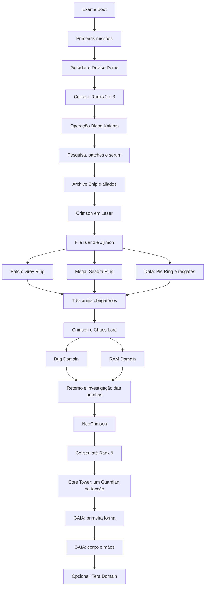

# Digimon World 2: campanha própria — pesquisa editorial e plano de adaptação

**Decisão consolidada de decks:** consultar o [registro por confronto](2026-10-20-decks-por-confronto.md) e o [banco de receitas completas](2026-10-20-listas-competitivas-confrontos.md). Eles substituem a lista de candidatos como decisão editorial, mantendo explícitos os grupos parciais, referências históricas e bloqueios da versão fiel. Nenhuma receita foi integrada ao produto.

**Atualização de decks:** o [cruzamento competitivo de World 1–3](2026-10-20-world-decks-competitivos.md) acrescenta 24 listas completas verificadas pela API DigiLab e uma matriz por encontro. A pesquisa narrativa abaixo permanece com suas lacunas de evidência original; a presença nominal nas listas não aprova fidelidade, legalidade regional integral ou engine. As menções a ausência de listas nesta subpesquisa descrevem a etapa narrativa anterior.

Consulta: **20/10/2026**. Planejamento em português, sem implementação. Complementa o [catálogo geral](2026-10-20-catalogo-combates-digimon.md) e o [plano técnico](2026-10-20-universo-digimon-story-mode.md). Escopo: jogo original de PlayStation, nomenclatura norte-americana com equivalentes japoneses identificados; mods e encontros aleatórios ficam fora.

## Decisão e limites da evidência

Recomendo campanha própria por missões e domínios, preservando os resgates, rivais e ofensivas repetidas. Duas alternativas foram consideradas: selecionar só Chaos Generals/GAIA seria barato, mas apagaria quase toda a história; reproduzir todas as salas e encontros aleatórios criaria repetição sem valor narrativo. A seleção intermediária abaixo registra cada confronto de missão, deixando exploração como contexto editorial.

**Todas as fichas de batalha estão no estado S: sustentadas por fonte secundária consultada, não reproduzidas no jogo original.** Nenhuma está liberada para publicação como verificação primária. Composições transcritas de guias devem ser confrontadas com captura da versão original antes de produção. P significa divergência explícita. Fontes de wiki trazem trechos marcados como perfil criado por fãs: usamos a seção de acontecimentos do jogo, sem promover o perfil inventado a documento oficial.

A pesquisa localizou o [manual norte-americano digitalizado](https://www.videogamemanual.com/ps1/Digimon%20World%202%20%28USA%29.pdf), de autoria Bandai, hospedado por terceiro. O navegador recusou o arquivo de 25 MB; portanto ele **não foi lido** e não comprova qualquer encontro aqui. O [catálogo de manuais](https://www.manualslib.com/products/Bandai-Digimon-World-2-15148626.html) confirma disponibilidade de uma digitalização de 30 páginas. A reprodução do jogo, páginas do manual e minutagens continuam pendentes. Guias de gameplay são fontes secundárias, mesmo quando contemporâneos.

## Protagonista, facções e nomes regionais

Akira é nome padrão alterável. Sua equipe de até três Digimon é variável; não há um WarGreymon obrigatório durante a campanha. No tutorial, comanda os parceiros de Zudokan: MegaSeadramon, Lillymon e Triceramon. Depois escolhe **Gold Hawk → Agumon**, **Blue Falcon → Patamon** ou **Black Sword → DemiDevimon**. Gold Hawk corresponde a Silver Cross na edição japonesa. Escolha de facção muda identidade inicial e o Guardian; não constitui três histórias completas distintas. [Personagens e equipes do jogo](https://wikimon.net/Digimon_World_2).

Usar nos dados nomes canônicos mais aliases regionais: Kim/Ayumi; Damien/Damedabose; Joy Joy/Lin Lin Shao; Mark Schultz/Arc Schultz; Chris Conner/Klon Gander; Debbie/Vivi. Scorpiomon no guia corresponde a Anomalocarimon, e Piedmon/Piemon/Pierrotmon são localizações. Isso exige tabela de identidade, não troca global de strings.

## Registro individual de confrontos

Cada linha significa **equipe indicada de Akira vs. o grupo adversário inteiro**. Todos os encontros da tabela são propostos para a linha principal, exceto as duas variantes alternativas de Guardian. A existência no original e a decisão de inclusão editorial são campos diferentes. Derrota do jogador permite tentar novamente; vitória tem o desfecho indicado. Fora do tutorial, a escolha do deck emprestado é representativa e não fixa retroativamente uma equipe canônica para Akira.

### C01. Exame de Guard Tamer

| ID     | Local / gatilho na missão | Lado de Akira                                                 | Adversários completos segundo a fonte | Desfecho / estado                    | Fonte                                       |
| ------ | ------------------------- | ------------------------------------------------------------- | ------------------------------------- | ------------------------------------ | ------------------------------------------- |
| W2-001 | Boot Domain · 1F          | MegaSeadramon + Lillymon + Triceramon emprestados por Zudokan | Gazimon + Gizamon                     | tutorial fixo; treino de comandos; S | [Referência](https://wikimon.net/Boot_Hole) |
| W2-002 | Boot Domain · 2F          | mesma equipe emprestada                                       | Leomon + Veedramon + ToyAgumon        | aprovação no exame; S                | [Referência](https://wikimon.net/Boot_Hole) |

### C02. Primeiras missões

| ID     | Local / gatilho na missão | Lado de Akira   | Adversários completos segundo a fonte | Desfecho / estado                        | Fonte                                          |
| ------ | ------------------------- | --------------- | ------------------------------------- | ---------------------------------------- | ---------------------------------------------- |
| W2-003 | SCSI Domain · 4F          | equipe variável | Hagurumon                             | primeira missão concluída; S             | [Referência](https://wikimon.net/Serial_Hole)  |
| W2-004 | Video Domain · 5F         | equipe variável | Kokatorimon                           | vitória; peça Dynamo; S                  | [Referência](https://wikimon.net/Plotter_Hole) |
| W2-005 | Disk Domain · 5F          | equipe variável | Numemon + Sukamon + DemiDevimon       | vitória; resgatar Angemon após a luta; S | [Referência](https://wikimon.net/Resist_Hole)  |
| W2-006 | BIOS Domain · 6F          | equipe variável | Centarumon + Gabumon + Starmon        | vitória; Entry Pass liberado; S          | [Referência](https://wikimon.net/Packet_Hole)  |

### C03. Peças do gerador e Device Dome

| ID     | Local / gatilho na missão       | Lado de Akira   | Adversários completos segundo a fonte | Desfecho / estado                                       | Fonte                                         |
| ------ | ------------------------------- | --------------- | ------------------------------------- | ------------------------------------------------------- | --------------------------------------------- |
| W2-007 | Web Domain · 7F                 | equipe variável | Kuwagamon + Gesomon + Octomon         | vitória; avançar investigação; S                        | [Referência](https://wikimon.net/Proxy_Hole)  |
| W2-008 | Drive Domain · 7F               | equipe variável | Birdramon + Flarerizamon + Candlemon  | vitória; recuperar Converter; S                         | [Referência](https://wikimon.net/Dynamo_Hole) |
| W2-009 | Modem Domain · encontro inicial | equipe variável | Greymon + Saberdramon + ToyAgumon     | vitória; continuar até Kim; S/P                         | [Referência](https://wikimon.net/Buffer_Hole) |
| W2-010 | Modem Domain · Kim/Ayumi        | equipe variável | Wizardmon + Seadramon + Akatorimon    | vitória; acesso a Device Dome e devolução de peças; S/P | [Referência](https://wikimon.net/Buffer_Hole) |

### C04. Operação Blood Knights

| ID     | Local / gatilho na missão       | Lado de Akira   | Adversários completos segundo a fonte     | Desfecho / estado                               | Fonte                                          |
| ------ | ------------------------------- | --------------- | ----------------------------------------- | ----------------------------------------------- | ---------------------------------------------- |
| W2-011 | SCSI Domain · revisita · 6F     | equipe variável | Darkrizamon + Bakemon + Deltamon          | vitória contra oficial; S                       | [Referência](https://wikimon.net/Serial_Hole)  |
| W2-012 | Video Domain · revisita         | equipe variável | Raremon + Devimon + Soulmon               | vitória contra oficial; S                       | [Referência](https://wikimon.net/Plotter_Hole) |
| W2-013 | Disk Domain · Bertran           | equipe variável | Vegiemon + Garurumon + Gabumon            | vitória no duelo de rivalidade; S               | [Referência](https://wikimon.net/Resist_Hole)  |
| W2-014 | Disk Domain · Damien/Damedabose | equipe variável | PlatinumSukamon + WaruMonzaemon + Nanimon | vitória; descobrir ordens sobre Archive Ship; S | [Referência](https://wikimon.net/Resist_Hole)  |

### C05. Rastrear o Archive Ship

| ID     | Local / gatilho na missão            | Lado de Akira   | Adversários completos segundo a fonte      | Desfecho / estado                       | Fonte                                                                            |
| ------ | ------------------------------------ | --------------- | ------------------------------------------ | --------------------------------------- | -------------------------------------------------------------------------------- |
| W2-015 | BIOS Domain · revisita               | equipe variável | Clockmon + Tankmon + Drimogemon            | vitória contra oficial; S               | [Referência](https://wikimon.net/Packet_Hole)                                    |
| W2-016 | Web Domain · revisita                | equipe variável | Devidramon + SkullGreymon + DarkTyrannomon | vitória contra oficial; S               | [Referência](https://wikimon.net/Proxy_Hole)                                     |
| W2-017 | Drive Domain · revisita              | equipe variável | Airdramon + Garudamon + Yanmamon           | vitória contra oficial; S               | [Referência](https://gamefaqs.gamespot.com/ps/437339-digimon-world-2/faqs/11502) |
| W2-018 | Modem Domain · Joy Joy/Lin Lin Shao  | equipe variável | Raremon + Monzaemon + Ninjamon             | vitória; aliada recupera consciência; S | [Referência](https://wikimon.net/Buffer_Hole)                                    |
| W2-019 | Modem Domain · Bertran               | equipe variável | Digitamamon + Deramon + Tankmon            | vitória; aliado recupera consciência; S | [Referência](https://wikimon.net/Buffer_Hole)                                    |
| W2-020 | Modem Domain · oficial Blood Knights | equipe variável | Mamemon + MetalMamemon + Guardromon        | vitória; neutralizar armadilha; S       | [Referência](https://wikimon.net/Buffer_Hole)                                    |
| W2-021 | DVD Domain · Ben Oldman              | equipe variável | Centarumon + MetalMamemon + Meramon        | vitória; Ben passa informações; S       | [Referência](https://wikimon.net/Old_Hole)                                       |

### C06. Crimson e a viagem a File Island

| ID     | Local / gatilho na missão            | Lado de Akira   | Adversários completos segundo a fonte     | Desfecho / estado                          | Fonte                                         |
| ------ | ------------------------------------ | --------------- | ----------------------------------------- | ------------------------------------------ | --------------------------------------------- |
| W2-022 | Code Domain · Damien                 | equipe variável | Etemon + Cherrymon + Ogremon              | vitória; Damien recua; S                   | [Referência](https://wikimon.net/Ergono_Hole) |
| W2-023 | Laser Domain · Damien                | equipe variável | MegaKabuterimon + Puppetmon + RedVegiemon | vitória; continuar; S                      | [Referência](https://wikimon.net/Decode_Hole) |
| W2-024 | Laser Domain · Crimson               | equipe variável | ExTyrannomon + SkullMammothmon + Deltamon | vitória; Crimson parte para File Island; S | [Referência](https://wikimon.net/Decode_Hole) |
| W2-025 | Laser Domain · oficial Blood Knights | equipe variável | Cyclonemon + Vademon + Tuskmon            | vitória; encerrar perseguição local; S     | [Referência](https://wikimon.net/Decode_Hole) |

### C07. File Island e o resgate de Jijimon

| ID     | Local / gatilho na missão | Lado de Akira   | Adversários completos segundo a fonte | Desfecho / estado                                               | Fonte                                                                            |
| ------ | ------------------------- | --------------- | ------------------------------------- | --------------------------------------------------------------- | -------------------------------------------------------------------------------- |
| W2-026 | Power Domain              | equipe variável | MasterTyrannomon                      | vitória; acesso à cidade; S                                     | [Referência](https://gamefaqs.gamespot.com/ps/437339-digimon-world-2/faqs/11502) |
| W2-027 | Diode/Dioda Domain        | equipe variável | Bakemon + Phantomon + Devidramon      | vitória contra comandante; S                                    | [Referência](https://gamefaqs.gamespot.com/ps/437339-digimon-world-2/faqs/11502) |
| W2-028 | Port Domain               | equipe variável | Meramon + SkullMeramon + Flarerizamon | vitória contra comandante; S                                    | [Referência](https://gamefaqs.gamespot.com/ps/437339-digimon-world-2/faqs/11502) |
| W2-029 | Giga Domain               | equipe variável | Ikkakumon + Zudomon + Tortomon        | vitória; resgate de Jijimon na progressão; S                    | [Referência](https://gamefaqs.gamespot.com/ps/437339-digimon-world-2/faqs/11502) |
| W2-030 | Scan Domain               | equipe variável | Deramon + Pumpkinmon + Woodmon        | vitória contra comandante; divergência de espécie pendente; S/P | [Referência](https://gamefaqs.gamespot.com/ps/437339-digimon-world-2/faqs/11502) |

### C08. Os três Chaos Rings

| ID     | Local / gatilho na missão        | Lado de Akira   | Adversários completos segundo a fonte         | Desfecho / estado           | Fonte                                             |
| ------ | -------------------------------- | --------------- | --------------------------------------------- | --------------------------- | ------------------------------------------------- |
| W2-031 | Patch Domain / Reverb Hole       | equipe variável | ChaosGreymon + Triceramon + Anomalocarimon    | vitória; Grey Ring; S       | [Referência](https://wikimon.net/ChaosWarGreymon) |
| W2-032 | Mega Domain / Bias Hole          | equipe variável | ChaosMetalSeadramon + Megadramon + Gigadramon | vitória; Seadra Ring; S     | [Referência](https://wikimon.net/Chaos_Seadramon) |
| W2-033 | Data Domain · Bertran · 8F       | equipe variável | Digitamamon + Okuwamon + Ninjamon             | vitória; libertar aliado; S | [Referência](https://wikimon.net/Noise_Hole)      |
| W2-034 | Data Domain · Joy Joy · 8F       | equipe variável | Deramon + Monzaemon + Starmon                 | vitória; libertar aliada; S | [Referência](https://wikimon.net/Noise_Hole)      |
| W2-035 | Data Domain · Mark Schultz · 11F | equipe variável | Angewomon + MagnaAngemon + Garudamon          | vitória; libertar aliado; S | [Referência](https://wikimon.net/Noise_Hole)      |
| W2-036 | Data Domain · Debbie · 11F       | equipe variável | Piximon + Lillymon + Blossomon                | vitória; libertar aliada; S | [Referência](https://wikimon.net/Noise_Hole)      |
| W2-037 | Data Domain · Chris Conner · 11F | equipe variável | Phantomon + Myotismon + Vademon               | vitória; libertar aliado; S | [Referência](https://wikimon.net/Noise_Hole)      |
| W2-038 | Data Domain · 14F                | equipe variável | ShogunGekomon + Gekomon + Gekomon             | vitória; cessar controle; S | [Referência](https://wikimon.net/Noise_Hole)      |
| W2-039 | Data Domain · chefe final        | equipe variável | ChaosPiedmon + Giromon + Andromon             | vitória; Pie Ring; S        | [Referência](https://wikimon.net/Chaos_Piemon)    |

### C09. Confronto com Chaos Lord

| ID     | Local / gatilho na missão                  | Lado de Akira   | Adversários completos segundo a fonte   | Desfecho / estado                          | Fonte                                          |
| ------ | ------------------------------------------ | --------------- | --------------------------------------- | ------------------------------------------ | ---------------------------------------------- |
| W2-040 | Soft Domain / Cluster Hole · 16F · Crimson | equipe variável | Myotismon + VenomMyotismon + Pumpkinmon | vitória; Crimson foge; S                   | [Referência](https://wikimon.net/Cluster_Hole) |
| W2-041 | Soft Domain / Cluster Hole · 16F · final   | equipe variável | Chaos Lord                              | vitória; ameaça da nova forma permanece; S | [Referência](https://wikimon.net/Chaos_Lord)   |

### C10. Última ofensiva dos Blood Knights

| ID     | Local / gatilho na missão      | Lado de Akira   | Adversários completos segundo a fonte     | Desfecho / estado                 | Fonte                                                       |
| ------ | ------------------------------ | --------------- | ----------------------------------------- | --------------------------------- | ----------------------------------------------------------- |
| W2-042 | Bug Domain · 7F · comandante   | equipe variável | Hyogamon + Zudomon + Icemon               | vitória; avançar; S               | [Referência](<https://wikimon.net/Akira_(Digimon_World_2)>) |
| W2-043 | Bug Domain · 11F · comandante  | equipe variável | SkullMeramon + Birdramon + BlueMeramon    | vitória; avançar; S               | [Referência](<https://wikimon.net/Akira_(Digimon_World_2)>) |
| W2-044 | Bug Domain · 15F · comandante  | equipe variável | Togemon + MegaKabuterimon + Woodmon       | vitória; avançar; S               | [Referência](<https://wikimon.net/Akira_(Digimon_World_2)>) |
| W2-045 | Bug Domain · 17F · Damien      | equipe variável | Garbagemon + GranKuwagamon + ExTyrannomon | vitória; Damien recua; S          | [Referência](<https://wikimon.net/Akira_(Digimon_World_2)>) |
| W2-046 | RAM Domain · comandante 1      | equipe variável | Machinedramon + Piedmon + Digitamamon     | vitória; avançar; S               | [Referência](https://wikimon.net/Spool_Hole)                |
| W2-047 | RAM Domain · comandante 2      | equipe variável | MasterTyrannomon + Boltmon + Guardromon   | vitória; avançar; S               | [Referência](https://wikimon.net/Spool_Hole)                |
| W2-048 | RAM Domain · 17F · Damien      | equipe variável | WaruMonzaemon + Etemon + Garbagemon       | vitória; regressar à cidade; S    | [Referência](https://wikimon.net/Spool_Hole)                |
| W2-049 | ROM Domain / Freeze Hole · 17F | equipe variável | NeoCrimson                                | vitória; fim dos Blood Knights; S | [Referência](https://wikimon.net/Neo_Crimson)               |

### C11. Kernel Zone e a verdade de GAIA

| ID     | Local / gatilho na missão              | Lado de Akira   | Adversários completos segundo a fonte              | Desfecho / estado                       | Fonte                                             |
| ------ | -------------------------------------- | --------------- | -------------------------------------------------- | --------------------------------------- | ------------------------------------------------- |
| W2-050 | Core Tower · 24F · escolha Blue Falcon | equipe variável | Blue Falcon Guardian                               | vitória; revelação sobre GAIA; S        | [Referência](https://wikimon.net/Blue_Guardian)   |
| W2-051 | Core Tower · 24F · escolha Gold Hawk   | equipe variável | Gold Hawk Guardian / Silver Guardian               | variante alternativa do mesmo evento; S | [Referência](https://wikimon.net/Silver_Guardian) |
| W2-052 | Core Tower · 24F · escolha Black Sword | equipe variável | Black Sword Guardian                               | variante alternativa do mesmo evento; S | [Referência](https://wikimon.net/Black_Guardian)  |
| W2-053 | Chaos Tower · 20F · primeira luta      | equipe variável | Overlord GAIA · primeira forma, sozinho            | vitória; GAIA transforma-se; S          | [Referência](https://wikimon.net/GAIA)            |
| W2-054 | Chaos Tower · 20F · segunda luta       | equipe variável | Overlord GAIA · corpo + mão esquerda + mão direita | vitória; encerramento da campanha; S    | [Referência](https://wikimon.net/GAIA)            |

## Divergências que impedem publicação automática

1. **Modem Domain:** há conflito na ordem/autoria entre o [guia RIrawan de 03/06/2001](https://gamefaqs.gamespot.com/ps/437339-digimon-world-2/faqs/11502) e a [descrição de Buffer Hole](https://wikimon.net/Buffer_Hole). A wiki descreve Greymon como chefe anterior a Ayumi/Kim, que usa Wizardmon; o guia atribui “Boss 1 (Kim)” a Greymon. Esta campanha adota a atribuição da wiki como hipótese explícita, com revisão por vídeo/jogo obrigatória.
2. **Scan Domain:** o guia registra Deramon + Pumpkinmon + Woodmon; a narrativa de Akira para MIMD Hole registra Kiwimon + Pumpmon + Woodmon. Preservar as duas leituras em proveniência e verificar se é erro de guia, versão ou domínio. A composição da linha correspondente é provisória; não substituir automaticamente Deramon por Kiwimon.
3. **Chaos Tower:** o guia RIrawan chama o chefe final “ChaosLord”; a [descrição de GAIA](https://wikimon.net/GAIA) especifica duas lutas de Overlord GAIA. Chaos Lord pertence a Soft Domain; NeoCrimson vem depois, em ROM Domain. O confronto final não deve ganhar um terceiro Chaos Lord por causa do erro do guia.
4. **ChaosGreymon:** nome de mapa, nome em diálogo “Chaos BlackWarGreymon” e nome de batalha “C-WarGreymon” variam até dentro da mesma versão. Não é WarGreymon comum; o trio com Triceramon e Anomalocarimon tem confirmação secundária específica na [ficha de ChaosGreymon](https://wikimon.net/ChaosWarGreymon).
5. **MegaKabuterimon:** conferir cor/variante na reprodução, sobretudo Bug Domain; a ficha geral menciona Atlur Kabuterimon Blue. Não resolver apenas pelo nome localizado abreviado.
6. **Datas de edição:** [Wikimon](https://wikimon.net/Digimon_World_2) informa Japão 27/07/2000 e lançamento inglês 19/05/2001; isso identifica versões pesquisadas, não prova igualdade de scripts e equipes. Sem comparação integral Japão/NA; nenhuma edição PAL foi atestada nesta rodada.

## Coliseu: trilha separada com portas narrativas

A campanha precisa representar a evolução do ranking. O **Rank 3** é porta para a operação Blood Knights, e o **Rank 9 Chief Tamer** antecede Kernel Zone. Não tratar todo torneio como pós-jogo opcional. A [narrativa de Akira](<https://wikimon.net/Akira_(Digimon_World_2)>) enumera os seis duelos iniciais abaixo; as composições dos Ranks 4–9 continuam pendentes nesta entrega.

| ID     | Torneio / rodada | Akira, equipe variável, vs.                        | Evidência |
| ------ | ---------------- | -------------------------------------------------- | --------- |
| W2-T01 | Rank 2 / 1       | Bertran: ToyAgumon + Patamon + Gizamon             | S         |
| W2-T02 | Rank 2 / 2       | Joy Joy/Lin Lin Shao: Tapirmon + Crabmon + Kunemon | S         |
| W2-T03 | Rank 2 / 3       | Esmeralda: Tentomon + Biyomon + Tapirmon           | S         |
| W2-T04 | Rank 3 / 1       | Yaruyaru: Elecmon + Gotsumon + Floramon            | S         |
| W2-T05 | Rank 3 / 2       | Ototate Shina: Otamamon + DemiDevimon + Gazimon    | S         |
| W2-T06 | Rank 3 / 3       | Bertran: Raremon + Gabumon + Penguinmon            | S         |

Yaruyaru e Ototate Shina estão com os nomes japoneses da referência; seus nomes na edição NA precisam ser identificados antes de fechar a tradução. Os seis trios têm suporte secundário; antes de implementar, validar sequência, participantes e nomes na edição alvo. Os [detalhes de Coliseum e técnicas](https://gamefaqs.gamespot.com/boards/437339-digimon-world-2/67196089) são apoio secundário adicional, sem transpor automaticamente todas as equipes para esta entrega.

## Missões sem luta autoral e pós-jogo

Capturar **Yanmamon, Syakomon e Ikkakumon** para pesquisa, obter patches/serum e entregar **Tankmon** são objetivos narrativos entre C04 e C05. Devem ser cenas/cartões de missão com progresso por evento de campanha; não inventar chefes para cumprir esses pedidos. A captura original não se converte em mecânica de captura no TCG. [Sequência de missões](https://gamefaqs.gamespot.com/ps/437339-digimon-world-2/faqs/11502).

**Tera Domain**, após os créditos/retorno via New GAIA, é candidato a desafio opcional de exploração. A fonte antiga admite informação incompleta e cerca de 100 andares: número exato, condições, fim do domínio e eventual chefe não foram confirmados. Não inventar “superboss de Tera”. O catálogo de encontros de chefes não inclui inimigos selvagens apenas por existirem nesse domínio. Fontes: [guia RIrawan](https://gamefaqs.gamespot.com/ps/437339-digimon-world-2/faqs/11502) e [walkthrough de Almar](https://almarsguides.com/retro/walkthroughs/PS1/Games/DigimonWorld2/FullPlaythrough/).

Recrutamento de MetalGreymon em BIOS pode ser desafio opcional contextual; não é chefe obrigatório. Captura, coleção e grind/DNA são matéria de ambientação ou desafios futuros, sem bloquear a história adaptada. Todos os Ranks extras, trades e desafios opcionais ainda não demonstrados ficam em pesquisa pendente, e não numa falsa lista exaustiva.

## Grafo de capítulos e desbloqueios propostos

O grafo é decisão de adaptação, não uma alegação de que o jogo tem capítulos com estes nomes. As portas de ranking do original serão exibidas como torneios autorais; Ranks 4–9 não estão liberados enquanto a pesquisa de equipes não fechar. Cada AND exige todas as missões, cada OR significa escolha de edição/rota, nunca três vitórias somadas.

A ordem interna de ramos liberados em conjunto não deve ser rigidamente serializada sem necessidade. Em C02, Video e Disk convergem antes de BIOS; em C03 Web/Drive convergem antes de Modem. Em C07 validar a necessidade exata de radar, visita a cada domínio e resgate antes de fixar todas as dependências. Para Bug/RAM, a adaptação pode exigir ambas narrativamente, mas o jogo permite percursos relacionados a scripts de captura: comparar versão alvo antes de declarar ordem obrigatória. Não apoiar a campanha num exploit.

## Tradução para dois assentos do TCG

A mesa continua um jogador contra um bot. “Três Digimon” no RPG não significa três decks adversários simultâneos, três jogadores ou novas regras do TCG.

- **Tutorial:** deck emprestado representativo do trio MegaSeadramon/Lillymon/Triceramon, ainda a curar. Se a mistura for injogável, oferecer três representantes, mostrar os outros como aliados narrativos e declarar a compressão.
- **Akira:** três linhas emprestadas iniciais ligadas à facção, com opções posteriores sem inventar evolução obrigatória. Nem Agumon precisa culminar em WarGreymon, nem Patamon em Seraphimon por força deste jogo.
- **Chefes com equipe:** eleger o líder como linha principal; aliados entram como cartas existentes quando houver sinergia válida. Se não houver, preservar o trio no detalhe da batalha e oferecer variantes representativas. Não apresentar deck mono-Devimon como reprodução literal de Raremon + Devimon + Soulmon.
- **Chaos series:** são identidades próprias; deck de BlackWarGreymon, MetalSeadramon, Piedmon ou Chaosdramon pode ser aproximação editorial explícita. Aparição de silhueta em arte não cria carta jogável de ChaosGreymon. Confirmar catálogo e execução no engine antes de aceitar substituto.
- **Guardians, NeoCrimson e GAIA:** nenhuma lista competitiva ou suporte específico foi demonstrado nesta rodada. Preferência: cenário fiel somente após auditoria e decisão de suporte; fallback: encerramento narrativo sinalizado, sem contar como vitória de batalha, ou encontro TCG representativo com nome diferente e aviso. Nunca renomear um deck Machinedramon como se fosse implementação de GAIA.
- **GAIA:** duas lutas com checkpoint entre elas; segunda mantém a representação de três alvos como contexto ou objetivos aprovados da campanha. Não adicionar ações ilegais ao match competitivo. Regras especiais precisam de contrato e testes próprios; até lá, bloquear a publicação da ficha jogável fiel.

Para cada deck ainda pendente, a tarefa editorial deve obter pela API DigiLab uma lista concreta e registrar consulta/evento/formato/região/banlist, 50 cartas e ovos, origem, hash e versão congelada. Uma lista temática fica rotulada temática; apoio de um Digimon em uma lista não torna sua linha meta. Esta pesquisa não consultou novos decks, não acessou credenciais e não afirma que os trios disponham de lista competitiva.

## Progressão, conquistas e dificuldade

Reaproveitar o modelo de progresso do plano principal: conclusão de batalha gravada pela API após resultado autoritativo, evidência idempotente por tentativa/resultado e concessão única por identidade+conquista+conjunto/chave de compatibilidade. A revisão de conteúdo/deck fica na evidência; mudar a revisão não permite conceder a mesma conquista novamente. Replay altera recordes, não duplica concessão. Guest conserva identidade e merge de conta une conclusões verificáveis; mudança de facção em replay não apaga a campanha já concluída.

Conquistas propostas: **Guard Tamer** após Boot; **Protetor de Digital City** após C04; **Amigos recuperados** após os resgates de Modem e Data; **Três anéis** após Grey/Seadra/Pie; **Fim dos Blood Knights** após NeoCrimson; **A verdade de GAIA** após segunda luta final. Cada capítulo também recebe conclusão simples; selo da história depende da rota principal, não de Tera ou das três alternativas de Guardian. Variantes de Guardian podem conceder medalhas de exploração separadas sem obrigar repetir toda a obra.

Bot iniciante no tutorial, padrão nas missões, com perfis posteriores por deck. Aumentar dificuldade por política de decisão testada, não por compra adicional escondida ou conhecimento indevido da mão. Confrontos de aliados controlados terminam com libertação, sem texto de morte. Não há derrota canônica obrigatória demonstrada nesta seleção; não inventar uma. Se fonte primária revelar retirada, substituir objetivo/vídeo antes da publicação.

## Biblioteca visual e telas desta campanha

Capa própria World 2; mapa abstrato Directory Continent → File Island → Kernel Zone; motivos de DigiBeetle, briefing de missão e chips/anéis. Por capítulo: arte de ambiente e retrato de interlocutor; por batalha: os três inimigos nomeados, posição narrativa e selo de aproximação TCG; seleção emprestada: facção, linha e diferença entre trio original/deck; resultado: vitória, aliado libertado ou peça obtida; conquistas: símbolos autorais de cidade/anéis/retorno.

Usar arte licenciada ou com autorização documentada; screenshots e capas não são automaticamente redistribuíveis. Registrar titular, URL, licença/autorização e atribuição por ativo. Fallback: fundo abstrato autoral e nomes textuais, sem copiar logos. Nenhum mockup/imagem foi criado nesta pesquisa. Retratos não substituem texto, cor não identifica facção sozinha, foco/teclado e leitores de tela recebem mesmos requisitos do plano geral; cartões responsivos exibem grupo completo sem truncar nomes.

## Tarefas sequenciadas e aceite

1. **W2-E01 — Fonte primária e versões, 2–4 dias:** capturar versão legalmente disponível de PS1; registrar edição, idioma, domínio, piso e instante de cada luta. Resolver Scan/Modem/Chaos Tower/MegaKabuterimon e confirmar as variantes de Guardian. Aceite: cada ficha tem evidência direta ou permanece bloqueada.
2. **W2-E02 — Ranking e opcionais, 1–3 dias:** investigar cada rodada dos Ranks 2–9, ordem e exigências; Tera e recrutamento contextual. Aceite: nenhuma porta narrativa aponta a um conjunto de equipes desconhecidas. Não transformar contagem estimada em definitiva.
3. **W2-E03 — Pacote de conteúdo, 2–3 dias:** IDs estáveis, aliases, fontes, desfechos, dependências AND/OR e contagem sem duplicar alternativas; cenas de pesquisas e bombas explicitamente não são matches. Aceite: validador detecta pré-requisito inexistente/ciclo, descrição incompleta e variante contando duas vezes.
4. **W2-D01 — Decks e suporte, 3–6 dias:** selecionar lista/fallback por ficha, auditar cartas e engine, obter hashes de deck e banlist. Aceite: nenhuma lista fabricada, temática não rotulada meta, espécie substituída sempre visível. Perfis sem suporte bloqueiam publicação fiel.
5. **W2-T01 — Integração, após infraestrutura geral, 3–5 dias:** reaproveitar `packages/shared/src/story/StoryBattle.ts`, fixtures de `apps/api/src/story/getStoryScenario.ts` e tela de `apps/web/src/story`; estender metadados de obra/arco/capítulo/fontes/variantes conforme plano principal. Não criar um segundo motor específico de World 2.
6. **W2-T02 — Progresso e testes, 2–4 dias:** adaptar Store/migrações futuras da proposta central, conclusão por API e concessões únicas. Testar ramo triplo dos anéis, alternativa de Guardian, replay sem farming, guest→conta e retomada após GAIA1. Replay fixa revisão e seed; alteração de deck não muda retrospectivamente partidas salvas.
7. **W2-V01 — Arte/acessibilidade/editoria, 2–4 dias:** direitos, fallbacks, interfaces estreita/larga, teclado e leitores de tela. Aceite final editorial confirma grupos completos e não vende duelo de um deck como reprodução literal de 3×3.

Estimativa incremental: **15–29 dias de trabalho**, com curadoria/arte parcialmente paralelas; infraestrutura geral, novos efeitos de cartas e novos tipos de boss ficam fora. O bloqueio central é evidência e suporte de entidades sem correspondência TCG. Primeira entrega pode conter C01–C04 completos; segunda, C05–C09; terceira, C10–C11 e ranking restante. Não publicar salto narrativo até GAIA só porque o chefe já tem imagem.

## Abrangência e verificações desta pesquisa

Arquivo documental somente. Contagem de linhas auditável por IDs W2 e W2-T; não inclui todas as batalhas aleatórias nem demonstra exaustividade dos torneios. Todos os encontros continuam secundários; Scan, autoria de Modem e os aliases de dois participantes do Rank 3 são pendências explícitas. Nenhum código, contrato, migração, fixture ou teste foi alterado. Gate global será executado pelo agente coordenador; este documento não afirma testes de produto, browser ou reprodução do jogo.

**Contagem desta revisão:** 54 linhas W2-001–W2-054, das quais três são alternativas de um único Guardian. Um percurso contém 52 combates dessa tabela, contando as duas formas de GAIA como duas lutas. Agrupando GAIA num único evento com duas fases, são 51 eventos por percurso. Somam-se seis duelos iniciais de torneio já descritos; Ranks 4–9 não enumerados impedem declarar o total final da campanha. Cadastro atual: 60 fichas/linhas, 58 combates selecionados por percurso com torneios iniciais, 57 eventos se GAIA for agregado. Todos com evidência secundária, nenhum reproduzido no jogo nesta pesquisa.
