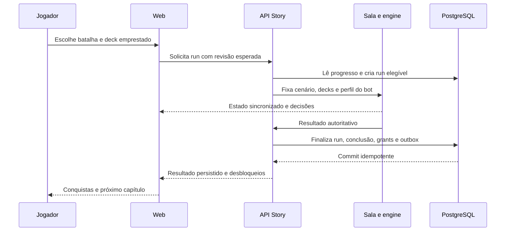

# Universo Digimon: planejamento editorial e técnico do Story Mode

Data da pesquisa: **20/10/2026**, horário de São Paulo. Documento de planejamento; nenhuma funcionalidade, migração, imagem ou fixture foi implementada. Base local: `develop`, commit `319f1e57ffe8e56491357c7ae775f071abc542c7`, igual ao HEAD inicial da worktree `digimon-story-universe-plan`. Não houve publicação, push ou PR.

## Atualização de escopo: inventário de todas as obras

O usuário ampliou a prioridade para **inventariar todos os animes, mangás e jogos**, antes de concentrar trabalho num piloto. O cadastro de referência passa a ser o [inventário ampliado de obras](2026-10-20-inventario-obras-digimon.md): 40 registros de animação, 50 de quadrinhos, 108 de jogos, 16 complementos de edição/DLC e 23 eventos de colaboração, com aliases, fontes, estados e lacunas. Há ainda 20 registros de famílias de jogos/dispositivos físicos e uma lacuna regional. Essas contagens incluem edições e unidades filhas; não significam histórias inéditas nem campanhas implementadas.

As seções 4–7 abaixo preservam a pauta inicial e devem ser lidas junto do inventário ampliado, que individualiza entradas antes agrupadas e acrescenta omissões. Odaiba e Our War Game são exemplos detalhados e uma hipótese de implementação futura, não o limite das obras a pesquisar. A sequência editorial agora prioriza obra/edição → arcos/capítulos/missões → confrontos principais → decks/adaptações → ondas de implementação. Nenhuma obra será excluída da pesquisa por falta de deck competitivo ou de suporte do engine.

## 1. Decisão de produto e limites de conclusão

### Campanhas próprias de World 1, 2 e 3

Por decisão explícita do usuário, os três jogos recebem campanhas independentes no planejamento: [World 1](2026-10-20-campanha-digimon-world-1.md), [World 2](2026-10-20-campanha-digimon-world-2.md) e [World 3/2003](2026-10-20-campanha-digimon-world-3.md). A pesquisa foi dividida entre três subagentes especializados, um por jogo, e deve ser lida junto das lacunas declaradas em cada arquivo. Os números 1–3 não impõem uma sequência de desbloqueio entre histórias.

| Campanha     | Levantamento especializado                                                                                | Limites de conclusão                                                                                                  |
| ------------ | --------------------------------------------------------------------------------------------------------- | --------------------------------------------------------------------------------------------------------------------- |
| World 1      | 40 fichas em dez arcos: 25 da seleção inicial, 11 desafios e quatro de pós-jogo                           | 38 identidades ao deduplicar três acessos de Back Dimension; guardas, Ice Sanctuary e torneios ainda pendentes        |
| World 2      | 60 fichas em 11 capítulos e trilha de ranking: 54 linhas principais e seis duelos de torneio              | 58 combates selecionados por percurso, descontando alternativas de Guardian; Ranks 4–9 e divergências ainda pendentes |
| World 3/2003 | 54 fichas em 17 capítulos e ramificações: 28 principais, dois Magasta, oito DRI, 11 opcionais e cinco PAL | Duas fases de Galacticmon, guarnições ainda em backlog e equivalência japonesa não comprovada                         |

As contagens são cadastros editoriais com unidades explicitadas, não campanhas completas ou decks prontos. Todas as composições de combate permanecem sustentadas por fontes secundárias e precisam de conferência no original. A apresentação oficial consultada de World 3 sustenta a estrutura anunciada, sem confirmar cada equipe. As pesquisas especializadas ampliam e corrigem as linhas resumidas do catálogo geral; não somar seus números aos 132 registros anteriores.

Recomenda-se uma campanha curada por jogo, com ramificações e conteúdo opcional. Uma sequência apenas de chefes finais perde eventos essenciais; uma réplica integral dos RPGs adiciona criação, navegação, encontros aleatórios e economia fora do escopo. A adaptação preserva eventos e participantes, usando partidas TCG e telas narrativas. Em World 1 o jogador controla um parceiro variável; em World 2 a equipe original e a escolha de clube precisam ser representadas; em World 3 a equipe, as trocas e as versões regionais exigem metadados próprios. Esses sistemas originais não passam a existir no engine por constarem do plano.

Cada jogo terá `campaignId` e conjuntos de conclusão próprios, com história principal separada de recrutamentos/desafios e pós-jogo. A edição regional e a rota são condições de elegibilidade, não conquistas obrigatórias de todas as versões simultaneamente. IDs de encontros já usados no catálogo são aliases editoriais para conciliação, sem duplicar recompensa. Um chefe com várias fases pode exigir vários encontros jogáveis, mas continua um evento narrativo; a contagem deve informar a unidade usada.

Para implementar depois: concluir a auditoria das fontes e composições inimigas; congelar o grafo editorial de cada campanha; pesquisar e versionar decks via DigiLab; testar cartas/bots/replays; então preparar assets e publicar capítulos conforme os gates deste plano. Os arquivos de pesquisa não aprovam decks novos, direitos de imagens ou suporte de entidades especiais. A prioridade de pesquisa dos três jogos não altera automaticamente o piloto técnico B01–B03 nem autoriza implementação.

### Definição geral

O [catálogo de confrontos individuais](2026-10-20-catalogo-combates-digimon.md) detalha a pauta antes agrupada por antagonista/arco: 132 encontros candidatos, com distinção entre duelos, equipes, fusões e chefes enfrentados por equipe variável. Jogos e mangás curtos podem ficar apenas no inventário, conforme pedido posterior do usuário. O catálogo não promove esses encontros a decks ou cenários prontos; somente B01–B03 têm o detalhamento de piloto apresentado neste plano.

Criar uma biblioteca de campanhas dentro do Story Mode existente: **continuidade > obra > arco > capítulo editorial > batalha**. Cada batalha explica quem participou, o que aconteceu na obra e como o confronto foi traduzido para uma partida TCG de dois assentos. Deck emprestado dispensa coleção própria. Conquistas são cosméticas e dependem de resultados confirmados pela API.

O catálogo geral abaixo preserva obras de anime, filmes, especiais, mangás/manhua e jogos, inclusive entradas que não justificam campanha. Ele é um **inventário de trabalho**, não uma certificação de exaustividade mundial: publicidade regional, quadrinhos licenciados, eventos temporários e jogos móveis antigos precisam de reconciliação adicional. As tabelas distinguem uma obra inventariada de um confronto efetivamente pesquisado. Nenhuma lista ausente foi preenchida por suposição.

Como hipótese de implementação posterior ao inventário geral, o piloto proposto tem três encontros novos: dois de Odaiba e o clímax de Our War Game. As listas competitivas verificadas são referências completas, não decks aprovados automaticamente para publicação. Odaiba exige curadoria temática para evitar evoluções e personagens de outras continuidades; o filme pode começar por uma variante competitiva claramente rotulada. Se os gates editoriais, de direitos ou engine falharem, publicar somente os encontros aprovados e manter os outros como “em preparação”, fora do denominador de conclusão. Não anunciar Adventure inteira concluída por terminar uma seleção de Odaiba.

Premissas adotadas: português no conteúdo novo, integração à tradução existente; spoilers ocultos até abertura do detalhe; sem economia, ranking ou recompensas monetizáveis; campanhas independentes entre continuidades; primeira entrega com partidas individuais, sem engine cooperativo, raid ou sistema de diálogo com escolhas. A pesquisa usa o TCG atual; cronologia da obra não determina data de lançamento das cartas.

### Alternativas consideradas

| Opção                                                     | Benefício                                                       | Custo/limitação                                                 | Decisão                                                                   |
| --------------------------------------------------------- | --------------------------------------------------------------- | --------------------------------------------------------------- | ------------------------------------------------------------------------- |
| Campanhas curadas e versionadas sobre os cenários atuais  | Reutiliza jogo, bots, replays e progresso; revisão por encontro | Pesquisa e balanceamento editorial contínuos                    | **Recomendada**                                                           |
| Gerar automaticamente campanhas a partir de wiki + meta   | Aumenta rapidamente o número de entradas                        | Confunde cânone, suporte e arquétipos; decks mudam sem controle | Usar automação apenas para levantar candidatos e detectar links quebrados |
| Construir engine de equipes/chefes e campanha RPG própria | Maior liberdade para fusões e combates coletivos                | Multiplica regras, interface e compatibilidade                  | Reavaliar depois de duas ondas medidas                                    |

## 2. Evidência local: o que existe e o que falta

Links relativos apontam para arquivos reais nesta base. Números de linha são referências de inspeção, sujeitos a mudanças futuras.

| Ponto existente                                                                                                                                                                                        | Constatação                                                                                                                    | Reaproveitamento/extensão futura                                                                                                  |
| ------------------------------------------------------------------------------------------------------------------------------------------------------------------------------------------------------ | ------------------------------------------------------------------------------------------------------------------------------ | --------------------------------------------------------------------------------------------------------------------------------- |
| [StoryBattle.ts](../../packages/shared/src/story/StoryBattle.ts)                                                                                                                                       | Catálogo plano: id, personagens, capítulos externos, fonte, capa, playable/adapted, um prerequisiteId; progresso é completed[] | Preservar campos e IDs Liberator; acrescentar hierarquia e referências a revisões                                                 |
| [StoryBattleKind.ts](../../packages/shared/src/story/StoryBattleKind.ts)                                                                                                                               | depicted_card_battle, reported_card_battle e grouped_card_battles descrevem encontros de cartas                                | Preservar valores; adicionar classificação de adaptação física ao TCG separada do tipo de evidência                               |
| [storyBattles.ts](../../packages/shared/src/story/storyBattles.ts) e [README da API](../../apps/api/src/story/README.md)                                                                               | 30 encontros, 12 personagens; três aberturas documentadas, 27 adaptações; decks ocultos reconstruídos mesmo nos primeiros três | Manter Liberator como campanha legada; não reapresentar as 30 listas como decks canônicos completos                               |
| [getStoryScenario.ts](../../apps/api/src/story/getStoryScenario.ts)                                                                                                                                    | Mapeamento explícito de IDs para fixtures; devolve structuredClone                                                             | Resolver revisão validada e fixture por ID; não interpretar texto de wiki em runtime                                              |
| [getStorySeatDeck.ts](../../apps/api/src/story/getStorySeatDeck.ts)                                                                                                                                    | Reconstrói deck contando mão, segurança, trash, campo, fontes, links e ovos                                                    | Validar exatamente 50 cartas principais considerando TODAS as zonas; separar ovos                                                 |
| [shuffleStoryDecks.ts](../../apps/api/src/story/shuffleStoryDecks.ts)                                                                                                                                  | Embaralha pilhas remanescentes; abertura permanece controlada                                                                  | Preservar reprodução da abertura; não permitir seed escolhida pelo jogador em produção                                            |
| [AegisRoom.ts](../../apps/api/src/rooms/AegisRoom.ts), onAuth perto de 539                                                                                                                             | Valida identidade e prerequisiteId na API                                                                                      | Substituir internamente por resolvedor de requisitos, incluindo revisão e deck permitido                                          |
| Mesmo arquivo, onCreate perto de 748 e criação de assentos perto de 1547                                                                                                                               | API escolhe cenário, deck e bot; caminho Story exige sala bot/beta                                                             | Separar regra de admissão de campanha da disponibilidade competitiva normal; não liberar cartas inválidas usando beta como atalho |
| Mesmo arquivo, evento gameOver perto de 865                                                                                                                                                            | Vitória do assento 0 grava progresso; falha de gravação é apenas logada de forma assíncrona                                    | Finalização durável, retry e confirmação de recompensa; vitória visual não deve prometer persistência antes do commit             |
| Mesmo arquivo, perto de 1146                                                                                                                                                                           | Story não grava estatísticas regulares nesse caminho                                                                           | Manter isolamento de ladder e estatísticas                                                                                        |
| [StoryProgressStore.ts](../../apps/api/src/story/StoryProgressStore.ts)                                                                                                                                | INSERT ON CONFLICT por identidade/batalha; conta e convidado separados                                                         | Base da idempotência, ainda sem conquistas, dificuldade, revisões ou transferência                                                |
| [installStoryRoutes.ts](../../apps/api/src/story/installStoryRoutes.ts)                                                                                                                                | GET /story/progress; no-store; sessão ou Authorization StoryGuest                                                              | Manter endpoint legado e adicionar leitura versionada; nunca aceitar completed[] enviado pelo cliente                             |
| [038-story-progress.ts](../../apps/api/src/db/migrations/038-story-progress.ts), [039-story-guest-progress.ts](../../apps/api/src/db/migrations/039-story-guest-progress.ts)                           | Tabelas de conclusões com battle_id, match_id e completed_at; PK composta; convidado identificado por hash                     | Migrações aditivas, sem editar migrations publicadas; nenhuma migração nesta tarefa                                               |
| [StoryScreen.tsx](../../apps/web/src/story/StoryScreen.tsx), [StoryBattleRow.tsx](../../apps/web/src/story/StoryBattleRow.tsx), [story.css](../../apps/web/src/story/story.css)                        | Filtro por personagem, lista, capas externas, progresso e replay; bloqueia início quando leitura falha                         | Biblioteca por obra/arco com estado de carregamento, erro e bloqueio explícitos                                                   |
| [getStoryGuestToken.ts](../../apps/web/src/story/getStoryGuestToken.ts), [getStoryGuestHash.ts](../../apps/api/src/story/getStoryGuestHash.ts)                                                         | Token aleatório local; banco guarda SHA-256; login troca para progresso da conta                                               | Fazer merge autenticado e transacional; não tratar localStorage como comprovante de vitória                                       |
| [digilab.ts](../../apps/api/src/deckProviders/providers/digilab.ts), [ProviderClient.ts](../../apps/api/src/deckProviders/ProviderClient.ts), [desenvolvimento](../../internal-docs/ai/development.md) | Provedor DigiLab já existe; X-API-Key somente no servidor; snapshots persistidos e coletor com limites                         | Reutilizar coleta/cache e validação. Campanhas fixam listas aprovadas, sem fetch externo na abertura da partida                   |
| [BotPlayer.ts](../../apps/api/src/bot/BotPlayer.ts), [policy.ts](../../apps/api/src/bot/policy.ts), [matchHarness.ts](../../apps/api/src/bot/matchHarness.ts)                                          | Bot aceita política e timeout com fallback                                                                                     | Medir comportamento antes de oferecer dificuldade; não pressupor presets fácil/médio/difícil já existentes                        |
| [arquitetura](../ARCHITECTURE.md), [replays.ts](../../packages/shared/src/replays.ts), [recording.ts](../../apps/api/src/replays/recording.ts)                                                         | Replay visual é diferente do registro de inputs que reexecuta engine                                                           | Fixar metadados e preservar fixture embaralhada no registro privado; não expor randomKey                                          |

Testes lidos: [storyProgress.test.ts](../../apps/api/src/story/storyProgress.test.ts), [installStoryRoutes.test.ts](../../apps/api/src/story/installStoryRoutes.test.ts), [getStorySeatDeck.test.ts](../../apps/api/src/story/getStorySeatDeck.test.ts), [shuffleStoryDecks.test.ts](../../apps/api/src/story/shuffleStoryDecks.test.ts), [storyEncounterOpenings.test.ts](../../apps/api/src/story/storyEncounterOpenings.test.ts), [AegisRoom.story.test.ts](../../apps/api/src/rooms/AegisRoom.story.test.ts), [StoryScreen.test.tsx](../../apps/web/src/story/StoryScreen.test.tsx). Eles cobrem isolamento, bloqueios forjados, decks do servidor, embaralhamento, admissão e interface. Não provam fidelidade de todas as cartas ou viabilidade de uma campanha nova.

## 3. Método editorial e política de fontes

Cada unidade de conteúdo terá ID estável, continuidade, mídia/edição/região, ordem editorial, referências a episódio/capítulo/missão, protagonistas, aliados, adversários, Digimon centrais, desfecho, objetivo jogável, grau de adaptação e revisão. Títulos de capítulos propostos aqui são editoriais, não títulos oficiais.

Estados editoriais: **inventariado**, **pesquisa pendente**, **confronto confirmado**, **deck documentado**, **engine auditado**, **balanceado**, **direitos resolvidos**, **publicável**. A presença em uma tabela não implica passagem pelos demais estados. Episódios/missões não conferidos recebem localizador pendente; não inventar números. Apenas a primeira onda recebe especificação operacional completa neste plano; o restante é backlog discriminado.

Prioridade de evidência: obra/episódio ou publicação oficial; sinopse oficial; distribuidor licenciado; wiki como índice secundário; vídeo de gameplay com versão e marca temporal para jogos antigos. Uma sinopse que termina antes do desfecho não prova sozinha quem venceu. Registrar a diferença. Não copiar roteiro, páginas ou texto longo. Usar resumo próprio curto e link para consumir a obra legalmente.

Fontes gerais consultadas em 20/10/2026: [catálogo Toei](https://lineup.toei-anim.co.jp/ja/series/digimon/), [Digimon Anime Portal](https://digimon-anime.com/), [Digimon Comic oficial](https://digimon.net/digimoncomic/en/), [portal oficial de jogos](https://digimon-gameportal.bn-ent.net/), [inventário de jogos Wikimon](https://wikimon.net/List_of_Video_Games), [inventário alternativo de jogos](https://en.wikipedia.org/wiki/List_of_Digimon_video_games). As duas últimas são índices de descoberta, não autoridade para a implementação de regras TCG.

Reconciliar o catálogo a cada onda: enumerar páginas de ambos os índices, registrar aliases, deduplicar ports, procurar novidades nos portais oficiais e documentar toda entrada descartada. Não chamar o catálogo de completo antes dessa reconciliação e da revisão das publicações regionais. Situação de serviço e disponibilidade de capítulos devem ser revalidadas na data de produção.

## 4. Inventário de anime, cinema e especiais

### 4.1 Séries e continuidades

Cada linha é uma obra ou subdivisão editorial preservada; “O2+” significa onda posterior, ainda com pesquisa de confrontos/decks pendente salvo os candidatos da seção 5.

| ID editorial | Obra                                            | Continuidade e tratamento                                                    | Estado/onda                              |
| ------------ | ----------------------------------------------- | ---------------------------------------------------------------------------- | ---------------------------------------- |
| A01          | Digimon Adventure (1999)                        | Continuidade Adventure original; não misturar com reboot                     | O1 Odaiba; restante O2                   |
| A02          | Adventure 02                                    | Sequência; equipe nova e participações da anterior                           | O2                                       |
| A03          | Tamers                                          | Universo próprio; cartas da ficção não equivalem ao TCG de 2020              | O2                                       |
| A04          | Frontier                                        | Universo próprio; humanos se transformam, não têm parceiros convencionais    | O3                                       |
| A05          | Savers / Data Squad                             | Universo próprio; nomes localizados são aliases                              | O3                                       |
| A06          | Xros Wars, primeira fase                        | Taiki/Xros Heart; Digixros exige tradução explícita                          | O3                                       |
| A07          | Xros Wars: Death Generals / Seven Kingdoms      | Continuação de A06; arcos por reino                                          | O3                                       |
| A08          | Xros Wars: Young Hunters Who Leapt Through Time | Continuação; Tagiru e crossover final                                        | O3; crossover não funde os universos     |
| A09          | Universe: Appli Monsters                        | Continuidade Appmon própria                                                  | O4; verificar card pool e engine         |
| A10          | Adventure: (2020)                               | Reboot independente de A01                                                   | O3                                       |
| A11          | Ghost Game                                      | Universo próprio; muitos conflitos terminam em acordo                        | O3                                       |
| A12          | Beatbreak                                       | Obra recente: registrar somente episódios efetivamente publicados/conferidos | O4; revisão de catálogo antes da entrega |

Fontes por série: [Adventure e episódios](https://lineup.toei-anim.co.jp/ja/tv/dejimon/staff/), [02](https://wikimon.net/Digimon_Adventure_02), [Tamers](https://wikimon.net/Digimon_Tamers), [Frontier](https://wikimon.net/Digimon_Frontier), [Savers](https://wikimon.net/Digimon_Savers), [Xros Wars](https://wikimon.net/Digimon_Xros_Wars), [Appmon](https://wikimon.net/Digimon_Universe_Appli_Monsters), [reboot](https://wikimon.net/Digimon_Adventure:), [Ghost Game](https://wikimon.net/Digimon_Ghost_Game), [Beatbreak oficial](https://www.toei-anim.co.jp/tv/digimon_beatbreak/en/). Para publicações futuras, acompanhar o site; não inferir encerramento ou total de episódios a partir de postagens da comunidade.

### 4.2 Filmes, curtas, especiais e remontagens

| ID  | Título/unidade preservada                                               | Continuidade/ação editorial                                                                                                                      | Primeira pauta de capítulo                                                        |
| --- | ----------------------------------------------------------------------- | ------------------------------------------------------------------------------------------------------------------------------------------------ | --------------------------------------------------------------------------------- |
| F01 | Digimon Adventure (curta de 1999)                                       | Prólogo de Adventure                                                                                                                             | Hikarigaoka: Greymon e Parrotmon; vitória jogável não equivale a morte canônica   |
| F02 | Our War Game!                                                           | Adventure                                                                                                                                        | Internet: Infermon e Diaboromon; O1 clímax                                        |
| F03 | Hurricane Touchdown!! / Transcendent Evolution!! The Golden Digimentals | Duas partes do mesmo filme 02; encaixe cronológico deve ser anotado, não forçado                                                                 | Wallace, Terriermon/Lopmon; Cherubimon; Magnamon/Rapidmon                         |
| F04 | Diablomon Strikes Back / Revenge of Diaboromon                          | Adventure/02                                                                                                                                     | Retorno e Armageddemon; Imperialdramon Paladin Mode                               |
| F05 | Tamers: Battle of Adventurers                                           | Ramificação vinculada a Tamers; conferir encaixe                                                                                                 | Okinawa, Mephismon/Gulfmon                                                        |
| F06 | Tamers: Runaway Locomon                                                 | Filme de Tamers; relação com final da TV documentada como variante                                                                               | Trem, Locomon/Parasimon                                                           |
| F07 | Frontier: Revival of the Ancient Digimon!! / Island of Lost Digimon     | Side story; não impor posição exata sem prova                                                                                                    | Disputa Human/Beast; Ornismon                                                     |
| F08 | Digital Monster X-evolution                                             | Especial CG, continuidade própria                                                                                                                | Dorumon, Alphamon, Omnimon, Death-X-mon                                           |
| F09 | Savers: Ultimate Power! Activate Burst Mode!!                           | Side story de Savers                                                                                                                             | ShineGreymon e Argomon; conferir forma/cartas                                     |
| F10 | Adventure tri. 1 Reunion                                                | Adventure                                                                                                                                        | Kuwagamon e Alphamon; reunir equipe                                               |
| F11 | tri. 2 Determination                                                    | Mesma sequência                                                                                                                                  | Imperialdramon infectado; Rosemon/Vikemon                                         |
| F12 | tri. 3 Confession                                                       | Mesma sequência                                                                                                                                  | Meicoomon/Meicrackmon e reboot                                                    |
| F13 | tri. 4 Loss                                                             | Mesma sequência                                                                                                                                  | Machinedramon; Phoenixmon e aliados                                               |
| F14 | tri. 5 Coexistence                                                      | Mesma sequência                                                                                                                                  | Raguelmon e Jesmon; conflito coletivo                                             |
| F15 | tri. 6 Future                                                           | Mesma sequência                                                                                                                                  | Ordinemon; Omnimon Merciful Mode                                                  |
| F16 | Last Evolution Kizuna                                                   | Adventure; final narrativo próprio                                                                                                               | Eosmon; Agumon/Gabumon Bonds                                                      |
| F17 | Adventure 02: The Beginning                                             | Adventure/02                                                                                                                                     | Lui/Ukkomon; BigUkkomon; resolução não reduzida a extermínio                      |
| F18 | Adventure 3D: Digimon Grandprix!                                        | Curta de corrida                                                                                                                                 | Inventariar; sem campanha de batalhas por padrão                                  |
| F19 | Savers 3D: The Digital World in Imminent Danger!                        | Curta de atração                                                                                                                                 | Conferir conflito e material disponível                                           |
| F20 | Adventure 20th Anniversary Memorial Story Project                       | Cinco curtas: To Sora; Hole in the Heart; Medical Student Joe Kido; The Desired Jogress Evolution; The Shibuya-ish Heroic Saga of Pump and Gotsu | Vinhetas/galeria; pesquisa individual antes de propor combate                     |
| F21 | Adventure -Beyond-                                                      | Vídeo de aniversário/promocional                                                                                                                 | Extra; não vender trailer como campanha longa                                     |
| F22 | Time Stranger Prelude                                                   | Curta promocional ligado ao jogo                                                                                                                 | Vincular ao jogo, sem duplicar missão sem diferença narrativa                     |
| F23 | Digimon: The Movie (2000)                                               | Remontagem/localização de F01–F03                                                                                                                | Registrar edição e diferenças; não contar como três campanhas inéditas adicionais |
| F24 | The Best Adventure We Chose / Digimon Selection                         | Compilação/reexibição                                                                                                                            | Alias editorial para episódios originais; nenhuma recompensa duplicada            |

Fontes: [Toei filmes](https://lineup.toei-anim.co.jp/ja/series/digimon/), [Our War Game oficial](https://lineup.toei-anim.co.jp/en/movie/digimon_wargame/), [filme 02 de 2000](https://www.toei-anim.co.jp/movie/2000_summer/index.html), [retorno de Diaboromon](https://www.toei-anim.co.jp/movie/2001_spring/story.html), [X-evolution](https://wikimon.net/Digital_Monster_X-evolution), [tri.](https://wikimon.net/Digimon_Adventure_tri.), [The Beginning oficial](https://www.toei-anim.co.jp/movie/digimon-adventure/eng/), [Selection oficial](https://www.toei-anim.co.jp/tv/digimon_selection/en/). Candidatos nesta tabela ainda exigem assistir/conferir localizadores e desfechos; F02 e Odaiba recebem detalhamento abaixo. Fontes de trailers não autorizam reutilizar as imagens.

## 5. Estrutura de campanha e confrontos

### 5.1 Primeira onda: especificação dos três encontros

**Adventure (1999) > arco Odaiba > capítulo editorial “Luz na névoa” > B01: A flecha de luz.** Localizador: episódio 37, exibição japonesa 21/11/1999. Hikari/Kari e Tailmon/Gatomon protagonizam; Wizardmon e os demais escolhidos são aliados. Adversário: Myotismon/Vamdemon, forma Perfect/Ultimate. Centro: Angewomon versus Myotismon, com energia/apoio dos aliados; sacrifício de Wizardmon faz parte do contexto. Desfecho: Angewomon derrota sua forma, mas a ameaça continua. A [sinopse Toei](https://lineup.toei-anim.co.jp/ja/tv/dejimon/episode/37/) contextualiza o ataque; o [perfil oficial de Angewomon](https://www.toei-anim.co.jp/tv/dejimon/chara/enjewomon.html) e a [sinopse licenciada do episódio](https://tv.apple.com/us/episode/episode-37/umc.cmc.2jo6f4zrzq7dcrvuyczleh6wy?showId=umc.cmc.606jnexnoqvedueovv7xjfg1m) complementam o desfecho.

Adaptação: um jogador representa Hikari e a equipe; um bot representa Myotismon. Objetivo obrigatório é vencer a partida; conquista opcional requer Angewomon participar de um ataque que resolva, não só aparecer na mão. Não exigir simular o sacrifício literalmente. Referências completas: D06 Virus Busters para linha Tailmon/Angewomon e D03 Myotismon Loop para o adversário. **Ambas têm personagens/evoluções externos à cena; não publicar como reconstrução fiel.** Decks de história H01 e H02 serão versões temáticas novas, com listas de 50 + ovos ainda pendentes de curadoria. Não afirmar que esses decks temáticos são meta. A variante “inspirada em torneios” só pode usar D06/D03 íntegros com aviso de mistura de universos. B01 é raiz de Odaiba e libera B02 ao ser concluída.

**Adventure (1999) > Odaiba > capítulo editorial “Duas evoluções supremas” > B02: Romper a escuridão.** Localizador: episódios 38–39; a cronologia exata da estreia do 39 deve ser conferida na mídia/guia antes da publicação. Taichi/Tai e Yamato/Matt; aliados Hikari, Takeru e toda equipe; adversário **VenomMyotismon/VenomVamdemon**. Centro: WarGreymon + MetalGarurumon, apoiados pelos outros Digimon e emblemas. Desfecho: vitória coletiva e fim da névoa; retorno ao Mundo Digital é o gancho. [Índice oficial dos episódios 38–39](https://lineup.toei-anim.co.jp/ja/tv/dejimon/staff/) e [guia secundário de episódios](https://digimon.fandom.com/wiki/List_of_Digimon_Adventure_episodes) identificam a distinção e o resultado; conferir vídeo legal antes do fechamento editorial.

Adaptação: escolha entre deck emprestado de Tai (D01) e Matt (D02), uma vitória basta para progressão; o aliado aparece no resumo, não como terceiro assento. Desafio opcional posterior permite vencer com os dois. D01/D02 contêm evoluções externas à cena; na modalidade temática, remover essas linhas apenas em novas revisões H03/H04 devidamente listadas e testadas. D07 é lista documentada contendo VenomMyotismon, mas tem apenas uma cópia e foco em MaloMyotismon: serve de referência, **não é um deck competitivo dedicado ao chefe**. H05, adversário temático centrado em VenomMyotismon, continua pendente. Estado inicial recomendado: partida padrão; uma abertura de clímax só se justificar por didática e contar as cartas retiradas do deck. Finalizar B01+B02 concede conquista de arco Odaiba, não de Adventure completa.

**Our War Game! > arco Crise na internet > capítulo editorial “Conexões” > B03: A última conexão.** Obra lançada no Japão em 04/03/2000. Tai e Matt/Agumon e Gabumon; Izzy e os usuários conectados apoiam; adversário Diaboromon/Diablomon e suas cópias. Centro: fusão em **Omnimon/Omegamon**. Desfecho: equipe vence e impede a catástrofe. [Ficha oficial](https://lineup.toei-anim.co.jp/en/movie/digimon_wargame/) e [sinopse oficial](https://lineup.toei-anim.co.jp/ja/movie/digimon_wargame/story/) são a referência da obra; validar o localizador do clímax na edição escolhida antes de publicar.

Adaptação: D04 ADVENTURE Omni versus D05 Diaboromon, listas integrais, rotuladas como **desafio competitivo inspirado no filme**, com regras TCG normais. A lista D04 usa Merciful Mode, e D05 usa Armageddemon, Arata e X Antibody; essas presenças não ocorreram nesse clímax. A ficha distingue tudo isso. Para modo temático fiel, produzir H06/H07 removendo anacronismos, com novas listas, sem atribuir o resultado competitivo original à variante. Uma vitória conclui esta **seleção do filme**; uma futura campanha integral adicionará encontros anteriores com outro conjunto de conclusão. B03 pode ser iniciado sem terminar Odaiba, pois filmes e séries são portas independentes da biblioteca.

**Correção do exemplo original:** “WarGreymon vs Myotismon” é uma abreviação inadequada para Adventure. B01 é Angewomon contra Myotismon; B02 é WarGreymon e MetalGarurumon contra VenomMyotismon. **MaloMyotismon/BelialVamdemon pertence ao clímax de Adventure 02**, com Imperialdramon e apoio mundial; não substitui nenhum dos dois. [Episódio 50 oficial de 02](https://lineup.toei-anim.co.jp/ja/tv/digimon02/episode/50/) identifica BelialVamdemon. Nomes localizados não são espécies intercambiáveis.

### 5.2 Backlog editorial dos demais arcos de TV

As linhas seguintes definem pauta de obra > arco > capítulo > batalha. **São candidatos, não encontros publicados**: falta conferir os episódios/páginas específicos, participação exata, resultado detalhado, listas e engine. “Vitória coletiva” significa que a adaptação proposta usa um deck representativo e preserva os aliados na ficha; nunca anunciar duelo individual literal.

| Obra > arco > capítulo editorial                  | Protagonistas/aliados > adversário; Digimon centrais                   | Desfecho a preservar e adaptação proposta                                                                |
| ------------------------------------------------- | ---------------------------------------------------------------------- | -------------------------------------------------------------------------------------------------------- |
| Adventure > File Island > A luz da esperança      | Takeru/Patamon e escolhidos > Devimon; Angemon                         | Devimon derrotado, Angemon se sacrifica e retorna a ovo; vitória com epílogo, sem impor morte como regra |
| Adventure > Server > Coragem                      | Tai/Agumon, equipe > Etemon; MetalGreymon                              | Etemon derrotado e separação temporária; partida única                                                   |
| Adventure > Dark Masters > O mar                  | Tai/WarGreymon, Whamon/equipe > MetalSeadramon                         | Vitória com sacrifício de Whamon; deck Greymon vs marinho                                                |
| Adventure > Dark Masters > A floresta             | Matt/MetalGarurumon/equipe > Puppetmon                                 | Vitória; manter confronto de Tai/Matt em capítulo separado, não confundir com chefe                      |
| Adventure > Dark Masters > A cidade               | Tai/WarGreymon, Kari e aliados > Machinedramon                         | Vitória; deck Machine sem acrescentar Chaosdramon ao cânone                                              |
| Adventure > Dark Masters > O último mestre        | Takeru/MagnaAngemon e equipe > Piedmon                                 | Vitória coletiva; não atribuir desfecho somente a WarGreymon                                             |
| Adventure > Apocalymon > Novos caminhos           | Oito escolhidos > Apocalymon                                           | Vitória coletiva; chefe em TCG, não simular destruição de mundos                                         |
| 02 > Imperador > Armaduras                        | Davis/Veemon, Ken/Wormmon > Kimeramon; Magnamon                        | Kimeramon vencido com sacrifício de Wormmon; conclusão narrativa não exige jogar como Ken                |
| 02 > Control Spires > O guerreiro negro           | Davis/Ken/equipe > BlackWarGreymon                                     | Arco inclui conflitos sem vitória definitiva; selecionar episódios antes de definir condição             |
| 02 > Jogress > União                              | Davis/Ken, Yolei/Kari, Cody/T.K. > antagonistas do arco                | Separar Paildramon, Silphymon e Shakkoumon por evento confirmado; pesquisa dos adversários pendente      |
| 02 > Mundo real > O selo                          | Imperialdramon e equipe > Daemon                                       | Daemon é banido/selado, não morto; vitória TCG seguida de resolução fiel                                 |
| 02 > Final > Todos conectados                     | Davis/Imperialdramon e escolhidos do mundo > MaloMyotismon             | Vitória coletiva; D03 é referência de arquétipo, não lista canônica                                      |
| Tamers > Devas > A cidade sitiada                 | Takato/WarGrowlmon e aliados > Vikaralamon                             | Vitória coletiva; adaptar como uma partida                                                               |
| Tamers > Mundo Digital > Luto e fúria             | Jeri/Leomon, Takato/Guilmon > Beelzemon; Megidramon                    | Leomon morre; separar tragédia narrativa e desafio posterior vencível                                    |
| Tamers > Mundo Digital > Recuperar o vínculo      | Takato/Gallantmon > Beelzemon                                          | Gallantmon vence e o adversário é poupado; sem execução no resultado                                     |
| Tamers > Soberanos > Entendimento                 | Henry/MegaGargomon, aliados > Zhuqiaomon                               | Conflito evolui para entendimento; resolução sem declarar morte                                          |
| Tamers > D-Reaper > Resgatar Jeri                 | Gallantmon Crimson Mode, Sakuyamon, MegaGargomon e aliados > D-Reaper  | Vitória por operação conjunta; D-Reaper é programa, não “outro Digimon”                                  |
| Frontier > Espíritos > Luz e sombra               | Koji/Lobomon > Duskmon/Koichi                                          | Recuperação de Koichi; duelista é humano transformado                                                    |
| Frontier > Querubim > União dos espíritos         | Takuya/EmperorGreymon e Koji/MagnaGarurumon > Cherubimon               | Vitória; escolha de deck representa equipe                                                               |
| Frontier > Royal Knights > Recuos                 | Equipe > Dynasmon e Crusadermon                                        | Há derrotas/recuos; versão narrativa usa objetivo de sobrevivência somente após suporte auditado         |
| Frontier > Lucemon > Todos os espíritos           | Seis crianças/Susanoomon > Lucemon e formas                            | Vitória coletiva; fases como partidas separadas, sem transformar Satan Mode em evolução inventada        |
| Savers > DATS > O rival                           | Marcus/ShineGreymon e equipe > Kurata/Belphemon                        | Vitória; distinguir monstro de controlador humano                                                        |
| Savers > Royal Knights > Confrontar a ordem       | DATS e Burst Modes > Royal Knights                                     | Múltiplas alianças e adversários; escolher pares por episódio                                            |
| Savers > Yggdrasil > Mundo em risco               | Marcus/Agumon e aliados > Yggdrasil                                    | Vitória coletiva; fallback se entidade sem carta equivalente                                             |
| Xros Wars > Zonas > Rivalidade                    | Taiki/Shoutmon e equipe > Kiriha/Blue Flare                            | Selecionar confrontos com resultado conferido; decks Xros Heart/Blue Flare                               |
| Xros Wars > Bagra > Resistência                   | Xros Heart e aliados > Bagramon/DarkKnightmon                          | Separar etapas e traíções; derrotas não viram vitória canônica                                           |
| Xros Wars Seven Kingdoms > Reinos > Generais      | Taiki/Kiriha/Nene > generais de cada reino                             | Um capítulo por reino; enumerar nomes, episódios e desfechos na pesquisa O3                              |
| Xros Wars Seven Kingdoms > Final > Unidos         | Shoutmon X7 Superior Mode e aliados > DarknessBagramon                 | Vitória coletiva; não copiar fusão visual como regra sem carta                                           |
| Hunters > DigiQuartz > Caçada                     | Tagiru/Gumdramon/Arresterdramon e aliados > Quartzmon                  | Vitória com participação de heróis de outras séries; marcar crossover                                    |
| Appmon > Leviathan > Deuses de aplicativos        | Haru/Gatchmon e aliados > Leviathan                                    | Resolução coletiva; pesquisar Appmon/card pool, sem trocar por Digimon parecido                          |
| Adventure: 2020 > Devimon > Evoluções sob pressão | Tai/Agumon, Matt/Gabumon > Devimon e formas                            | Partidas por etapa; não reutilizar continuidade ou sacrifício de 1999                                    |
| Adventure: 2020 > Milênio > Ameaça reconstruída   | Equipe/WarGreymon > Millenniummon e formas                             | Vitória coletiva; deck Millenniummon após verificar episódio                                             |
| Adventure: 2020 > Final > O núcleo                | Omnimon e equipe > Abbadomon/Abbadomon Core                            | Vitória; distinguir de batalha Liberator com a mesma espécie                                             |
| Ghost Game > Visitantes > Medo e diálogo          | Hiro/Gammamon, Ruli/Angoramon, Kiyoshiro/Jellymon > casos selecionados | Encerramentos frequentemente pacíficos; escolher casos por relevância e fonte                            |
| Ghost Game > Final > A outra voz                  | Hiro/Siriusmon e equipe > BloomLordmon/GulusGammamon conforme episódio | Separar lutas e negociação; não assumir Regulusmon como duelo final sem rever a obra                     |
| Beatbreak > arcos e capítulos a levantar          | Tomoro/Gekkomon e elenco a confirmar por episódio                      | Consulta ao portal oficial feita; confrontos, desfechos e totais permanecem pendentes                    |

Não há listas competitivas completas levantadas para estas linhas nesta entrega. Mapeamento de pesquisa: Gallantmon/Beelzemon/D-Reaper/MegaGargomon/Sakuyamon para Tamers; Hybrid/Susanoomon/Lucemon para Frontier; DATA SQUAD/Burst/Belphemon/Royal Knights para Savers; Xros Heart/Blue Flare/Bagra/Hunters para Xros; Gammamon/Siriusmon/Jellymon/Angoramon para Ghost Game; Dark Masters e Apocalymon para Adventure. Esses são termos de busca, não comprovação de meta nem garantia de suporte.

## 6. Inventário de mangás, quadrinhos e narrativas adjacentes

Cada linha é uma unidade editorial rastreável. Todos os confrontos desta seção ficam em O3/O4 e com listas pendentes; o Liberator existente é preservado em O0. Mangás que adaptam anime têm continuidade/versão própria e compartilham referência ao evento, não conclusão automática.

| Obra/unidade                                           | Pauta de obra > arco > capítulo > batalha e elenco                 | Resultado/adaptação e lacuna                                                                                                                                                       |
| ------------------------------------------------------ | ------------------------------------------------------------------ | ---------------------------------------------------------------------------------------------------------------------------------------------------------------------------------- |
| C'mon Digimon                                          | One-shot > encontro > Bun e seu tamer                              | Ler publicação e registrar rival/desfecho; não inferir deck por espécie                                                                                                            |
| V-Tamer 01                                             | Taichi/Zeromaru > Neo > Alias III, Arkadimon, Daemon               | Candidatos: AeroVeedramon/UlforceVeedramon vs Arkadimon; final Super Ultimate. Conferir estágios e páginas; Victory Mode não pode ser substituído silenciosamente por carta normal |
| V-Tamer, capítulos especiais/crossovers                | Taichi/Zeromaru > visitante de outra obra                          | Unidades separadas; inventariar cada especial e não contar coletânea como história nova                                                                                            |
| Digimon Next                                           | Tsurugi/Agumon e Yuu/Gaomon > Barbamon/NEO > união                 | VictoryGreymon/ZeedGarurumon no final; vitória coletiva candidata. Confirmar páginas e equivalência TCG de NEO                                                                     |
| Xros Wars, mangá                                       | Taiki/Shoutmon e aliados > Bagra > clímax                          | Pauta própria; não importar final do anime. Ler cada confronto antes de escolher Xros Heart/Bagra                                                                                  |
| World Re:Digitize, mangá                               | Taiga/Agumon > crise digital                                       | Adaptação ligada ao jogo; capítulos/desfechos pendentes                                                                                                                            |
| Re:Digitize Encode                                     | Taiga e elenco > arcos da adaptação                                | Obra separada da anterior; não pressupor que cobre todo Decode                                                                                                                     |
| Universe Appli Monsters, mangá                         | Haru/Gatchmon > aplicativos e ameaça central                       | Separar alterações da TV; suporte TCG pendente                                                                                                                                     |
| Appmon Academy!!                                       | Comédia escolar > episódios de convivência                         | Inventariado; campanha de batalhas só se houver confronto narrativo verificável                                                                                                    |
| Dreamers                                               | Ritsu/Pulsemon > encontros e maldição > desafios                   | Identificar antagonistas por capítulo, sem preencher pela linha competitiva Pulsemon                                                                                               |
| Liberator, webcomic                                    | Shoto/Pteromon, Arisa/Shoemon e elenco > Lacuna > encontros atuais | Preservar 30 IDs existentes; fazer nova auditoria de capítulos posteriores, não alegar cobertura atual completa                                                                    |
| Liberator, webnovel                                    | Yuuki/Impmon e elenco > Lacuna > jornadas paralelas                | Compartilha mundo, cronologia cruzada explícita; não duplicar batalhas reportadas                                                                                                  |
| ReCollection / Rikollection                            | Riko/Agumon > brinquedos materializados > confrontos               | Fonte oficial indica ShineGreymon/Armagemon; pares e desfechos dependem de leitura                                                                                                 |
| Paradox                                                | Reiji/Elecmon > arma do futuro > crise temporal                    | Machinedramon consta da apresentação; confirmar se adversário/aliado em cada cena                                                                                                  |
| Knuckles                                               | Haruka/Gankoomon > busca e treinamento                             | Listar adversários e final ao ler capítulos; deck Gankoomon não prova luta                                                                                                         |
| Hiragana Digimon: A Tale of the Royal Knights          | Royal Knights > capítulos curtos                                   | Separar vinheta de confronto; provável galeria antes de campanha                                                                                                                   |
| Seekers: Witch of the Crossroads                       | Spin-off do mundo Seekers > capítulo próprio                       | Não confundir com webnovel original; elenco, páginas e desfechos pendentes                                                                                                         |
| Seekers: Wall Slum's Nightmare                         | Eiji/Loogamon > Wall Slum                                          | Ficha própria de continuação; confrontos ainda não verificados                                                                                                                     |
| Digimon Eggs                                           | Série curta recente > capítulos a levantar                         | Inventariar publicação, elenco e escopo antes de prometer campanha                                                                                                                 |
| Digimon Get Back; Digimon Bilievers                    | One-shots > uma unidade por obra                                   | Leitura e grafia localizada pendentes; não fundir com série longa                                                                                                                  |
| Digimon Variants; Digital Monster CHILDREN:CODE        | Obras de concurso > one-shot ou derivação identificada             | Vincular Paradox/Knuckles somente após conferir relação editorial                                                                                                                  |
| One-shots Cyber Sleuth e Hacker's Memory               | Promoção de jogos > cena adaptada                                  | Não duplicar campanhas dos jogos; verificar capítulos e direitos                                                                                                                   |
| Go! Go!! Digimon                                       | Material promocional > episódios curtos                            | Inventariado; narrativa jogável a determinar                                                                                                                                       |
| Digimon Chronicle; Chronicle X                         | Narrativa promocional de V-pets, quadrinhos e texto                | Dorumon/Alphamon e Royal Knights/X; distinguir do especial X-evolution                                                                                                             |
| Battle!! Digital Monsters                              | Quadrinho regional > arcos a levantar                              | Confirmar edição/licença e elenco; pesquisa pendente                                                                                                                               |
| Adventure, manhua de Yu Yuen-wong                      | Adaptação regional > arcos do anime                                | Registrar diferenças de cenas e desfechos                                                                                                                                          |
| Adventure, manhua de Lu Shui-shi                       | Outra adaptação > capítulos próprios                               | Não tratar autores/edições como alias da mesma publicação                                                                                                                          |
| Adventure 02; Tamers; Frontier, manhua                 | Três obras > arcos de cada adaptação                               | Inventário com três unidades separadas; localização/paginação pendentes                                                                                                            |
| Digimon Legendary Skies                                | Quadrinho regional > campanha a levantar                           | Elenco, edição, cânone e direitos pendentes                                                                                                                                        |
| D-Cyber                                                | Hikaru/Dorumon e elenco > X-Antibody > conflitos                   | Continuidade própria, não X-evolution; confrontos por capítulo pendentes                                                                                                           |
| Quadrinhos licenciados ocidentais e tiras promocionais | Dark Horse e outras edições a reconciliar                          | Lacuna expressa: levantar títulos, números e eventuais histórias originais antes de alegar cobertura                                                                               |

Fontes consultadas: [V-Tamer](https://wikimon.net/Digimon_Adventure_V-Tamer_01), [Arkadimon](<https://wikimon.net/Arkadimon_(V-Tamer)>), [Next](https://wikimon.net/Digimon_Next), [Xros Wars mangá](<https://wikimon.net/Digimon_Xros_Wars_(Manga)>), [Dreamers](https://wikimon.net/Digimon_Dreamers), [D-Cyber](https://wikimon.net/D-Cyber), [Comic oficial e leitores](https://digimon.net/digimoncomic/en/), [Comic japonês](https://digimon.net/digimoncomic/), [Liberator oficial](https://digimoncard.com/digimon_liberator/en/). O índice de mídia do Wikimon é usado para descobrir obras regionais; a validação editorial dependerá da edição original/licenciada.

Adjacências preservadas como backlog, fora da contagem anime/mangá/jogo: webnovel **Seekers**, romances Adventure e Kizuna, **Tamers 1984**, audiodramas e peças de teatro. A webnovel Liberator já é relevante ao produto existente e foi incluída acima. Não criar conquistas por mídias sem encontros jogáveis aprovados.

## 7. Inventário de jogos e critério de deduplicação

Uma campanha por narrativa, não por plataforma. Port idêntico vira edição da mesma obra. Remake/expansão com arcos novos ganha subcampanha, mantendo o conteúdo comum vinculado. Versões em pares compartilham capítulos comuns e preservam exclusivos. Jogo regional/mobile encerrado permanece no inventário; falta de acesso é lacuna, não licença para inventar história. Serviço ativo, encerramento e disponibilidade regional precisam de fonte oficial datada antes de entrar na interface.

### 7.1 Console, portátil e RPGs: pauta e campanhas candidatas

| Unidade/aliases                                            | Campanha e pauta principal                       | Elenco/desfecho/adaptação; pesquisa restante                                                                                                                                   |
| ---------------------------------------------------------- | ------------------------------------------------ | ------------------------------------------------------------------------------------------------------------------------------------------------------------------------------ |
| World (PS1; edição PC regional)                            | File City > recrutamento > Infinity Mountain     | Hiro e parceiro escolhido, Jijimon > Analogman/Machinedramon; vitória candidata; não impor Agumon como parceiro canônico único                                                 |
| World 2                                                    | Equipes > invasão > final                        | Akira e equipe variável > ameaça final; capítulos, chefes e desfecho precisam de walkthrough versionado                                                                        |
| World 3 / World 2003                                       | Digimon Online > A.o.A > fim do mundo            | Junior, Teddy/Ivy e parceiros variáveis > Galacticmon; vitória candidata. 2003 preserva pós-jogo como subcampanha                                                              |
| World X / World 4                                          | Dungeons > chefes > terminal final               | Digimon controláveis; verificar Mecha Rogue X e rota final na edição; não confundir RPG de ação com duelo TCG literal                                                          |
| Re:Digitize (PSP)                                          | Crise do mundo digital > Mt. Infinity            | Taiga/Agumon, Nicolai e aliados; chefes e resolução pendentes                                                                                                                  |
| Re:Digitize Decode (3DS)                                   | Conteúdo comum + arcos novos                     | Subcampanhas exclusivas após reconciliação; não recadastrar todo PSP                                                                                                           |
| World: next 0rder (Vita)                                   | Floatia > crises Machinedramon > final           | Takuto/Shiki e dois parceiros; aliados Kouta/Himari; conferir chefes por capítulo                                                                                              |
| next 0rder International Edition e ports PS4/Switch/PC     | Campanha comum + acréscimos comprovados          | Edições da mesma obra; somente conteúdo novo justifica conquistas adicionais                                                                                                   |
| Digimon Story / World DS                                   | Narrativa original: levantar arcos e missões     | Protagonista e parceiros variáveis; identificar chefes e capítulos pela obra, sem importar organização de Savers pelo nome localizado                                          |
| Story Sunburst/Moonlight / World Dawn/Dusk                 | Duas guildas > crise > resolução                 | Koh/Sayo e parceiros variáveis; GraceNovamon competitivo não prova participação no jogo. Separar rotas e conferir Chronomon/Grimmon por capítulo                               |
| Story Lost Evolution                                       | Memória/evolução > antagonistas > final          | Shu/Kizuna e equipe; chefes/desfecho pendentes                                                                                                                                 |
| Story Super Xros Wars Red/Blue                             | Duas versões > regiões > antagonistas            | Taiki e elenco; não reaproveitar bosses da TV sem verificação                                                                                                                  |
| Story Cyber Sleuth                                         | EDEN > Eaters > Royal Knights > Mother Eater     | Aiba, Nokia, Arata, Yuuko/Kyoko; Omnimon e aliados; vitória coletiva candidata. Deck do protagonista é variável                                                                |
| Story Hacker's Memory                                      | Hudie > conflitos de hackers > Eater             | Keisuke, Erika/Hudiemon e aliados; trama paralela própria, final não deve herdar texto de Cyber Sleuth                                                                         |
| Cyber Sleuth Complete Edition                              | Contém duas campanhas anteriores                 | Edição de acesso; não terceira história nem terceira conquista                                                                                                                 |
| Story Time Stranger, ports e DLCs                          | ADAMAS > viagem temporal > mundos digital/humano | Dan/Kanan Yuki e Aegiomon; definir arcos e bosses após playthrough. Registrar DLCs nominalmente e por lançamento na pesquisa O4; não inventariados integralmente nesta entrega |
| Survive                                                    | Grupo perdido > decisões > rotas                 | Takuma/Agumon e aliados; Moral/Harmony/Wrathful/Truthful como rotas a confirmar por edição; conquistas de rota não exigem mortes como objetivo                                 |
| Adventure (PSP)                                            | Recontagem do anime + conteúdo próprio           | Equipe escolhida em combates; biblioteca vinculada a eventos de A01, sem compartilhar conclusão automaticamente                                                                |
| Adventure Anode Tamer/Cathode Tamer                        | Ryo > resgates > Millenniummon                   | Campanha com duas edições; vitórias e ordem por versão pendentes                                                                                                               |
| Anode/Cathode Tamer: Veedramon Version                     | Variante de localização/edição                   | Mapear diferenças antes de definir novos capítulos                                                                                                                             |
| Adventure 02 Tag Tamers                                    | Ryo/Ken > dimensões > Millenniummon              | Capítulos e formas finais a conferir; não derivar história só das cartas                                                                                                       |
| Adventure 02 D1 Tamers                                     | Ryo > torneio > ameaça                           | Arco separado; adversários e resultado pendentes                                                                                                                               |
| Tamers Brave Tamer                                         | Ryo/Monodramon > tempo > Millenniummon           | Final e relação com Cyberdramon exigem leitura própria; sem fusão automática com Tamers TV                                                                                     |
| Adventure 02 Digital Partner; 02 & Wondergate/Gate Pack    | Comunicação/criação e conexão                    | Confirmar se pacote é bundle, campanha ou função online; sem campanha presumida                                                                                                |
| Tamers Digimon Medley                                      | Cenas de séries em jogo                          | Registrar seleção/alterações; não terceira versão canônica do mesmo acontecimento                                                                                              |
| Savers Another Mission / World Data Squad                  | DATS > missão própria                            | Marcus e parceiros; história própria, não simples port de Savers TV                                                                                                            |
| Universe Appli Monsters (3DS)                              | Campanha de Appmon                               | Elenco do jogo e bosses a conferir separadamente da TV                                                                                                                         |
| Universe Appli Monsters Cyber Arena                        | Versão gratuita/prévia relacionada               | Vincular conteúdo comum; checar exclusivos antes de campanha própria                                                                                                           |
| Digital Card Battle (1999, JP)                             | Campanha do jogo de cartas antigo                | Obra própria; não é a mesma de Digital Card Arena                                                                                                                              |
| Digital Card Arena (2000) / Digital Card Battle localizado | Arenas > rivais > torneio                        | Duas nomenclaturas da obra de 2000; não confundir com 1999. Adaptação para TCG moderno explicitamente marcada                                                                  |
| Digital Monster Card Game Ver. WonderSwan Color            | Campanha de cartas antiga                        | Pesquisar estrutura e final; cartas do jogo antigo não viram IDs modernos por nome                                                                                             |
| Digital Monster D-Project                                  | Criação/aventura > progressão                    | Checar se há bosses narrativos suficientes; pauta pendente                                                                                                                     |

Fontes para pautas concretas: [World](https://wikimon.net/Digimon_World), [World 3](https://wikimon.net/Digimon_World_3), [Cyber Sleuth](https://wikimon.net/Digimon_Story:_Cyber_Sleuth), [Time Stranger oficial](https://www.bandainamcoent.com/games/digimon-story-time-stranger), [anúncio oficial do jogo](https://www.bandainamcoent.com/news/digimon-story-time-stranger-announcement). Para o restante, [índice por plataforma](https://wikimon.net/List_of_Video_Games) e [índice por gênero/edição](https://en.wikipedia.org/wiki/List_of_Digimon_video_games) são ponto de partida; a pesquisa de narrativa por jogo ainda está pendente.

### 7.2 Luta, criação, atrações e títulos sem campanha presumida

| Unidade                                                           | Tratamento planejado                                                                       |
| ----------------------------------------------------------------- | ------------------------------------------------------------------------------------------ |
| Rumble Arena / Tamers Battle Evolution                            | Mesmo título regional; verificar finais de personagem antes de propor desafios bônus       |
| Rumble Arena 2 / Battle Chronicle                                 | Mesmo título regional; torneio de luta não é continuidade única de anime                   |
| All-Star Rumble                                                   | Verificar modo história por personagem; desafios opcionais, não inventar guerras canônicas |
| Tamers Battle Spirit; Battle Spirit Ver. 1.5; port GBA            | Base + expansão/port; conteúdo comum deduplicado; chefes somente com roteiro verificado    |
| Frontier Battle Spirit / Battle Spirit 2                          | Separado do anterior; conferir campanha e finais                                           |
| Digimon Racing                                                    | Corridas, sem campanha TCG por padrão                                                      |
| World Championship                                                | Criação/torneios; nenhum vilão narrativo presumido                                         |
| Digital Monster Ver. S; Ver. WonderSwan                           | Simuladores de criação: galeria/desafios somente após confirmar narrativa                  |
| Pocket Digimon World; Wind Battle Disc; Cool & Nature Battle Disc | Três unidades de criação; diferenças de conteúdo a reconciliar                             |
| Pocket Culumon / Pocket Calumon                                   | Companion; não supor campanha de luta                                                      |
| Digivice Ver. Portable                                            | Companion do jogo PSP; mesma história quando aplicável                                     |
| Digimon Park; Typing                                              | Educacional/minijogos; inventário, sem campanha por padrão                                 |
| Battle Server; Net Battle; Circle; Fortune; Jintrix               | Online/PC legado: material e campanha a verificar; disponibilidade não presumida           |
| Battle Terminal; Battle Terminal 02; Battlium                     | Arcade/PC relacionado; ciclos narrativos a recuperar com fonte                             |
| Battle Walker; Battle Junction                                    | Atração/console: pesquisar documentação; sem campanha presumida                            |
| Xros Arena arcade e doméstico; Xros Loader Simulator              | Registrar meios distintos; verificar narrativa antes de dividir histórias                  |
| Super Digica Taisen; General Strikers                             | Arcade e expansão; temporadas/campanhas pendentes                                          |
| Data Carddass Appmon; Appmon Gatchinko Bingo                      | Arcade/atração; fora das ondas jogáveis até evidência narrativa                            |

### 7.3 Mobile, MMO e serviços encerrados ou regionais

| Unidade preservada                                                                                             | Decisão e lacuna                                                                                                                                                                          |
| -------------------------------------------------------------------------------------------------------------- | ----------------------------------------------------------------------------------------------------------------------------------------------------------------------------------------- |
| ReArise                                                                                                        | Prioridade O4: protagonista/Herissmon, Rasenmon e Spirals; atos e eventos devem ser recuperados de fontes. Serviço encerrado; não depender de endpoint vivo para campanha                 |
| Linkz; Collectors; Crusader / Heroes!                                                                          | Históricos; confirmar diferenças de localização e narrativa, encerramento e arquivos antes de escolher batalhas                                                                           |
| Soul Chaser                                                                                                    | Regional; temporadas e versões não deduplicadas sem revisão                                                                                                                               |
| New Century                                                                                                    | Regional; arcos originais separados de recontagens; tradução e fontes pendentes                                                                                                           |
| Encounter; Source Code                                                                                         | Duas unidades regionais, não aliases automáticos; acesso e narrativa pendentes                                                                                                            |
| Alysion                                                                                                        | Portal oficial consultado anuncia lançamento em 2026; campanha ligada ao Liberator. Não tratar beta/trailer como história já disponível; confirmar publicação antes de catalogar batalhas |
| Digimon UP                                                                                                     | Inventariado no índice recente; status, região e campanha precisam de confirmação oficial                                                                                                 |
| Digimon RPG / Digimon Battle                                                                                   | Alias regional a reconciliar; MMO por arcos/versionamento, não “um final” presumido                                                                                                       |
| Digimon Masters                                                                                                | MMO; separar quests originais, raids e adaptação de anime                                                                                                                                 |
| Super Rumble                                                                                                   | MMO; mesma regra e necessidade de versão/data                                                                                                                                             |
| Digimon Life; Pocket Wars; Pocket Dungeon                                                                      | Levantar versões móveis antigas e missões; encerramento não presumido por idade                                                                                                           |
| Pendulum Revive; Pendulum Survive                                                                              | Apps legados; conferir se há narrativa                                                                                                                                                    |
| Appli Monsters: Protect the World; Appmon Data Lab                                                             | Apps separados do jogo 3DS; conteúdo narrativo a determinar                                                                                                                               |
| Agumon Ice Slide; Agumon Sky Get; Gaomon Hard Punch; Gaomon Nice Catch; Lalamon Air Ride; Lalamon Panel Attack | Seis minijogos; sem campanha de batalhas por padrão                                                                                                                                       |
| Digital Monster mobile Ver.1–5                                                                                 | Cinco versões, agrupadas no inventário; criação sem história presumida                                                                                                                    |
| Vital Bracelet Lab; Vital Bracelet Arena                                                                       | Companion/combate; não criar campanha narrativa só por ter batalhas                                                                                                                       |
| Virtual Duel Space                                                                                             | Experiência online a verificar; não presumir roteiro                                                                                                                                      |
| Colaborações em jogos de terceiros                                                                             | Fora das ondas-base. Manter registro futuro por evento, datas e licença: Medarot S, Puzzle & Dragons e outros; não afirmar inventário completo de collabs                                 |

Fontes específicas: [ReArise](https://wikimon.net/Digimon_ReArise), [Alysion oficial](https://www.digimon-alysion.com/jp/), [relatório de beta](https://digimon-alysion.com/en/news/002.php). Portais e índices gerais da seção 3 cobrem a descoberta dos demais títulos. Datas de desligamento por região e inventário de eventos antigos são pendências explícitas. V-pets físicos não são “jogos digitais” deste recorte; Chronicle permanece como narrativa promocional na seção 6.

### 7.4 Critério para promover um jogo a campanha

Exigir sequência de missões verificável, pelo menos um conflito central com resultado documentado, fonte de acesso legal e correspondência entre Digimon e deck jogável. Parceiro variável é tratado como escolha do jogador, com a ficha dizendo “representação possível”, sem inventar equipe canônica. Rotas incompatíveis não se fundem: cada uma recebe requisitos e conjunto de conclusão próprios. Encerramento de serviço não bloqueia pesquisa em arquivo, mas bloqueia alegações de disponibilidade para jogar/consultar o original.

## 8. DigiLab: proveniência, listas completas e curadoria

### Decisões de deck para todos os confrontos definidos

O [registro completo por confronto](2026-10-20-decks-por-confronto.md) passa a ser a referência de decisão editorial: 264 fichas únicas, reunindo 154 das campanhas World e 110 do catálogo geral após deduplicar os aliases dos três jogos. Cada linha tem deck adversário principal, deck/pool de empréstimo do jogador e distinção entre identidade presente, grupo parcial, substituição temática e forma especial bloqueada. Isso não conclui o inventário de batalhas das obras ainda não pesquisadas.

O [banco integral de receitas](2026-10-20-listas-competitivas-confrontos.md) reúne 80 snapshots concretos da API DigiLab, com composições e hashes: 60 de até 30 dias, 19 complementares de 31–90 dias e uma Numemon histórica fora dessa janela. Quatro fontes foram quarentenadas por composição não representativa ou conflito com restrições; substituições não herdam o resultado competitivo da origem. T/X não são decks meta do chefe canônico nem presets publicados. A matriz anterior de 24 listas permanece como registro da primeira rodada de pesquisa, sem substituir esta decisão consolidada.

### Ampliação: decks para as campanhas World

O [cruzamento competitivo de World 1–3](2026-10-20-world-decks-competitivos.md) reúne 24 listas completas adicionais da API DigiLab, com eventos, formatos, países, resultados, quantidades e hashes. A matriz individual cobre as 154 fichas especializadas: 91 têm ao menos um adversário nominal nas listas, 63 permanecem sem correspondência nesta amostra. Isso não significa 91 grupos integralmente representados ou presets prontos. Ogremon está efetivamente em Titamon; Mamemon/MetalMamemon em PrinceMamemon; Tyrannomon/MasterTyrannomon em Dinomon; vários ciborgues em Metal Empire; Vemmon/Galacticmon em sua linha própria. As referências D01–D09 abaixo continuam históricas desta pesquisa e não são substituídas por silêncio.

### 8.1 Consulta autenticada e definição de “recente/competitivo”

A pedido do usuário, as listas foram confirmadas pela **API autenticada do DigiLab**, usando `X-API-Key`. A chave foi lida via SSH alias `oracle-vps`, com `sudo /usr/local/bin/aegis-safe` e leitura dirigida da configuração do slot; permaneceu em memória no processo local. Nenhum segredo foi impresso, gravado em arquivo, incluído em URL ou incorporado a este documento. Não houve alteração, restart ou exec em container na VPS.

Endpoints consultados: `GET https://digimon.digilab.cards/api/meta?page=1&per_page=20&sort=entries&sort_dir=desc`, `GET /api/meta?format=EX13&per_page=100&sort=entries&sort_dir=desc`, `GET /api/decklists?archetype_id=<id>&per_page=3&sort=date&sort_dir=desc` e `GET /api/decklist/<result_id>`. IDs consultados de arquétipo: Wargreymon 250, Metalgarurumon 194, Myotismon Loop 121, ADVENTURE Omni 208, Diaboromon 34, Virus Busters 293. `/api/formats` respondeu 404; os formatos vieram de `meta.formats`, conforme o coletor existente. Respostas sem credenciais ficaram em `.local/story-research/`, ignorado pelo Git; não são dependência do produto.

Janela editorial desejada: últimos 90 dias, preferindo últimos 30 e mesma região/formato. D01 é exceção histórica expressa: sua lista mais recente no arquétipo exato retornou evento de junho. D02 está em setembro. Listas antigas não se tornam “meta recente” só por serem as últimas disponíveis. Buscar variantes de família como Wargreymon OTK, ADVENTURE e DNA/CS Omnimon na próxima curadoria, sem assumir que pertencem ao mesmo personagem/obra.

Classificações: **lista de torneio** significa participação verificável; **resultado local** significa colocação em evento pequeno; **arquétipo presente no ambiente** usa amostra agregada; **meta dominante** exige amostra regional robusta e resultados recorrentes. Nenhuma das listas abaixo recebe rótulo de dominante. Comunidade/temático é uma categoria distinta, mesmo quando forte no bot.

Na consulta agregada EX13, a API retornou 5.681 entradas em 172 arquétipos: Examon 496 entradas/8,73%; ADVENTURE Omni 43/0,76%; Virus Busters 17/0,30%; Diaboromon 7/0,12%. Estes dados misturam a amostra disponível no DigiLab e não representam censo mundial ou apenas Brasil. Gallantmon tinha 182/3,20% e UlforceVeedramon 273/4,81%, úteis como pauta para Tamers/V-Tamer, sem provar que uma cena admite a lista inteira. [Visão pública do ambiente](https://digimon.digilab.cards/meta?format=EX13).

### 8.2 Região, formato e banlist

Formato do DigiLab é rótulo de temporada/card pool; **não é ID de banlist**. O detalhe da API não prova a política específica do organizador nem idioma permitido. A referência oficial consultada é o [anúncio de restrições de 21/08/2026](https://world.digimoncard.com/rule/restriction_card/), com alterações vigentes em 01/09/2026 e histórico de vigências anteriores, e as [regras de uso regionais](https://en.digimoncard.com/rule/). BT3-092 está limitado a uma cópia desde 04/04/2026; a lista D03 usa uma. Não reutilizar lista histórica com duas cópias como legal hoje.

Para D01 (27/06), D07 (17/08): aplicar revisão oficial vigente na respectiva data, antes da atualização de setembro; para D02–D06 e referências de outubro: candidata à revisão de 01/09/2026, ainda exigindo verificação de regras especiais do evento. Em todas as linhas, **banlist do evento não foi fornecida explicitamente pela API**. Na implementação, congelar snapshot da lista oficial, hash, vigência, região e exceções do organizador. Não afirmar legalidade completa com base apenas em `structure.valid=true`: esse campo valida estrutura, não fidelidade da cena nem suporte engine.

### 8.3 Registro de listas

Todas foram consultadas em 20/10/2026; resultados em V-D-E. Nome do país vem de `/decklists` quando disponível; detalhes sem país não devem ser completados a partir do nome do jogador.

| Ref. | Lista e evento verificáveis                                                                                                                              | Data/formato/região                | Evidência e uso                                                                                                               |
| ---- | -------------------------------------------------------------------------------------------------------------------------------------------------------- | ---------------------------------- | ----------------------------------------------------------------------------------------------------------------------------- |
| D01  | [GemCityDigimon, Wargreymon](https://digimon.digilab.cards/decklist/55375), [Mavericks Mason](https://digimon.digilab.cards/tournament/5181)             | 27/06/2026; BT25; EUA              | 19/30, 2-3-0; referência antiga de B02, não meta atual                                                                        |
| D02  | [BobbiDrake14, Metalgarurumon](https://digimon.digilab.cards/decklist/105250), [Eagle's Nest](https://digimon.digilab.cards/tournament/9342)             | 11/09/2026; BT26; online/webcam    | 19/19, 1-3-0; referência B02, sem evidência de alta performance; país de organizador não define região de todos participantes |
| D03  | [Headstock, Myotismon Loop](https://digimon.digilab.cards/decklist/110475), [Bali Awakening Zone](https://digimon.digilab.cards/tournament/9751)         | 18/09/2026; BT26; Bali/Indonésia   | 2/8, 2-1-0; referência B01 e futura 02; mistura MaloMyotismon, não representa chefe fiel                                      |
| D04  | [oDegas Vi Britannia, ADVENTURE Omni](https://digimon.digilab.cards/decklist/123479), [Batbanca](https://digimon.digilab.cards/tournament/10947)         | 17/10/2026; EX13; Paraná/Brasil    | 1/7, 3-0-0; jogador B03 competitivo adaptado                                                                                  |
| D05  | [Redezga, Diaboromon](https://digimon.digilab.cards/decklist/119060), [Games Corner](https://digimon.digilab.cards/tournament/10576)                     | 10/10/2026; EX13; Sydney/Austrália | 1/13, 2-0-0; bot B03 competitivo adaptado; duas rodadas não comprovam domínio                                                 |
| D06  | [Peppers, Virus Busters](https://digimon.digilab.cards/decklist/117289), [Fantastische Welten](https://digimon.digilab.cards/tournament/10394)           | 06/10/2026; EX13; Rostock/Alemanha | 1/8, 3-0-0; referência Angewomon de B01, inclui Ghost Game                                                                    |
| D07  | [Arti W, Myotismon Loop com VenomMyotismon](https://digimon.digilab.cards/decklist/84187), [Eagle's Nest](https://digimon.digilab.cards/tournament/7640) | 17/08/2026; EX12; online/webcam    | 12/16, 1-2-0; uma EX10-054; referência B02, sem deck competitivo dedicado a VenomMyotismon                                    |

A busca ordenada por data também encontrou [Myotismon Loop de JozefTheDigiDork](https://digimon.digilab.cards/decklist/117010), 03/10/2026, Regional BT26, 86/151, 3-4-1, cena North America, país nulo; e [Virus Busters de Trainb](https://digimon.digilab.cards/decklist/121481), 10/10/2026, Store Championship EX13, Alberta/Canadá, 14/22, 2-3-0. São referências mais novas que D03/D06, mas com resultados diferentes; não ocultar isso para sustentar narrativa de “meta”. Listas adicionais registradas ao final desta seção.

### 8.4 Decks completos transcritos da API

Notação `quantidade × CARD-ID`; IDs identificam a impressão exata. Todos os grupos principais somam 50. Ovos ficam separados; sideboard não foi fornecido. Nenhuma carta foi substituída. O card pool não foi auditado individualmente nesta tarefa documental.

#### D01 — Wargreymon, resultado 55375

[Fonte pública](https://digimon.digilab.cards/decklist/55375); API `GET /api/decklist/55375`. 2026-06-27, BT25; 19/30, 2-3-0.

**Ovos (4):** 4 × BT5-001.

**Digimon (33):** 4 × BT14-007; 3 × BT12-059; 4 × BT9-008; 1 × BT17-102; 4 × ST1-07; 1 × BT11-064; 3 × BT9-012; 4 × EX9-011; 2 × BT9-015; 1 × EX9-012; 4 × BT14-101; 2 × BT20-102.

**Tamers (6):** 3 × BT9-092; 3 × BT1-085.

**Options (11):** 3 × BT9-109; 2 × BT3-097; 4 × P-103; 2 × P-035.

Total: **50 principais + 4 ovos**. SHA-256 da composição normalizada: `b03777274142b8bb62f377fa3ac13ade94f5c2df11fb9198794fb04c8591443b`.

#### D02 — Metalgarurumon, resultado 105250

[Fonte pública](https://digimon.digilab.cards/decklist/105250); API `GET /api/decklist/105250`. 2026-09-11, BT26; 19/19, 1-3-0.

**Ovos (5):** 1 × BT14-002; 4 × BT15-002.

**Digimon (40):** 4 × BT17-019; 4 × EX12-021; 3 × EX4-039; 1 × EX5-015; 4 × AD1-010; 4 × EX12-024; 1 × ST2-06; 1 × EX5-018; 4 × EX12-032; 4 × EX9-019; 1 × EX4-049; 3 × AD1-014; 3 × EX12-035; 1 × EX5-026; 1 × BT17-077; 1 × EX12-037.

**Tamers (6):** 1 × AD1-019; 1 × BT3-093; 1 × ST16-14; 1 × EX9-066; 2 × BT22-084.

**Options (4):** 1 × LM-046; 1 × P-206; 2 × BT15-091.

Total: **50 principais + 5 ovos**. SHA-256 da composição normalizada: `4b5de4bf1ce2169844574be073d78259590cfdd105996bada28bf823fdc96331`.

#### D03 — Myotismon Loop, resultado 110475

[Fonte pública](https://digimon.digilab.cards/decklist/110475); API `GET /api/decklist/110475`. 2026-09-18, BT26; 2/8, 2-1-0.

**Ovos (4):** 4 × BT15-006.

**Digimon (35):** 4 × P-239; 4 × BT16-082; 1 × P-123; 3 × BT16-072; 1 × EX10-047; 4 × BT16-073; 1 × EX10-051; 4 × EX10-048; 4 × P-145; 4 × EX10-011; 2 × BT16-081; 1 × BT3-092; 2 × BT7-077.

**Tamers (8):** 1 × EX1-066; 4 × BT16-089; 3 × EX10-065.

**Options (7):** 1 × BT4-111; 1 × BT7-107; 3 × BT8-108; 2 × P-206.

Total: **50 principais + 4 ovos**. SHA-256 da composição normalizada: `bed2bfbe51b7583bd1658c1ca2a29597bc022e9f9b30e915238521bd59c35566`.

#### D04 — ADVENTURE Omni, resultado 123479

[Fonte pública](https://digimon.digilab.cards/decklist/123479); API `GET /api/decklist/123479`. 2026-10-17, EX13; 1/7, 3-0-0.

**Ovos (4):** 4 × ST21-01.

**Digimon (38):** 4 × ST20-10; 4 × ST20-02; 4 × ST21-10; 3 × ST21-07; 3 × BT16-082; 3 × ST21-05; 2 × ST20-08; 2 × AD1-009; 1 × AD1-012; 3 × AD1-014; 3 × AD1-004; 2 × AD1-025; 4 × EX13-077.

**Tamers (12):** 3 × AD1-022; 3 × AD1-019; 2 × BT21-102; 4 × EX13-073.

**Options (0):** nenhuma.

Total: **50 principais + 4 ovos**. SHA-256 da composição normalizada: `54e03b011deacb1510c47960cee33a80c540675f7d3738a7a3610399f0f4fbf6`.

#### D05 — Diaboromon, resultado 119060

[Fonte pública](https://digimon.digilab.cards/decklist/119060); API `GET /api/decklist/119060`. 2026-10-10, EX13; 1/13, 2-0-0.

**Ovos (4):** 4 × BT22-005.

**Digimon (43):** 4 × BT22-053; 4 × BT2-053; 2 × BT5-059; 3 × BT24-052; 4 × BT5-063; 2 × BT22-057; 4 × BT2-059; 1 × BT17-055; 4 × EX6-041; 4 × BT22-059; 4 × BT22-064; 2 × EX6-043; 1 × P-114; 2 × BT24-065; 1 × BT17-060; 1 × BT5-085.

**Tamers (7):** 4 × BT5-090; 3 × BT22-091.

**Options (0):** nenhuma.

Total: **50 principais + 4 ovos**. SHA-256 da composição normalizada: `7600a056ee41db3b93a4856299623937deca4459aa594c25d0e6c1c1bdfc2854`.

#### D06 — Virus Busters, resultado 117289

[Fonte pública](https://digimon.digilab.cards/decklist/117289); API `GET /api/decklist/117289`. 2026-10-06, EX13; 1/8, 3-0-0.

**Ovos (4):** 4 × EX12-001.

**Digimon (42):** 3 × EX12-005; 4 × EX12-021; 4 × EX12-040; 4 × EX12-013; 4 × EX12-024; 3 × EX12-042; 1 × EX12-010; 3 × EX12-044; 1 × EX12-016; 4 × EX12-032; 2 × P-240; 3 × EX12-035; 3 × EX12-018; 2 × EX12-037; 1 × EX12-077.

**Tamers (2):** 2 × EX12-066.

**Options (6):** 4 × EX12-069; 2 × EX12-073.

Total: **50 principais + 4 ovos**. SHA-256 da composição normalizada: `f3ab61767ebc2e233b63e16a2234bb95599697b6e2c4bc49646c95531db7f5d4`.

#### D07 — Myotismon Loop, resultado 84187

[Fonte pública](https://digimon.digilab.cards/decklist/84187); API `GET /api/decklist/84187`. 2026-08-17, EX12; 12/16, 1-2-0.

**Ovos (4):** 4 × BT15-006.

**Digimon (35):** 4 × P-239; 1 × BT16-082; 4 × BT16-072; 2 × EX10-047; 4 × BT16-073; 3 × EX10-051; 4 × EX10-048; 4 × P-145; 4 × EX10-011; 3 × BT16-081; 1 × EX10-054; 1 × BT9-112.

**Tamers (8):** 4 × BT16-089; 4 × EX10-065.

**Options (7):** 1 × BT4-111; 1 × BT7-107; 2 × BT20-096; 3 × BT8-108.

Total: **50 principais + 4 ovos**. SHA-256 da composição normalizada: `c946a173aaebf3aa10990607407286796e9727b3741c3d004c264a27198db5a9`.

#### D08 — Myotismon Loop, resultado 117010

[Fonte pública](https://digimon.digilab.cards/decklist/117010); API `GET /api/decklist/117010`. 2026-10-03, BT26; 86/151, 3-4-1.

**Ovos (4):** 4 × BT15-006.

**Digimon (33):** 4 × BT15-070; 4 × P-239; 4 × BT16-072; 4 × BT16-073; 2 × EX10-051; 4 × EX10-048; 4 × P-145; 2 × BT16-081; 1 × BT3-092; 4 × EX10-011.

**Tamers (9):** 1 × EX1-066; 4 × BT16-089; 4 × EX10-065.

**Options (8):** 1 × BT7-107; 3 × BT8-108; 4 × P-206.

Total: **50 principais + 4 ovos**. SHA-256 da composição normalizada: `abeb95e81f46e16fd7675ed2c64374c5a1092e09ecff81b923a482b1dc332ebb`.

#### D09 — Virus Busters, resultado 121481

[Fonte pública](https://digimon.digilab.cards/decklist/121481); API `GET /api/decklist/121481`. 2026-10-10, EX13; 14/22, 2-3-0.

**Ovos (4):** 4 × EX12-001.

**Digimon (39):** 4 × EX12-005; 4 × EX12-021; 3 × EX12-040; 3 × EX12-013; 3 × EX12-042; 3 × EX12-010; 3 × EX12-044; 2 × EX12-016; 3 × EX12-032; 3 × EX12-035; 2 × EX12-018; 3 × EX12-017; 3 × EX12-037.

**Tamers (4):** 4 × EX12-066.

**Options (7):** 3 × EX12-069; 4 × EX12-073.

Total: **50 principais + 4 ovos**. SHA-256 da composição normalizada: `7d83b64b82614777a09316776855267381f5399b31f8d7c150b75297b9061667`.

O hash acima usa JSON UTF-8 com chaves ordenadas e sem espaços: grupos eggs/digimon/tamers/options, cada grupo como pares `[card_id,count]` na ordem recebida. Serve para detectar mudança na composição consultada, não como hash de toda a resposta ou prova de direitos. A API informou `structure.valid=true` para as nove listas. Uma checagem estática local encontrou o módulo direto e `registerIrCard` para todos os IDs dessas nove listas. **Existência do módulo não comprova fidelidade, coverage full, ausência de residual, legalidade atual ou capacidade do bot.** Esses gates continuam pendentes.

### 8.5 Mapeamento e fallback obrigatório

| Confronto/linha        | Base competitiva disponível         | O que pode ser reaproveitado                           | Condição de publicação                                                                |
| ---------------------- | ----------------------------------- | ------------------------------------------------------ | ------------------------------------------------------------------------------------- |
| B01 Angewomon          | D06 e D09 Virus Busters             | Linha Salamon/Tailmon/Angewomon e escolhas de suporte  | H01 temática curada; não inserir Hiro/Gammamon no relato de Adventure                 |
| B01 Myotismon          | D03 e D08 Myotismon Loop            | Linha de Myotismon e mecanismo de reciclagem           | H02 centrada na espécie correta; Malo não substitui Myotismon no título               |
| B02 WarGreymon         | D01, referência fora de 90 dias     | Linha Agumon/Greymon, consistência e suporte           | H03 ou variante competitiva histórica explícita; não alegar meta recente              |
| B02 MetalGarurumon     | D02                                 | Linha Gabumon/Garurumon                                | H04; Imperialdramon Paladin e CresGarurumon não são participantes desse evento        |
| B02 VenomMyotismon     | D07, uma cópia de Venom             | Carta EX10-054 e infraestrutura apenas como referência | H05 de 50 cartas ainda pendente; não chamar D07 de arquétipo dedicado ao chefe        |
| B03 Omnimon/Diaboromon | D04/D05 completas                   | Variante competitiva da batalha inteira                | Publicar com aviso de adaptação e gates de engine/bot; modo temático H06/H07 pendente |
| Demais séries          | Arquétipos de pesquisa da seção 5.2 | Somente descoberta por família/cartas centrais         | Pesquisar fonte e lista antes de criar batalha jogável                                |

Fallback em ordem: (1) lista de torneio recente e legal contendo a espécie central; (2) lista de torneio histórica, rotulada com data; (3) deck temático curado e balanceado, rotulado **temático**, com lista completa e autor/revisor; (4) capítulo narrativo sem botão jogar quando não há carta ou engine capaz; (5) implementar suporte de carta/regra em tarefa separada antes de liberar. Não substituir boss por Digimon visualmente parecido, não inventar efeito de carta e não ajustar secretamente regras para “forçar o cânone”.

Cada adaptação terá `derivedFromDeckRevision`, diff de quantidades, justificativa e testes. A atribuição do resultado competitivo continua na lista original, nunca na derivada. Os H01–H07 são **IDs de trabalho e listas ainda não definidas**, não placeholders permitidos em produção. Falta de lista fiel bloqueia a variante temática, não autoriza completar slots silenciosamente.

Checklist de admissão futura por revisão: 50 principais, 0–5 ovos, contagem por impressão, limite de cópias, pares proibidos, data de liberação regional, restrições da campanha, linhas evolutivas possíveis, IDs no catálogo e módulos, coverage/residual, decisões suportadas pelo bot, partida completa sem travamento e replay reproduzível. Auditar cada carta pela [skill verify-card-implementation](../../.agents/skills/verify-card-implementation/SKILL.md) e [guia de cartas](../../internal-docs/ai/cards-and-rules.md); esta tarefa não certifica cartas individualmente.

## 9. Biblioteca visual e fluxos

### 9.1 Arquitetura de informação e direção visual

A navegação começa em “Histórias”, com continuar, busca por obra/Digimon e filtros por mídia/continuidade. Cartões mostram título, mídia, período/edição, progresso da seleção disponível e estado de publicação. Separar “conteúdo disponível” de “catálogo em pesquisa”. Obras não publicadas podem aparecer na aba de catálogo, nunca como batalha clicável ou conteúdo já concluível.

Usar linguagem visual do produto: superfícies e tipografia existentes, capa editorial por obra e cores de arco como acento. O núcleo visual é o conflito e seus participantes, evitando tratar todos os capítulos como uma lista de personagens Liberator. Tipografia da interface já disponível no projeto tem prioridade; novos arquivos de fonte exigem licença e fallback `system-ui`, inclusive para nomes japoneses. Não reproduzir logotipos por imitação nem criar arte supostamente oficial.

| Tela               | Conteúdo e controles                                                                             | Estados/aceite                                                                          |
| ------------------ | ------------------------------------------------------------------------------------------------ | --------------------------------------------------------------------------------------- |
| Biblioteca         | Continuar; capas; filtros anime/mangá/jogo; continuidade; progresso e conquistas                 | Vazio, busca sem resultado, erro com retry; fontes e status acessíveis                  |
| Obra               | Hero, resumo próprio curto, edição/continuidade, lista de arcos, aviso de spoilers               | Total corresponde ao conjunto publicado; extras e versões identificados                 |
| Arco/capítulos     | Linha vertical ou grade de capítulos com miniaturas e requisitos                                 | Bloqueado explica o motivo por texto; ordem do DOM acompanha ordem editorial            |
| Detalhe da batalha | Duas artes, protagonistas/aliados/adversários, origem, desfecho ocultável, objetivo e adaptações | Fonte sempre disponível; derrota canônica e condição jogável claramente distintas       |
| Deck emprestado    | Cartas centrais; 50 principais/ovos; lista expansível; data, formato, região, banlist e origem   | Escolha limitada aos decks aprovados; “temático” e “torneio” em texto; não exige compra |
| Pré-partida        | Objetivo, dificuldade e deck escolhido; resumo da adaptação                                      | API confirma elegibilidade e revisão; erro não perde seleção                            |
| Resultado          | Vitória/derrota/objetivo cumprido; progresso confirmado ou salvamento pendente; repetir/próximo  | Nunca mostrar conquista final antes de commit; falha de persistência tem retry seguro   |
| Conquistas         | Por batalha/capítulo/história e conjunto/edição; requisito, data e origem                        | Bloqueadas sem spoilers; sem depender só de cor; merge não dispara animações repetidas  |

### 9.2 Wireframe textual

```text
Histórias > Adventure (1999) > Odaiba
[ Capa da obra ]  Seleção Odaiba: 0/2  [Fontes] [Spoilers: ocultos]
Capítulo 1 · Luz na névoa
  Angewomon e aliados × Myotismon  [Detalhes] [Escolher deck]
Capítulo 2 · Duas evoluções supremas
  WarGreymon / MetalGarurumon × VenomMyotismon
  Bloqueado: conclua A flecha de luz

Detalhe > Adaptação temática / Desafio inspirado em torneios
[Arte de Angewomon] [Objetivo e aliados] [Arte de Myotismon]
[Deck Hikari] [Lista completa] [Origem e diferenças] [Iniciar]
```

### 9.3 Inventário de assets e direitos

Não baixar nem gerar imagens em massa nesta fase. Assets existentes com URLs oficiais não demonstram autorização de redistribuição para a expansão. Cada asset precisa de página-fonte, titular, autor quando conhecido, licença/permissão, texto de atribuição, data da revisão, finalidade permitida, arquivo derivado, hash, dimensões, foco do recorte, alt e fallback. “Está no Google/DigiLab/wiki” não é licença. Referenciar obra não implica permissão de hospedar páginas de mangá, screenshots, áudio ou logotipos.

| Família de asset        | Quantidade inicial alvo                                               | Fonte candidata e uso                                                                                   | Fallback sem direitos resolvidos                                 |
| ----------------------- | --------------------------------------------------------------------- | ------------------------------------------------------------------------------------------------------- | ---------------------------------------------------------------- |
| Capas de obra           | 2: Adventure e Our War Game                                           | Press kit autorizado de Toei/distribuidor, link à ficha da obra                                         | Composição tipográfica original com título, ano e cor de domínio |
| Capa de arco            | 2: Odaiba e crise na internet                                         | Arte licenciada ou composição autorizada de cartas já admitidas no produto                              | Painel tipográfico com ícone original de local/contexto          |
| Miniaturas de capítulo  | 3                                                                     | Mesma biblioteca autorizada; não capturar episódio sem permissão                                        | Nome, número e padrão gráfico original                           |
| Artes de confronto      | 6 papéis centrais, com variações de aliados quando necessárias        | Imagens oficiais das cartas na infraestrutura de assets existente, sujeitas à mesma revisão de direitos | Identificação textual das espécies e símbolos de cor             |
| Prévia de deck          | 7 linhas de referência; apenas decks aprovados aparecem               | Renderização com imagens de carta já servidas pelo produto, não screenshot da lista de outro site       | Lista textual com quantidades/IDs                                |
| Conquistas              | 3 de batalha + Odaiba + seleção do filme; opcionais em fase posterior | Insígnias originais simples em SVG/CSS, sem copiar emblemas/logotipos protegidos                        | Mesmo selo em texto                                              |
| Background de resultado | 1 base com variantes de estado                                        | Arte própria abstrata, sem fotogramas                                                                   | Tokens de superfície/gradiente do design system                  |

Fontes candidatas: [Toei Adventure](https://lineup.toei-anim.co.jp/ja/tv/dejimon/staff/), [Toei filme](https://lineup.toei-anim.co.jp/en/movie/digimon_wargame/), [Liberator](https://digimoncard.com/digimon_liberator/en/), [catálogo TCG oficial](https://world.digimoncard.com/cardlist/). Atribuição por asset conforme autorização, sem criar licença fictícia. Cartas/arte de fãs e IA exigem política própria; não são fallback automático para reproduzir IP. Fontes abertas eventuais terão nome, versão, licença OFL/Apache etc. arquivados no momento da seleção; nenhuma família nova foi escolhida aqui.

Servir derivados otimizados pela infraestrutura aprovada: AVIF/WebP com fallback, `srcset`, dimensões reservadas, lazy loading abaixo da dobra e carregamento prioritário apenas do hero. Não depender de hotlink de wiki ou DigiLab durante a partida. Definir tratamento de retirada de direitos: trocar asset por fallback sem alterar IDs/progresso. Mockups e capturas, se solicitados depois, vão para `.local/` ignorado.

### 9.4 Responsividade e acessibilidade

Verificar manualmente via Orca Browser 360/390, 768, 1280 e 1440 px, dark/light e zoom 200%; não há alteração de layout nesta tarefa. Grade de capas: uma/duas colunas no estreito conforme espaço, até quatro no largo; detalhe vira pilha vertical no mobile; listas de cartas não causam scroll horizontal da página. Alvos mínimos de 44 px como meta de produto, foco visível, teclado completo e retorno de foco após modal.

Títulos e campos têm texto real; imagens decorativas usam alt vazio e imagens informativas descrevem função, não repetem legenda. Contraste WCAG AA: 4,5:1 para texto normal, 3:1 para texto grande/controles; ícone e texto acompanham cor. `prefers-reduced-motion`, animação dispensável e sem flashes; progresso usa semântica acessível e estados de salvamento são anunciados sem roubar foco. Não colocar desfecho canônico em alt quando spoilers estiverem ocultos. “Bloqueado” informa pré-requisito e ação possível; listas de decks permitem ler quantidade/ID sem ver imagem.

## 10. Progressão, conquistas e resultados

### 10.1 Regras de conclusão

Cada história publicada define um **completionSetId** imutável contendo batalhas obrigatórias daquela edição/seleção. Um arco tem capítulos; um capítulo tem uma ou mais batalhas obrigatórias e opcionais. Concluir todas as obrigatórias concede capítulo; todos os capítulos obrigatórios concedem arco; todos os arcos do conjunto concedem história/seleção. Quantidades novas geram outro conjunto, preservando a conquista antiga e sua data. Nunca revogar silenciosamente um 100% porque chegou uma expansão.

A API calcula requisitos como DAG sem ciclos. Requisitos podem combinar `allOf` e `anyOf` de IDs estáveis. Primeiras histórias são independentes; dentro de Odaiba B01 libera B02. B02 aceita vitória com Tai **ou** Matt; uma conquista extra posterior pode pedir ambos. Não exigir ganhar todas as dificuldades para avançar. Capítulos informativos não bloqueiam jogo por “leitura confirmada” manipulável.

Conquistas iniciais propostas:

| ID estável proposto     | Nome                                  | Critério confirmado no servidor                       | Frequência                                   |
| ----------------------- | ------------------------------------- | ----------------------------------------------------- | -------------------------------------------- |
| light-through-mist      | Luz na névoa                          | Primeira vitória em B01 aprovada                      | Uma vez por identidade                       |
| two-ultimate-evolutions | Duas evoluções supremas               | Primeira vitória em B02 com qualquer deck permitido   | Uma vez                                      |
| last-connection         | A última conexão                      | Primeira vitória em B03                               | Uma vez                                      |
| odaiba-cleared-v1       | Odaiba libertada                      | B01+B02 no conjunto Odaiba v1                         | Uma vez por conjunto                         |
| war-game-selection-v1   | Conexão restaurada                    | B03 no conjunto “clímax selecionado” v1               | Uma vez; título não afirma campanha integral |
| light-in-action         | Flecha de esperança, opcional futura  | Vitória B01 e ataque resolvido com Angewomon elegível | Uma vez; requer evento auditável             |
| two-perspectives        | Dois pontos de vista, opcional futura | B02 vencida com Tai e Matt em runs válidos diferentes | Uma vez; sem grind de repetição              |

Vitória em nova versão compatível pode satisfazer o mesmo requisito se `completionCompatibilityKey` permanecer igual. Alteração de objetivo exigirá nova chave, sem apagar histórico. Difficulty e deckRevision ficam na evidência da conquista, mas não criam multiplicações automáticas de recompensa.

### 10.2 Derrota, empate, desistência e derrota canônica

Derrota comum/empate/desistência não avança nem concede vitória. Repetir é permitido sem custo. Desconexão usa regras de reconexão existentes; a tela mostra resultado decidido pelo servidor. Uma vitória alternativa do jogador não muda o resumo canônico: mostrar “Você venceu a adaptação” e, separado e ocultável, “Na obra…”.

Quando a obra exige derrota, preferir vinheta narrativa seguida de desafio vencível rotulado “e se…”. Objetivos de sobreviver N turnos/proteger entidade só entram quando a API puder avaliá-los por eventos, com término específico de objetivo. Nunca conceder “vitória” por apertar desistir, perder de propósito ou fechar aba. Conclusão por sobrevivência recebe `objective_completed`, distinta de `win`; conquista de “batalha vencida” exige win. Preservar comportamento Liberator legado até migração editorial explícita: hoje derrotas reportadas são adaptações vencíveis.

### 10.3 Anti-farming, idempotência e falhas

Sem moedas/XP repetível na primeira entrega. Replays e novas tentativas podem melhorar histórico, mas não recriar grants. Chave única de grant: identidade + achievementId + rewardVersion; chave de finalização: matchId + identidade + battleId + completionCompatibilityKey. Resultado final, conclusão, grants e evento de notificação são escritos na mesma transação ou através de outbox durável reconciliável.

Se banco falhar após gameOver, manter resultado assinado/identificado no fluxo durável, retry com backoff e reconciliação por matchId; UI mostra “Vitória confirmada; progresso pendente”. Não usar apenas o `void saved.catch` atual. Duplicar callback, reconectar, abrir duas abas ou reprocessar outbox não duplica conquista. Bot crash/timeout administrativo não deve produzir recompensa automática: classificar run inválida ou retomar conforme política explícita. Logs guardam IDs/revisões/latência, sem token de convidado/chave DigiLab.

Não aceitar deck, progresso, resultado, objetivo cumprido, dificuldade efetiva ou award do cliente. Cliente manda intenção de início e opção de deck/dificuldade; servidor valida tudo e fixa revisões antes de criar sala. IDs desconhecidos, revisão retirada ou dependência impossível falham com erro tipado; dados antigos continuam legíveis.

### 10.4 Conta, convidado e merge

Convidado continua jogando com token aleatório, somente hash persistido. Limpar o navegador perde acesso ao token e deve ser explicado antes da partida, sem obrigar login. Conquistas guest são reais no servidor, provisórias quanto à portabilidade. Login oferece importação do progresso local encontrado; autorização vem da sessão válida mais posse do token, nunca de completed[] do navegador.

Merge proposto: transação bloqueia hash guest e conta alvo; verifica que hash ainda não foi reivindicado por outra conta; faz união de conclusões compatíveis; preserva menor completed_at e proveniência de ambos os runs; grants usam unique e não são duplicados; registra recibo idempotente de merge e invalida reivindicação em outras contas. Login repetido na mesma conta retorna o recibo; outra conta recebe conflito. Runs em andamento são vinculadas à identidade de início: finalização e merge disputam o mesmo lock/recibo, e conclusões tardias do hash reivindicado são encaminhadas à conta já vinculada. Evita perder a vitória que chega depois da importação.

Não permitir transferir conquistas de conta para conta usando token antigo. Token perdido não é recuperável por nome do jogador. Política de retenção e exclusão guest deve ser definida antes da migração; guardar apenas evidência mínima necessária e alinhar com exclusão de conta existente.

## 11. Modelo técnico proposto

### 11.1 Conteúdo e contratos

Dados editoriais versionados em módulos TypeScript ESM por domínio/obra, com validação em build e release; persistência guarda progresso e revisões executadas. Sem CMS novo na O1. Somente dados públicos entram no shared; fixtures, decisões do bot, seed/key e lista de revisões admitidas são da API.

| Contrato proposto       | Campos essenciais                                                                                                                                                             | Autoridade                                      |
| ----------------------- | ----------------------------------------------------------------------------------------------------------------------------------------------------------------------------- | ----------------------------------------------- |
| StoryWork               | id, continuityId, mediaKind, edition, titleKey, sourceRefs, arcIds, assetRefs, publicationStatus                                                                              | Catálogo revisado                               |
| StoryArc / StoryChapter | id, parentId, order, requiredIds, optionalIds, completionSetId                                                                                                                | Catálogo; API avalia conclusão                  |
| StoryEncounter          | id, chapterId, cast com papéis, centralSpecies, canonicalOutcome, sourceRefs com localizadores, adaptationKind, objectives, prerequisiteExpr, deckChoiceIds, compatibilityKey | API na admissão; web apenas apresenta           |
| StoryDeckRevision       | id, revision, exact main/egg counts, source provider/resultId/event/date/region/format/banlist, retrievedAt, digest, classification, derivedFrom e diff, validationReport     | API; composição pública pode ser enviada ao web |
| StoryScenarioRevision   | id, revision, fixtureRef, initialZones, objectiveVersion, allowedDeckRevisionIds, botProfileRevision, engineCompatibility                                                     | API                                             |
| StoryAsset              | id, owner/license/permission, sourceUrl, attribution, dimensions/crop/alt, derivativeHash, fallback                                                                           | Catálogo e pipeline de assets                   |
| StoryProgressV2         | completedEncounterKeys, chapter/arc/set summaries, achievementGrants, pendingFinalizations, revision/etag                                                                     | API; legado completed[] preservado              |
| StoryRun                | runId, matchId, principal, encounter/version/set, deckRevision, bot/difficulty, engine/replay versions, status, result/objective evidence, timestamps                         | API + banco                                     |

Novos valores fixos ficam em enums do domínio no estilo [enums](../../.agents/skills/enums/SKILL.md): `StoryMediaKind`, `StoryPublicationStatus`, `StoryAdaptationKind`, `StoryObjectiveKind`, `StoryRunStatus`, `StoryDifficulty`, `StoryDeckClassification`. Metadados e opções derivam da definição. Não converter IDs de cartas/obras em enums; não renumerar enums numéricos do engine. `StoryBattleKind` e IDs serializados Liberator mantêm valores atuais. Cada helper exportado tem arquivo próprio; imports diretos, sem barrels e sem comentários de código.

Endpoints propostos, sujeitos ao roteamento existente:

- `GET /story/catalog?locale=pt&version=...`: manifesto público, hierarquia e revisão; sem credenciais de provedor.
- `GET /story/progress`: manter formato legado; `GET /story/v2/progress` com estado rico e no-store.
- `POST /story/runs`: encounterId, deckChoiceId, difficulty e expectedContentRevision; API resolve fixture/revisões e retorna ticket de sala/runId. Requisições repetidas usam chave de início com escopo da identidade para não abrir duas runs por retry.
- `GET /story/runs/:id/result`: consulta proprietária do resultado e grants confirmados; guest apresenta token. Não é endpoint para enviar vitória.
- `POST /story/guest/claim`: sessão + token guest e chave idempotente; resposta traz recibo e progresso unificado. Não transportar token em query string.

Usar 401 para identidade ausente, 403 para bloqueio, 404 para ID não disponível, 409 para revisão/claim em conflito, 422 para opção inválida, 503 para dependência indisponível, segundo convenções existentes a confirmar na implementação. Não revelar existência de runs de outras contas. Catálogo pode usar ETag; progresso/resultados privados não são cache público. Valores recebidos são validados como unknown, inclusive `constructor`/`__proto__`.

### 11.2 Persistência e migrações futuras

Propor migrations com próximo número livre **na data da implementação**; não reservar 040 nesta tarefa e não alterar 038/039. Atualizar [COLLECTIONS.md](../../COLLECTIONS.md) quando schema de fato mudar.

| Estrutura futura                                                         | Chaves/dados                                                                                                                                           | Regras                                                                                                  |
| ------------------------------------------------------------------------ | ------------------------------------------------------------------------------------------------------------------------------------------------------ | ------------------------------------------------------------------------------------------------------- |
| Revisões de conteúdo/deck de campanha ou manifestos imutáveis arquivados | contentRevision, deckRevision, digest, payload, publishedAt/retiredAt                                                                                  | Binário/runtime pode resolver versão atual, mas histórico não depende de fonte externa mutável          |
| story_runs                                                               | runId PK, matchId UNIQUE, principal kind/ref, encounter/compatibility/content/deck/bot/engine versions, status, result, objective evidence, timestamps | Principal validado; índice por identidade/finishedAt; não guardar segredo de shuffle em payload público |
| Conclusões v2                                                            | identidade, encounterId, compatibilityKey, primeira run/data, best difficulty quando aplicável                                                         | Unique por identidade + encounter + compatibilityKey; coexistir com legado durante transição            |
| story_achievement_grants                                                 | grantId, identidade, achievementId, rewardVersion, run/set evidence, grantedAt                                                                         | Unique por identidade + achievement + rewardVersion                                                     |
| story_guest_claims                                                       | guestHash PK, accountId FK, claimedAt, receiptId                                                                                                       | Uma conta por hash; leitura e finalização sob lock; retenção coerente                                   |
| story_finalization_outbox                                                | eventId PK, matchId, payload mínimo, attempts, nextAttemptAt, processedAt                                                                              | Worker idempotente; alerta de atraso; índice de pendências                                              |

Implementar conta e guest com FKs/checks adequados, evitando FK polimórfica fictícia que o banco não pode validar. Escolha concreta sugerida: manter tabelas separadas de conclusão/grant por identidade inicialmente e centralizar acesso no store; `story_runs` usa `account_id` nullable + `guest_hash` nullable com XOR e FK de conta, mais check de formato. Claim redireciona hash, não altera retrospectivamente evidência original da run. Em uma refatoração futura, avaliar tabela principal de identidade de progresso para reduzir duplicação.

Backfill: traduzir cada battleId Liberator existente para uma compatibilityKey legacy-v1; preservar matchId e completedAt; não inventar deckVersion ou dificuldade desconhecida. Backfill grants de seleção apenas quando conjunto exigir IDs existentes e evidência for suficiente. Registro legado sem metadados deve carregar `legacy`, não receber conquista opcional de “usou carta X”. Migração repetível por constraints; provar em PostgreSQL real, além do memory pool. Rollback de aplicação lê legado e ignora colunas/tabelas aditivas; não apagar grants para desfazer deploy.

### 11.3 Fluxo de execução e versão



Fixar por run: contentRevision, completionSetId, compatibilityKey, deckRevision/compositionHash dos dois lados, scenarioRevision, objectiveVersion, botPolicyRevision, difficulty e versão do engine/input replay. Atualização semanal do DigiLab gera candidato editorial, não modifica partidas já abertas. Retirar lista inválida bloqueia novas runs e preserva replays/grants históricos; interrupção por bug crítico exige estado explícito e explicação, sem derrota automática.

Replays visuais existentes continuam reproduzindo frames. Reexecução de inputs depende de engine compatível, fixture efetivamente embaralhada e metadados privados. Guardar a composição executada, não só URL ou resultId. Mudança incompatível de formato exige versão nova e reader compatível; não incrementar REPLAY_FORMAT_VERSION apenas para alterar título/capa. Se engine antiga não estiver disponível, abrir replay visual quando possível e informar limite de reexecução. Assistir replay, importar replay ou executar cenário dev nunca concede conquista.

### 11.4 Dificuldade do bot e balanceamento

O1 publica apenas **Normal**, com perfil de bot congelado e validado; as opções História/Desafio entram depois de medições. Dificuldade não é aumentar tempo de espera nem dar informação oculta. História pode oferecer tutorial e abertura mais favorável explicitamente descrita, como outra scenarioRevision; Desafio usa política mais forte ou lista alternativa aprovada, sem mudar texto das cartas.

Para cada pareamento: pelo menos 100 seeds por deck permitido no harness, nos dois lados quando útil à avaliação, medindo término, rejeições de intents, decisões sem resposta, duração, turnos e distribuição de vitórias. O bot não vencerá todo matchup; revisão humana deve detectar loops, jogadas sem sentido e curvas que impedem a espécie central de aparecer. Metas iniciais: zero travamentos/rejeições não recuperadas no conjunto; partidas tipicamente 8–20 minutos para humano; testar dificuldade com jogadores representativos antes de fixar taxa de vitória. Bot-vs-bot não mede taxa de vitória humana.

Imbalanceamento forte exige outra lista/abertura versionada ou adiar; não conceder vitórias falsas. Fixar contagem legal ao distribuir cartas para cenário, incluindo ovos sob Digimon, mão e segurança. Não registrar decks novos no catálogo genérico de meta bots apenas para atender Story; usar resolvedor do domínio com referências explícitas.

## 12. Ondas e tarefas sequenciadas

Estimativas são **dias úteis de esforço**, não prazo fechado; pressupõem uma pessoa de engenharia com revisão editorial/TCG e design disponíveis. Direitos e cartas sem suporte são dependências externas que podem ampliar o calendário. Cada onda é aprovada por conteúdo realmente pronto; catálogo geral continua visível internamente mesmo quando publicação é parcial.

| Onda | Escopo                                                                                   | Estimativa e saída                                                                                       |
| ---- | ---------------------------------------------------------------------------------------- | -------------------------------------------------------------------------------------------------------- |
| O0   | Preservar Liberator e registrar catálogo geral com status honestos                       | 2–4 dias de inventário/reconciliação, sem expandir lutas                                                 |
| O1   | Infraestrutura mínima, B01/B02 Odaiba, B03 clímax do filme, conquistas e deck emprestado | 22–38 dias somando tarefas abaixo, excluindo licenciamento e grandes lacunas de engine                   |
| O2   | Adventure restante, 02 e Tamers; filmes F01/F03–F06 após pesquisa                        | 15–25 dias editoriais + 2–5 dias por encontro aprovado; estimativa refinada após inventário por episódio |
| O3   | Frontier, Savers, Xros/Hunters, reboot, Ghost Game, tri./Kizuna e principais mangás      | Pesquisa por obra 3–8 dias; engenharia por encontro 2–5 dias, mais cartas novas                          |
| O4   | Appmon, Beatbreak, jogos, mobile/encerrados, obras curtas e regionais                    | Descoberta por obra 2–10 dias; não há estimativa total confiável antes de recuperar fontes               |

Não somar essas faixas como promessa de “toda a franquia”. O custo cresce com quantidade de confrontos, disponibilidade de fonte e lacunas do engine, não com quantidade de títulos em uma lista.

### Sequência implementável da O1

| Tarefa                                | Dependência                       | Trabalho concreto                                                                                                                                    | Aceite e tamanho                                                                                                          |
| ------------------------------------- | --------------------------------- | ---------------------------------------------------------------------------------------------------------------------------------------------------- | ------------------------------------------------------------------------------------------------------------------------- |
| T01 — Fechar fichas editoriais        | Nenhuma                           | Rever eps.37–39 e clímax F02 em edição licenciada; localizadores, elenco, resultado, spoilers e fontes; confirmar três IDs estáveis e conjuntos      | Cada afirmação canônica aponta a fonte/localizador; 1–2 dias                                                              |
| T02 — Reconciliar decks e banlist     | T01                               | Selecionar D04/D05 competitivos e criar listas H01–H05; registrar alternativas H06/H07; recuperar snapshot oficial por data/região e explicar deltas | 50+ovos por deck; espécie correta; rótulo temático/competitivo; nenhuma lista parcial publicável; 2–4 dias                |
| T03 — Auditar engine e bot por cartas | T02                               | Consultar catálogo/KB e módulos diretos; testes de cláusulas críticas e loops; separar correções de engine em tarefas próprias                       | Relatório com coverage/residual e impedimentos por ID; 2–4 dias se suporte existente for suficiente; novas regras à parte |
| T04 — Modelar contratos e catálogo    | T01                               | Tipos/enums hierárquicos, requisito DAG, fontes/assets, deck e cenário revisionados; adaptador Liberator legado                                      | Todos os 30 IDs preservados; catálogo inválido/cíclico falha no gate; build shared passa; 2–3 dias                        |
| T05 — Persistência e merge            | T04                               | Migrations aditivas, backfill legado, runs/grants/outbox, claim guest; atualizar COLLECTIONS.md                                                      | Concorrência e retry em PostgreSQL real; evidência preservada, sem duplicar grants; 3–5 dias                              |
| T06 — Admissão e finalização API      | T03–T05                           | Endpoints propostos, resolvedor de decks/cenários, ticket proprietário, finalização durável, autorizações e falhas tipadas                           | Cliente não escolhe estado/recompensa; gravação falha recupera; replay/fixture dev não recompensa; 3–4 dias               |
| T07 — Assets e preparação visual      | T01, pode ocorrer durante T02–T06 | Aprovar biblioteca de fontes/direitos ou fallbacks tipográficos; definir recortes, alt, miniaturas e insígnias                                       | Nenhum asset sem proveniência/licença/permissão; 1–3 dias de produção, espera de licença fora da estimativa               |
| T08 — Biblioteca e detalhes           | T04, T07                          | Implementar obra/arco/capítulo, continuar, fontes/spoilers e seleção de deck emprestado, traduções e estados                                         | Teclado/leitor, mobile/wide e dark/light; conteúdo sem direito usa fallback; 3–4 dias                                     |
| T09 — Resultado e conquistas          | T05, T06, T08                     | UI de persistência pendente/confirmada, próximo capítulo, galeria, merge e recibo                                                                    | Retry e reload não duplicam premiação/animação; legado continua legível; 2–3 dias                                         |
| T10 — Cenários e equilíbrio           | T02, T03, T06                     | Fixtures de comportamento, revisão de aberturas, seeds, partidas humanas e ajustes versionados                                                       | Todas as variantes admitidas terminam e têm replay; deck correto aparece; 2–4 dias                                        |
| T11 — Gate final e entrega revisável  | T08–T10                           | Suites, migrador real, browser Orca, acessibilidade, link audit, direitos, observabilidade e feature flag                                            | Critérios da seção 13; 1–2 dias                                                                                           |

T04/T05 podem avançar com metadados enquanto T02/T03 resolvem cartas; publicação depende de ambos. Escopo mínimo seguro se B01/B02 atrasarem: B03 competitivo adaptado + infraestrutura e conjunto “clímax selecionado”, mantendo Odaiba em preparação. Não premiar “Adventure concluída” nesse corte.

### Passagem para cada onda posterior

Para cada obra do inventário: (1) levantar capítulos/episódios/missões e edição; (2) criar tabela de todos os conflitos candidatos, inclusive omitidos; (3) selecionar principais por virada narrativa, estreia relevante, mudança de aliança e encerramento de arco; (4) conferir elenco/desfecho com localizador; (5) pesquisar lista DigiLab por espécie, família, data e região; (6) arquivar composição original e derivada; (7) auditar engine/bot; (8) produzir asset com direitos ou fallback; (9) testar cenário, progressão e replay; (10) publicar conjunto fechado.

Para filmes F01–F17, a pauta da seção 4 é o backlog inicial por obra; para jogos sem conflito confirmado a tarefa de levantamento antecede qualquer implementação. Não abrir dezenas de tarefas de engine com nomes de chefes ainda não confirmados. Títulos de issues/PRs e relatórios GitHub serão em inglês quando houver autorização para criá-los; este plano e suas tarefas permanecem em português como solicitado.

## 13. Testes, aceitação e observabilidade futura

### 13.1 Matriz de validação

| Camada                | Casos obrigatórios                                                                                                                                               | Evidência de aceite                                                                                                        |
| --------------------- | ---------------------------------------------------------------------------------------------------------------------------------------------------------------- | -------------------------------------------------------------------------------------------------------------------------- |
| Catálogo/shared       | IDs únicos; pais válidos; ordem; DAG sem ciclo; referências existentes; publicável exige fonte/deck/engine/asset; conjuntos fechados; validação de enums unknown | Testes de dados com amostras independentes, sem espelhar funções; build compartilhado                                      |
| Deck/engine           | Todos os grupos/zonas somam lista aprovada; limite/cor/evolução; restrições por data/região; tokens/fusões/decisões críticas                                     | Auditoria de cartas, validateDecklist e partida por intents públicos; snapshots de efeitos sincronizados se houver mudança |
| API/autorização       | ID forjado; deck/dificuldade incompatível; pré-requisito forjado; duas abas; token inválido; resultado de outra conta; revisão retirada                          | Requisições reais e testes de sala; nunca confiar em completed[] do cliente                                                |
| Persistência          | Callback duplicado; matchId duplicado; erro antes/depois do commit; restart do worker; grant concorrente; guest claim concorrente e vitória tardia               | Testes em PostgreSQL real, unique/locks/outbox exercitados; memoryPool não basta                                           |
| Migração              | Banco com 038/039 e dados; conta+guest duplicados; ID legado removido do catálogo; rerun seguro; rollback da aplicação                                           | Primeiro timestamp preservado; linhas legadas não somem; migrations antigas intactas                                       |
| Progresso             | B01 libera B02; B03 independente; qualquer deck elegível B02 basta; derrota/empate/desistência não avança; objetivos futuros distintos de win                    | Asserções sobre progresso e grants após resultado autoritativo                                                             |
| Conquistas            | Uma por batalha, fechamento de capítulo/arco/conjunto; opcional por evento real; atualização de conteúdo não revoga antigas                                      | Grants únicos com prova e versão; nenhum grant em replay/fixture dev                                                       |
| Bot                   | 100 seeds por pareamento; loops; intent recusada; timeout de política; fallback; deck específico                                                                 | Relatório de execução, sem travamentos no conjunto; revisão humana separada                                                |
| Replay                | Mesma abertura/lista/semente privada e decisões; atualização de deck não altera replay antigo; versão desconhecida                                               | Reexecução de input quando suportada e reprodução visual; nenhum grant ao assistir                                         |
| Web/E2E               | Carregamento/erro/retry; filtros; spoiler; bloqueio; deck; início; resultado pendente/confirmado; login/merge; reload                                            | Testes com estado real e `ScenarioPage.openFixture`; sem fixed sleeps/waitForTimeout                                       |
| Visual/acessibilidade | Narrow/wide, dark/light, zoom 200%, foco, teclado, contraste, reduced motion, alt/spoilers, imagem quebrada                                                      | Checklist manual via Orca Browser e capturas apenas em `.local/`                                                           |
| Pesquisa/licença      | Links acessíveis; data do evento vs consulta; país nulo preservado; banlist explícita; direitos por asset                                                        | Revisão editorial aprovada antes de publicação                                                                             |

Regressões devem nomear comportamento, como “une conclusões do convidado sem duplicar conquistas” e “preserva o deck de uma run após atualização do catálogo”. Fixtures compartilhadas vão para `engine/scenario`/`setupScenario`; nenhuma arena permanente é necessária. Não colocar IDs de torneios/reports nos nomes de cenários. Proveniência vai em Markdown e no registro de deck.

### 13.2 Comandos futuros de implementação

Usar Node `>=26 <27`, pnpm `10.30.1`, conforme package.json. Iniciar com `pnpm dev` e reiniciar após alterações API compiladas. Antes de testes focados após mudar contratos: `pnpm --filter @aegis/shared build`. Executar as suites Story/API/web afetadas, teste de migrations em PostgreSQL e testes de replay pertinentes. Depois `pnpm check:fix` limitado aos arquivos alterados, revisar diff, `pnpm check`, `pnpm typecheck` e `git diff --check`, conforme [quality-gate](../../.agents/skills/quality-gate/SKILL.md). Mudanças em cartas também exigem [testes de regras](../../internal-docs/ai/testing.md) e sincronização dos efeitos.

### 13.3 Operação e critérios de liberação

Feature flag da nova biblioteca e da admissão de encontros, mantendo Liberator disponível. Medir início/fim por encontro e revisão, opção de deck, dificuldade, abandono, tempo de partida, erro de decisão, latência de finalização, backlog da outbox e taxa de merge. Não coletar segredos, páginas de mangá ou inputs ocultos em analytics públicos. Alarmar finalização pendente acima de cinco minutos e crescimento de run inválida; limite inicial deve ser calibrado com volume real.

Aceite de O1: três fichas editoriais revisadas ou corte menor explicitamente rotulado; todas as listas executáveis completas e fixadas; B01/B02 não trocam as três espécies Myotismon; nenhuma conquista fraudável pelo cliente; merge guest seguro; recompensas confirmadas uma vez; replay preservado; degradação visual funcional; licença/permissão ou fallback em todo asset; testes relevantes verdes. Se falhar gate de carta, bloqueia encontro afetado, sem enfraquecer validação global.

Rollback: desligar novos inícios pela flag, deixar runs válidas terminarem, manter leitura de resultado e outbox. Nunca apagar progresso para restaurar aplicação. Uma revisão quebrada é retirada de novas partidas e substituída por revisão nova; grants históricos permanecem auditáveis. Alterações de licença retiram assets, não conquistas.

## 14. Dependências, riscos e decisões pendentes

| Risco/dependência                          | Consequência                                      | Mitigação/condição de saída                                                                                            |
| ------------------------------------------ | ------------------------------------------------- | ---------------------------------------------------------------------------------------------------------------------- |
| “Cada obra” sem inventário fechado         | Promessa impossível de auditar                    | Inventário explícito, aliases e lacunas; reconciliação por onda e por edição                                           |
| Falta de fonte para manga/mobile encerrado | Confrontos e finais inventados                    | Manter pesquisa pendente; obter publicação ou gameplay versionado legal                                                |
| Meta recente incompatível com espécie/cena | Anacronismos e narrativa falsa                    | Duas classificações visíveis; listas originais intactas e temáticas derivadas                                          |
| Amostra pequena no DigiLab                 | Rotular deck local como dominante                 | Informar campo/resultado/data e agregado regional; não inferir meta mundial                                            |
| API/DigiLab indisponível ou rate limit     | Biblioteca depende de terceiro no meio da partida | Snapshots editoriais fixados; limites do ProviderClient e coletor; refresh fora do caminho de início                   |
| Coletor atual só pega populares por set    | Deck temático raro pode não aparecer no snapshot  | Importação editorial dirigida por resultId via ferramenta interna futura; não aumentar coleta global para cada jogador |
| Banlist mudou                              | Deck antigo recusado ou ilegal                    | Snapshot versionado por data/região; revalidar antes de publicar, marcar histórico                                     |
| Módulo existe, mas efeito/bot incompleto   | Batalha trava ou premia incorretamente            | Auditoria por carta e harness; bloquear publicação até prova comportamental                                            |
| Equipes/fusões sem equivalente de engine   | Mudanças amplas de regras                         | Um assento representativo e adaptação explícita; engine de equipes fora da O1                                          |
| Finalização assíncrona atual               | Vitória visual sem progresso persistido           | Run + outbox e retry; UI de pendência                                                                                  |
| Merge guest em corrida com gameOver        | Perda/duplicação ou transferência indevida        | Lock e recibo de claim; unique grants e roteamento de conclusão tardia                                                 |
| Revisions alteram denominador              | Jogador perde 100% antigo                         | completionSetId imutável e conquistas por edição                                                                       |
| Direitos/atribuição de imagens             | Bloqueio de distribuição                          | Registro de permissão e fallback tipográfico; sem geração/download massivo                                             |
| Crescimento de catálogo e traduções        | Bundle e revisão ficam caros                      | Módulos por obra, carregamento por manifesto, pautas e revisores por onda                                              |

Decisões opcionais para refinamento posterior, sem bloquear este plano: prioridade entre jogos e mangás na O3; objetivo de dificuldade humana; permissões já existentes para artwork; política de retenção guest; conjunto exato de rotas/DLCs a cobrir. Recomendações já adotadas: campanhas curadas, Odaiba e clímax do filme como piloto, decks emprestados, Normal primeiro, conquistas cosméticas e progressão pela API.

## 15. Abrangência real e pendências de pesquisa

Esta entrega fornece inventário amplo com unidade/edição e exclusões, pauta dos arcos principais de TV e filmes, mapeamento inicial de mangás/jogos, especificação de três encontros da O1, nove listas completas obtidas por API e arquitetura de entrega. **Não fornece todos os confrontos de todas as obras, nem decks temáticos finais H01–H07, nem auditoria de todas as cartas.** Essas ausências estão convertidas em tarefas e gates, sem apresentar backlog como implementação pronta.

Prioridades de pesquisa restantes:

1. Fechar localizadores de B02/B03 e rever a mídia original/licenciada; fichas de capítulos de filmes F01/F03–F17, sobretudo resoluções sem morte.
2. Selecionar e listar H01–H05 de Odaiba; H06/H07 temáticos do filme opcionais; examinar famílias WarGreymon OTK/ADVENTURE/CS para alternativas atuais sem substituir a cena.
3. Enumerar todos os conflitos candidatos por episódio para O2; registrar por que foram selecionados/omitidos. Mangás requerem leitura/paginação por edição; jogos requerem missão/rota/versionamento.
4. Reconciliar quadrinhos ocidentais, especiais/crossovers V-Tamer, concursos e publicações regionais; material recente Beatbreak e novos comics não teve leitura integral.
5. Enumerar DLCs de Time Stranger e eventos mobile/MMO, confirmar disponibilidade/encerramentos regionais com fontes oficiais. O inventário atual não demonstra exaustividade desses segmentos.
6. Associar cada arte à autorização e cada deck à banlist efetiva do evento; API sozinha não fornece ambas.
7. Auditar cartas, cenários, bot e replays por comportamento. Checagem de existência de módulo não é certificação.

Não foi criado site, CMS, mockup publicado, imagem gerada, alteração em schema ou código de produto. Sem commit/push/PR nesta entrega; a autorização é para planejar nesta worktree.

## 16. Validação documental da versão inicial

Validação feita com Node 26.5.0 e pnpm 10.30.1. A instalação local usou `pnpm install --frozen-lockfile --ignore-scripts`; lockfile e arquivos de produto permaneceram intactos. Hooks/configuração Git não foram alterados.

- `pnpm format:files docs/plans/2026-10-20-universo-digimon-story-mode.md`: passou; formatação restrita ao documento.
- `pnpm check`: passou, incluindo Oxlint e Oxfmt globais. Oxlint emitiu 1.463 avisos preexistentes em código não alterado; não foram suprimidos nem corrigidos fora do escopo.
- `git diff --check`: passou. Como o documento novo está untracked, também foi usado `git diff --no-index --check /dev/null <plano>`: nenhuma ocorrência de whitespace; o exit 1 dessa comparação indica arquivo novo/diferente.
- Validação local dos links relativos: nenhum destino de arquivo inexistente. Fontes externas centrais foram consultadas; não foi feito crawler de todos os links de leitores/licenciadores nem leitura integral de todas as obras.
- Nove listas: transcrição comparada programaticamente com a resposta autenticada; 50 principais em cada uma, 4 ovos em oito listas e 5 em D02; nenhum item unresolved. Módulo direto e chamada `registerIrCard` encontrados para todos os IDs. Isso não substitui auditoria comportamental/banlist.
- `pnpm dev`: primeira tentativa falhou por dependências ausentes; após instalação, Vite abriu na porta 5174 porque 5173 estava ocupada, mas o scan inicial reportou shared ainda sem build; o watcher shared depois concluiu sem erros. Os processos desta tentativa foram encerrados. Não foi usado como evidência de aplicação funcional ou teste manual.

Não foram executados `pnpm typecheck`, suites de produto/engine, migrations em banco, simulações de partidas ou browser: nenhum contrato/código/schema/layout mudou. Os testes existentes foram inspecionados, não certificados nesta entrega. Evidências temporárias sem credenciais e log do gate estão em `.local/story-research/`, ignorado. Nenhum arquivo temporário foi criado na VPS. Na versão inicial, a alteração versionável era somente este documento; a ampliação autorizada acrescentou o inventário de obras, com validação registrada nele.
